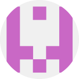
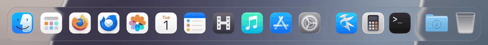
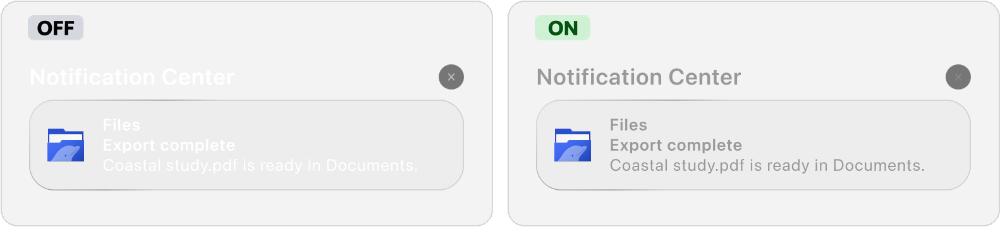
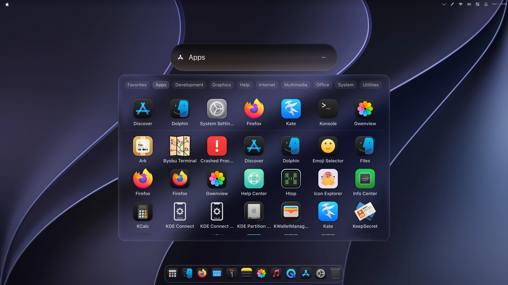
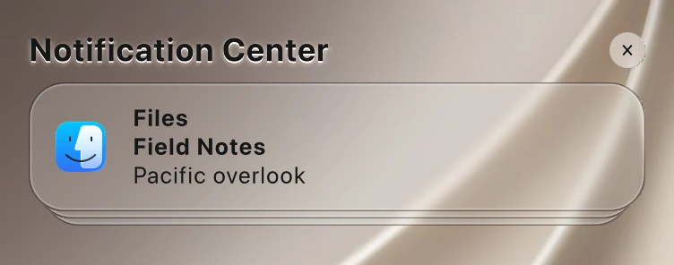
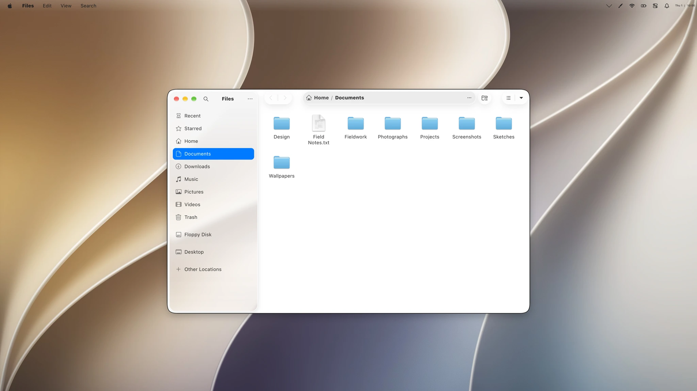
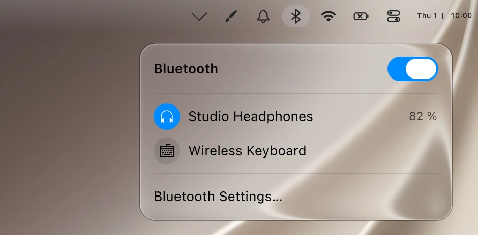
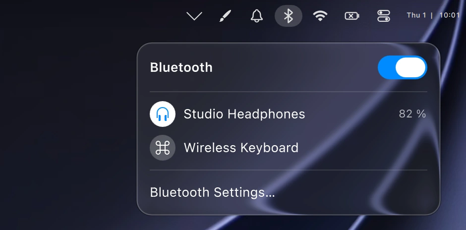
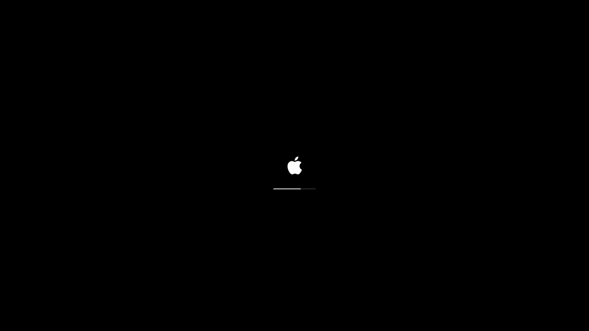

<p align="center">
  <!-- Adapted with ImageGen from artwork by Apple: https://developer.apple.com/macos/. Tux design by Larry Ewing. -->
  <picture>
    <source media="(prefers-color-scheme: dark)" srcset="docs/artwork/glass-tux-golden-gate-dark-8a2f000e0c83.png">
    
  </picture>
</p>

<h1 align="center">Shell de macOS Golden Gate para KDE en Linux</h1>

<p align="center">
  <a href="README.md" lang="en" hreflang="en">🇺🇸 English</a> ·
  <a href="README.es.md" lang="es" hreflang="es" aria-current="page">🇪🇸 Español</a> ·
  <a href="README.zh-CN.md" lang="zh-CN" hreflang="zh-CN">🇨🇳 简体中文</a> ·
  <a href="README.pt-BR.md" lang="pt-BR" hreflang="pt-BR">🇧🇷 Português (Brasil)</a> ·
  <a href="README.de.md" lang="de" hreflang="de">🇩🇪 Deutsch</a> ·
  <a href="README.fr.md" lang="fr" hreflang="fr">🇫🇷 Français</a> ·
  <a href="README.it.md" lang="it" hreflang="it">🇮🇹 Italiano</a> ·
  <a href="README.ja.md" lang="ja" hreflang="ja">🇯🇵 日本語</a> ·
  <a href="README.ko.md" lang="ko" hreflang="ko">🇰🇷 한국어</a> ·
  <a href="README.ru.md" lang="ru" hreflang="ru">🇷🇺 Русский</a> ·
  <a href="README.ar.md" lang="ar" hreflang="ar">🇸🇦 العربية</a> ·
  <a href="README.hi.md" lang="hi" hreflang="hi">🇮🇳 हिन्दी</a> ·
  <a href="README.nl.md" lang="nl" hreflang="nl">🇳🇱 Nederlands</a> ·
  <a href="README.pl.md" lang="pl" hreflang="pl">🇵🇱 Polski</a> ·
  <a href="README.tr.md" lang="tr" hreflang="tr">🇹🇷 Türkçe</a>
</p>

<p align="center">
  <a href="https://github.com/lestercorderomurillo/macos-golden-gate-liquid-kde/releases"></a>
  <a href="https://kde.org/plasma-desktop/"></a>
  <a href="LICENSE"></a>
  <a href="https://github.com/lestercorderomurillo/macos-golden-gate-liquid-kde/issues/new"></a>
</p>


<p align="center">
  <sub>Selecciona una distribución para ver el estado de sus pruebas.</sub>
</p>

<p align="center">
  <a href="https://github.com/lestercorderomurillo/macos-tahoe-liquid-kde/blob/main/tests/vm/PROOF.md#cachyos" title="CachyOS"></a>
  <a href="https://github.com/lestercorderomurillo/macos-tahoe-liquid-kde/blob/main/tests/vm/PROOF.md#arch" title="Arch Linux"></a>
  <a href="https://github.com/lestercorderomurillo/macos-tahoe-liquid-kde/blob/main/tests/vm/PROOF.md#endeavouros" title="EndeavourOS"></a>
  <a href="https://github.com/lestercorderomurillo/macos-tahoe-liquid-kde/blob/main/tests/vm/PROOF.md#fedora" title="Fedora"></a>
  <a href="https://github.com/lestercorderomurillo/macos-tahoe-liquid-kde/blob/main/tests/vm/PROOF.md#manjaro" title="Manjaro"></a>
  <a href="https://github.com/lestercorderomurillo/macos-tahoe-liquid-kde/blob/main/tests/vm/PROOF.md#artix" title="Artix Linux (OpenRC)"></a>
  <a href="https://github.com/lestercorderomurillo/macos-tahoe-liquid-kde/blob/main/tests/vm/PROOF.md#garuda" title="Garuda Linux"></a>
  <a href="https://github.com/lestercorderomurillo/macos-tahoe-liquid-kde/blob/main/tests/vm/PROOF.md#nobara" title="Nobara Linux"></a>
  <a href="https://github.com/lestercorderomurillo/macos-tahoe-liquid-kde/blob/main/tests/vm/PROOF.md#opensuse" title="openSUSE Tumbleweed"></a>
  <a href="https://github.com/lestercorderomurillo/macos-tahoe-liquid-kde/blob/main/tests/vm/PROOF.md#neon" title="KDE neon"></a>
  <a href="https://github.com/lestercorderomurillo/macos-tahoe-liquid-kde/blob/main/tests/vm/PROOF.md#debian" title="Debian testing / sid (Plasma 6.6+)"></a>
  <a href="https://github.com/lestercorderomurillo/macos-tahoe-liquid-kde/blob/main/tests/vm/PROOF.md#nixos" title="NixOS (experimental)"></a>
</p>

Este proyecto personaliza la apariencia de tu escritorio KDE en Linux. No incluye servicios de Apple ni se conecta a ellos. Si necesitas servicios de Apple, [compra directamente en Apple](https://www.apple.com/store).

> [!CAUTION]
> **Filosofía de actualización continua**
> Experimental. Recibe actualizaciones diarias. Las actualizaciones pueden romper la compatibilidad. Evita los sistemas de producción; [informa de problemas aquí](https://github.com/lestercorderomurillo/macos-golden-gate-liquid-kde/issues/new).

> [!WARNING]
> **Cuidado con quienes lo redistribuyen de pago: este tema es GRATUITO.**
>
> Si encontraste este tema a través de un canal de terceros, no necesitas pagar para obtenerlo: descárgalo directamente de este repositorio. Mantenemos este proyecto gratuito para que todos puedan disfrutarlo sin barreras de pago. No se requiere compra ni suscripción.

<br>


Informes de errores, correcciones, pruebas y documentación: consulta la [guía de contribución](CONTRIBUTING.md).

Colaboradores de código y personas que informan de errores en Tahoe y Golden Gate:

<p>
  <a href="https://github.com/lestercorderomurillo"></a>
  <a href="https://github.com/yanhenrique-dev"></a>
  <a href="https://github.com/naevui"></a>
  <a href="https://github.com/caioniehues"></a>
  <a href="https://github.com/404-not-found129"></a>
  <a href="https://github.com/myakupozluk"></a>
  <a href="https://github.com/EMS1998"></a>
  <a href="https://github.com/allfritz"></a>
  <a href="https://github.com/elegos"></a>
  <a href="https://github.com/kozeki-uii"></a>
  <a href="https://github.com/imightbelosthere"></a>
  <a href="https://github.com/evaildev"></a>
  <a href="https://github.com/xarblu"></a>
  <a href="https://github.com/PKMNPlatin"></a>
  <a href="https://github.com/matinlotfali"></a>
  <a href="https://github.com/luisbocanegra"></a>
  <a href="https://github.com/OliverChase2003"></a>
  <a href="https://github.com/RoxasYTB"></a>
  <a href="https://github.com/Flagwill"></a>
  <a href="https://github.com/4l3j0Ok"></a>
  <a href="https://github.com/0xrushi"></a>
  <a href="https://github.com/aenriii"></a>
  <a href="https://github.com/andreas399"></a>
  <a href="https://github.com/Andrew-Sor"></a>
  <a href="https://github.com/ardashir77"></a>
  <a href="https://github.com/azizaktas"></a>
  <a href="https://github.com/binary-pleb"></a>
  <a href="https://github.com/bneils"></a>
  <a href="https://github.com/FAYZER77"></a>
  <a href="https://github.com/fxrncyyisingithub"></a>
  <a href="https://github.com/germanbagutteorsomething"></a>
  <a href="https://github.com/iNarrow12"></a>
  <a href="https://github.com/IsaiahSHanson"></a>
  <a href="https://github.com/kuau"></a>
  <a href="https://github.com/Lando0007"></a>
  <a href="https://github.com/LilT59"></a>
  <a href="https://github.com/marcosfantonio"></a>
  <a href="https://github.com/moulikanand12345-lang"></a>
  <a href="https://github.com/nanechi"></a>
  <a href="https://github.com/nousernameget"></a>
  <a href="https://github.com/OpalSand"></a>
  <a href="https://github.com/P0sixSplo1t-2"></a>
  <a href="https://github.com/rokan00"></a>
  <a href="https://github.com/RussH"></a>
  <a href="https://github.com/Salkio"></a>
  <a href="https://github.com/Shivamingale3"></a>
  <a href="https://github.com/shoko3756"></a>
  <a href="https://github.com/Sonicx9876"></a>
  <a href="https://github.com/Tias-dev"></a>
  <a href="https://github.com/txhammer68"></a>
  <a href="https://github.com/vanshdev0101"></a>
  <a href="https://github.com/vialolis"></a>
  <a href="https://github.com/Whiddu"></a>
  <a href="https://github.com/yingmanwumen"></a>
  <a href="https://github.com/yofriendfromschool1"></a>
  <a href="https://github.com/zhaokelei"></a>
  <a href="https://github.com/blaykelarue"></a>
  <a href="https://github.com/JacobJS34"></a>
  <a href="https://github.com/Leon-Swains"></a>
  <a href="https://github.com/LucipurrsDad"></a>
  <a href="https://github.com/SinglerGold2"></a>
</p>

<br>


### Dock multicolor

Dale a los iconos del Dock el color de tu escritorio.

<p align="center">
  
</p>

<br>

### Quickbar

Accede a los menús de la aplicación activa desde la barra superior.

<p align="center">
  
  
</p>

<br>

### Contraste adaptativo

El texto se ajusta al fondo para que las etiquetas sigan siendo legibles.

<p align="center">
  
</p>

<br>

### Launchpad

Busca aplicaciones o explóralas por categoría.

<p align="center">
  
  
</p>

<br>

### Centro de control

Ajusta el Wi-Fi, el sonido y el brillo desde un solo menú.

<p align="center">
  
  
</p>

<br>

### Notificaciones

Consulta las notificaciones recientes agrupadas por aplicación.

<p align="center">
  
  
  
  
</p>

<br>

### Finder

Explora tus archivos en una ventana al estilo Finder.

<p align="center">
  <a href="src/screenshots/previews/readme-golden-gate-light-finder-362858f81e2b.webp"></a>
  <a href="src/screenshots/previews/readme-golden-gate-dark-finder-b835bc92a197.webp"></a>
</p>

<br>

### Calendario

Abre el reloj para consultar el calendario del mes.

<p align="center">
  
  
</p>

<br>

### Bluetooth

Conecta tus dispositivos emparejados y consulta su batería.

<p align="center">
  
  
</p>

### Wi-Fi

Consulta las redes disponibles y el estado de la conexión.

<p align="center">
  
  
  <br><sub>Conectado con Harbor Studio. El modo de luz (izquierda) y el modo oscuro (derecha).</sub>
</p>

<br>

### Batería

Consulta el nivel de batería y el estado de carga.

<p align="center">
  
  
  <br><sub>No se detecta ninguna batería interna. El modo de luz (izquierda) y el modo oscuro (derecha).</sub>
</p>

<br>

### Historial del portapapeles

Reutiliza texto e imágenes que hayas copiado.

<p align="center">
  
  
</p>

<br>

### Información del sistema

Consulta los detalles del hardware, el software y el tema.

<p align="center">
  
  
</p>

<br>

### Tema Plasma

Los menús y las ventanas emergentes siguen el tema claro u oscuro.

<p align="center">
  
  
</p>

<br>

### Pantalla de inicio

Al arrancar, aparece una pantalla de bienvenida a juego con el tema.

<p align="center">
  
</p>

<br>


- **Apariencia:** Temas claros y oscuros coordinados en el escritorio, las aplicaciones, los iconos y las decoraciones de ventanas, con cambio automático y fondos por monitor.
- **Efectos de cristal:** Desenfoque, refracción y tinte ajustables, con texto que se adapta al fondo en los menús compatibles.
- **Dock:** Aplicaciones fijadas, ampliación al pasar el puntero, insignias de notificación y ocultación configurable. El Dock te sigue entre pantallas.
- **Barra de menús y Centro de control:** Menús globales de aplicaciones y controles rápidos del sistema, con ajustes de la barra de menús compartidos entre pantallas.
- **Launchpad:** Busca aplicaciones, explora categorías y guarda tus favoritas en cualquiera de sus dos diseños.
- **Widgets de escritorio:** Añade widgets de Liquid Glass directamente al escritorio.
- **Notificaciones:** Avisos de cristal e historial agrupado, con acciones rápidas y respuestas en las aplicaciones compatibles.
- **Historial del portapapeles:** Busca y reutiliza texto e imágenes copiados y fija los elementos que quieras conservar.
- **Integración de aplicaciones:** Navegación al estilo Finder en Nautilus, integración de menús GTK y tema de Firefox con copias de seguridad de los perfiles.
- **Información del sistema y arranque:** Ventana de información del sistema y pantalla de arranque opcional a juego con el tema.
- **Instalación y recuperación:** Instalador gráfico con los recursos del tema, actualizaciones y copias de los ajustes que se pueden restaurar al desinstalar.
- **Idiomas:** El idioma del instalador se elige en Ajustes. Los widgets de Plasma usan el idioma del escritorio.
- **Compatibilidad:** Plasma 6.6–6.8 en sistemas basados en Arch o Fedora, openSUSE, Debian y KDE neon.
- **Funciones opcionales:** Protección de paneles OLED y compatibilidad experimental con NixOS y Home Manager.

<br>


Descarga y abre el instalador:

```bash
git clone --filter=blob:none https://github.com/lestercorderomurillo/macos-golden-gate-liquid-kde.git
cd macos-golden-gate-liquid-kde
./installer
```

Elige **Express** para instalar. Abre `./installer` de nuevo para actualizar o desinstalar.

Para liberar espacio en disco conservando tu copia de Git y el trabajo local:

```bash
./installer --free-space
```

| Idioma del instalador | Estado |
| --- | --- |
| 🇺🇸 Inglés |  |
| 🇪🇸 Español |  |
| 🇨🇳 Chino simplificado |  |
| 🇧🇷 Portugués de Brasil |  |
| 🇩🇪 Alemán |  |
| 🇫🇷 Francés |  |
| 🇮🇹 Italiano |  |
| 🇯🇵 Japonés |  |
| 🇰🇷 Coreano |  |
| 🇷🇺 Ruso |  |
| 🇸🇦 Árabe |  |
| 🇮🇳 Hindi |  |
| 🇳🇱 Neerlandés |  |
| 🇵🇱 Polaco |  |
| 🇹🇷 Turco |  |

<details>
<summary><b>Requisitos</b></summary>

Escritorio, herramientas de compilación y paquetes del sistema necesarios.

- KDE Plasma 6.6+
- Python 3.10+ y PyQt6
- `sudo`
- Herramientas de desarrollo Qt 6
- Paquetes de desarrollo KDE y Qt 6 para los plasmoides compilados y efectos KWin
- `cmake`, `g++`, y `pkg-config` cuando se seleccionan funciones compiladas
- `dbus-send`
- `systemctl` o `crontab` para las funciones programadas

Se requiere acceso a internet para las descargas, las dependencias que falten y KDE Rounded Corners opcional.

| Distribución | Herramientas Qt 6 | Paquetes de desarrollo KDE Plasma 6 |
|--------|------------|-----------------------------------|
| Familia Arch | `pacman -S qt6-tools` | `pacman -S extra-cmake-modules plasma-workspace kdecoration libplasma libnotificationmanager libksysguard plasma-activities-stats` |
| Familia Fedora | `dnf install qt6-qttools-devel` | `dnf install extra-cmake-modules plasma-workspace-devel kdecoration-devel libplasma-devel knotifications-devel libksysguard-devel kf6-plasma-activities-devel` |
| openSUSE Tumbleweed | `zypper install qt6-tools-devel` | `zypper install extra-cmake-modules plasma6-workspace-devel kdecoration-devel libKF6Plasma-devel libnotificationmanager6-devel libksysguard6-devel libKF6PlasmaActivitiesStats6-devel` |

</details>

<details>
<summary><b>Protección OLED</b></summary>

Desplazamientos opcionales de los paneles; desactivados por defecto.

Actívalo en la página **Protección OLED**. Elige allí el intervalo y el desplazamiento máximo en píxeles; está desactivado por defecto.

**Controles manuales**

```bash
mac-tahoe-oled-care shift
mac-tahoe-oled-care restore
mac-tahoe-oled-care status
```

</details>


<br>


Comprueba el soporte de tu distribución, sistema de inicio y versión de Plasma.

<details>
<summary><b>Pruebas de distribuciones</b></summary>

Prueba el tema en un escritorio Plasma aislado.

```bash
./vm <os>
```

**OS:** `cachyos` · `arch` · `manjaro` · `endeavouros` · `garuda` · `fedora` · `nobara` · `opensuse` · `neon` · `debian` · `artix` · `kubuntu`

`all` inicia todas las distribuciones. [Guía de preparación y validación de VM](https://github.com/lestercorderomurillo/macos-tahoe-liquid-kde/blob/main/tests/vm/README.md).

`./vm kubuntu` arranca la ISO de Kubuntu 26.04.1 LTS fijada por SHA-256 en el puerto SSH de bucle local `2234` tras preparar el invitado. Este destino de regresión del lanzador está pendiente de validación completa en vivo.

Las 11 distribuciones de esta tabla pasaron la validación en VM en vivo. Selecciona una insignia de estado para ver capturas revisadas y resultados de pruebas.

| | Nombre | Estado |
|:--:|------|---------|
|  | CachyOS | [](https://github.com/lestercorderomurillo/macos-tahoe-liquid-kde/blob/main/tests/vm/PROOF.md#cachyos) |
|  | Arch Linux | [](https://github.com/lestercorderomurillo/macos-tahoe-liquid-kde/blob/main/tests/vm/PROOF.md#arch) |
|  | EndeavourOS | [](https://github.com/lestercorderomurillo/macos-tahoe-liquid-kde/blob/main/tests/vm/PROOF.md#endeavouros) |
|  | Fedora | [](https://github.com/lestercorderomurillo/macos-tahoe-liquid-kde/blob/main/tests/vm/PROOF.md#fedora) |
|  | Manjaro | [](https://github.com/lestercorderomurillo/macos-tahoe-liquid-kde/blob/main/tests/vm/PROOF.md#manjaro) |
|  | Artix Linux (OpenRC) | [](https://github.com/lestercorderomurillo/macos-tahoe-liquid-kde/blob/main/tests/vm/PROOF.md#artix) |
|  | Garuda Linux | [](https://github.com/lestercorderomurillo/macos-tahoe-liquid-kde/blob/main/tests/vm/PROOF.md#garuda) |
|  | Nobara | [](https://github.com/lestercorderomurillo/macos-tahoe-liquid-kde/blob/main/tests/vm/PROOF.md#nobara) |
|  | openSUSE Tumbleweed | [](https://github.com/lestercorderomurillo/macos-tahoe-liquid-kde/blob/main/tests/vm/PROOF.md#opensuse) |
|  | KDE neon | [](https://github.com/lestercorderomurillo/macos-tahoe-liquid-kde/blob/main/tests/vm/PROOF.md#neon) |
|  | Debian testing / sid (Plasma 6.6+) | [](https://github.com/lestercorderomurillo/macos-tahoe-liquid-kde/blob/main/tests/vm/PROOF.md#debian) |

**NixOS / Home Manager**

[Validación en escritorio pendiente](https://github.com/lestercorderomurillo/macos-tahoe-liquid-kde/blob/main/tests/vm/PROOF.md#nixos).

</details>

<details>
<summary><b>Sistemas de inicio</b></summary>

El cambio automático de tema y la protección OLED utilizan los siguientes backends de planificación:

| Sistema de inicio | Planificación | Pruebas registradas |
| --- | --- | --- |
| systemd | Temporizadores de usuario |  |
| OpenRC | Cron por usuario |  |
| dinit | Cron por usuario |   |

OpenRC y dinit requieren un demonio cron activo.
[Resultados de pruebas de escritorio](https://github.com/lestercorderomurillo/macos-tahoe-liquid-kde/blob/main/tests/vm/PROOF.md) · [Prueba de planificación dinit](https://github.com/lestercorderomurillo/macos-tahoe-liquid-kde/blob/main/CONTRIBUTING.md#setup).

</details>

<details>
<summary><b>Versiones de Plasma</b></summary>

Plasma 6.6–6.8 está soportado; los efectos compilados utilizan el SDK del anfitrión.

| Plasma | Soporte | Desde |
|--------|---------|-------|
| 6.5 y anteriores |  | No aplicable |
| 6.6 |  | v0.1.0 |
| 6.7 |  | v0.19.0 |
| 6.8 |  | v0.54.1 |

</details>

<br>


Esta es una reimplementación independiente inspirada en la estética de macOS. No está afiliada ni respaldada por Apple o KDE. «macOS» y «Apple» son marcas comerciales de Apple Inc.

El emblema de macOS 27, los fondos incluidos, los sonidos del sistema y las fuentes SF Pro / SF Mono siguen siendo propiedad de Apple y no están cubiertos por la licencia de este proyecto. Los demás componentes conservan sus licencias y avisos de copyright; consulta el índice de avisos de terceros a continuación para conocer el alcance y las lagunas de procedencia conocidas.

Licenciado como conjunto bajo [GPL-3.0](LICENSE); las licencias de los componentes y los derechos de terceros siguen siendo aplicables. Consulta los [avisos de copyright](NOTICE), la [licencia e identidad del proyecto](LICENSING.md) y los [avisos de terceros](THIRD_PARTY_NOTICES.md).

<br>


Referencias del proyecto y componentes de terceros:

- **[EliverLara](https://github.com/EliverLara/TahoeLauncher)**: `TahoeLauncher`: Referencia de diseño de Launchpad.
- **[vinceliuice](https://github.com/vinceliuice)**: `MacTahoe-icon-theme`: iconos y cursores base; referencia de diseño GTK.
- **[taj-ny](https://github.com/taj-ny/kwin-effects-forceblur)** y **[4v3ngR](https://github.com/4v3ngR/kwin-effects-glass)**: Better Blur y su bifurcación de cristal: código de origen utilizado por Acrylic Glass.
- **[luisbocanegra](https://github.com/luisbocanegra/plasma-panel-colorizer)**: `plasma-panel-colorizer`, incluido sin conexión para teñir los paneles.
- **[jaxparrow07](https://github.com/jaxparrow07/liquidglass-kde-widgets)**: `liquidglass-kde-widgets` aporta la colección de widgets de escritorio Liquid Glass que se incluye con el tema (GPL-3.0, licencia incluida).
- **[RoxasYTB](https://github.com/RoxasYTB)**: El [widget de Fotos](https://github.com/jaxparrow07/liquidglass-kde-widgets/pull/41) muestra fotos en el escritorio. El [cambio automático entre Solid y Glass](https://github.com/jaxparrow07/liquidglass-kde-widgets/pull/40) activa el estilo Glass cuando hay una ventana abierta en la pantalla.
- **[Matin Lotfaliei](https://github.com/matinlotfali/KDE-Rounded-Corners)**: `KDE-Rounded-Corners`, el efecto de ventanas redondeadas de KWin compilado contra el SDK KWin del anfitrión.
- **[ful1e5](https://github.com/ful1e5)**: `apple_cursor`: referencia alternativa de diseño de cursores.
- **[sahibjotsaggu](https://github.com/sahibjotsaggu)**: `San-Francisco-Pro-Fonts`: origen del paquete SF Pro / SF Mono.
- **[Lucide](https://github.com/lucide-icons/lucide)**: iconos de copia incluidos en el menú global.
- **[512pixels.net](https://512pixels.net/projects/default-mac-wallpapers-in-5k/)**: archivo de fondos de macOS en alta resolución.

Reimplementación independiente inspirada en la estética de macOS, sin afiliación ni respaldo de Apple. «macOS» y «Apple» son marcas comerciales de Apple Inc.; los fondos incluidos y las fuentes SF siguen siendo propiedad de Apple. Licenciado bajo GPL-3.0.


[Capturas del instalador y pruebas](TESTING.md).
