<p align="center">
  <!-- Adapted with ImageGen from artwork by Apple: https://developer.apple.com/macos/. Tux design by Larry Ewing. -->
  <picture>
    <source media="(prefers-color-scheme: dark)" srcset="docs/artwork/glass-tux-golden-gate-dark-8a2f000e0c83.png">
    
  </picture>
</p>

<h1 align="center">Shell macOS Golden Gate pour KDE sous Linux</h1>

<p align="center">
  <a href="README.md" lang="en" hreflang="en">🇺🇸 English</a> ·
  <a href="README.es.md" lang="es" hreflang="es">🇪🇸 Español</a> ·
  <a href="README.zh-CN.md" lang="zh-CN" hreflang="zh-CN">🇨🇳 简体中文</a> ·
  <a href="README.pt-BR.md" lang="pt-BR" hreflang="pt-BR">🇧🇷 Português (Brasil)</a> ·
  <a href="README.de.md" lang="de" hreflang="de">🇩🇪 Deutsch</a> ·
  <a href="README.fr.md" lang="fr" hreflang="fr" aria-current="page">🇫🇷 Français</a>
</p>

<p align="center">
  <a href="https://github.com/lestercorderomurillo/macos-golden-gate-liquid-kde/releases"></a>
  <a href="https://kde.org/plasma-desktop/"></a>
  <a href="LICENSE"></a>
  <a href="https://github.com/lestercorderomurillo/macos-golden-gate-liquid-kde/issues/new"></a>
</p>


<p align="center">
  macOS Golden Gate style pour KDE Plasma 6.6, 6.7 et 6.8+.
</p>

<p align="center">
  <sub>Sélectionnez une distribution pour consulter l’état de ses tests.</sub>
</p>

<p align="center">
  <a href="https://github.com/lestercorderomurillo/macos-tahoe-liquid-kde/blob/main/tests/vm/PROOF.md#cachyos" title="CachyOS"></a>
  <a href="https://github.com/lestercorderomurillo/macos-tahoe-liquid-kde/blob/main/tests/vm/PROOF.md#arch" title="Arch Linux"></a>
  <a href="https://github.com/lestercorderomurillo/macos-tahoe-liquid-kde/blob/main/tests/vm/PROOF.md#endeavouros" title="EndeavourOS"></a>
  <a href="https://github.com/lestercorderomurillo/macos-tahoe-liquid-kde/blob/main/tests/vm/PROOF.md#fedora" title="Fedora"></a>
  <a href="https://github.com/lestercorderomurillo/macos-tahoe-liquid-kde/blob/main/tests/vm/PROOF.md#manjaro" title="Manjaro"></a>
  <a href="https://github.com/lestercorderomurillo/macos-tahoe-liquid-kde/blob/main/tests/vm/PROOF.md#artix" title="Artix Linux (OpenRC)"></a>
  <a href="https://github.com/lestercorderomurillo/macos-tahoe-liquid-kde/blob/main/tests/vm/PROOF.md#garuda" title="Garuda Linux"></a>
  <a href="https://github.com/lestercorderomurillo/macos-tahoe-liquid-kde/blob/main/tests/vm/PROOF.md#nobara" title="Nobara Linux"></a>
  <a href="https://github.com/lestercorderomurillo/macos-tahoe-liquid-kde/blob/main/tests/vm/PROOF.md#opensuse" title="openSUSE Tumbleweed"></a>
  <a href="https://github.com/lestercorderomurillo/macos-tahoe-liquid-kde/blob/main/tests/vm/PROOF.md#neon" title="KDE neon"></a>
  <a href="https://github.com/lestercorderomurillo/macos-tahoe-liquid-kde/blob/main/tests/vm/PROOF.md#debian" title="Debian testing / sid (Plasma 6.6+)"></a>
  <a href="https://github.com/lestercorderomurillo/macos-tahoe-liquid-kde/blob/main/tests/vm/PROOF.md#nixos" title="NixOS (experimental)"></a>
</p>

Ce projet personnalise l’apparence de votre bureau KDE sous Linux. Il n’inclut aucun service Apple et ne se connecte à aucun de ces services. Si vous avez besoin de services Apple, [achetez directement auprès d’Apple](https://www.apple.com/store).

> [!CAUTION]
> **Principe de publication continue**
> Expérimental. Reçoit des mises à jour quotidiennes. Les mises à jour peuvent rompre la compatibilité. Évitez les systèmes de production ; [signalez les problèmes ici](https://github.com/lestercorderomurillo/macos-golden-gate-liquid-kde/issues/new).

> [!WARNING]
> **Méfiez-vous des redistributions payantes : ce thème est GRATUIT.**
>
> Si vous avez découvert ce thème par un canal tiers, vous n’avez pas besoin de payer pour l’obtenir : téléchargez-le directement depuis ce dépôt. Nous gardons ce projet gratuit pour que chacun puisse en profiter sans barrière payante. Aucun achat ni abonnement n’est nécessaire.

<br>


Signalements de bogues, corrections, tests et documentation : consultez le [guide de contribution](CONTRIBUTING.md).

Contributeurs au code et personnes signalant des bogues dans Tahoe et Golden Gate :

<p>
  <a href="https://github.com/lestercorderomurillo"></a>
  <a href="https://github.com/yanhenrique-dev"></a>
  <a href="https://github.com/naevui"></a>
  <a href="https://github.com/caioniehues"></a>
  <a href="https://github.com/404-not-found129"></a>
  <a href="https://github.com/myakupozluk"></a>
  <a href="https://github.com/EMS1998"></a>
  <a href="https://github.com/allfritz"></a>
  <a href="https://github.com/elegos"></a>
  <a href="https://github.com/kozeki-uii"></a>
  <a href="https://github.com/imightbelosthere"></a>
  <a href="https://github.com/evaildev"></a>
  <a href="https://github.com/xarblu"></a>
  <a href="https://github.com/PKMNPlatin"></a>
  <a href="https://github.com/matinlotfali"></a>
  <a href="https://github.com/luisbocanegra"></a>
  <a href="https://github.com/OliverChase2003"></a>
  <a href="https://github.com/RoxasYTB"></a>
  <a href="https://github.com/Flagwill"></a>
  <a href="https://github.com/4l3j0Ok"></a>
  <a href="https://github.com/0xrushi"></a>
  <a href="https://github.com/aenriii"></a>
  <a href="https://github.com/andreas399"></a>
  <a href="https://github.com/Andrew-Sor"></a>
  <a href="https://github.com/ardashir77"></a>
  <a href="https://github.com/azizaktas"></a>
  <a href="https://github.com/binary-pleb"></a>
  <a href="https://github.com/bneils"></a>
  <a href="https://github.com/FAYZER77"></a>
  <a href="https://github.com/fxrncyyisingithub"></a>
  <a href="https://github.com/germanbagutteorsomething"></a>
  <a href="https://github.com/iNarrow12"></a>
  <a href="https://github.com/IsaiahSHanson"></a>
  <a href="https://github.com/kuau"></a>
  <a href="https://github.com/Lando0007"></a>
  <a href="https://github.com/LilT59"></a>
  <a href="https://github.com/marcosfantonio"></a>
  <a href="https://github.com/moulikanand12345-lang"></a>
  <a href="https://github.com/nanechi"></a>
  <a href="https://github.com/nousernameget"></a>
  <a href="https://github.com/OpalSand"></a>
  <a href="https://github.com/P0sixSplo1t-2"></a>
  <a href="https://github.com/rokan00"></a>
  <a href="https://github.com/RussH"></a>
  <a href="https://github.com/Salkio"></a>
  <a href="https://github.com/Shivamingale3"></a>
  <a href="https://github.com/shoko3756"></a>
  <a href="https://github.com/Sonicx9876"></a>
  <a href="https://github.com/Tias-dev"></a>
  <a href="https://github.com/txhammer68"></a>
  <a href="https://github.com/vanshdev0101"></a>
  <a href="https://github.com/vialolis"></a>
  <a href="https://github.com/Whiddu"></a>
  <a href="https://github.com/yingmanwumen"></a>
  <a href="https://github.com/yofriendfromschool1"></a>
  <a href="https://github.com/zhaokelei"></a>
</p>

<br>


### Finder (Alpha)

Navigation de fichiers de style Finder avec le verre Golden Gate.

<p align="center">
  <a href="src/screenshots/previews/readme-golden-gate-light-finder-362858f81e2b.webp"></a>
  <a href="src/screenshots/previews/readme-golden-gate-dark-finder-b835bc92a197.webp"></a>
</p>

<details>
<summary><strong>Accents rouges et bleus en modes clair et sombre</strong></summary>

<table>
<tr><th>Accent</th><th>Clair</th><th>Sombre</th></tr>
<tr><td>Bleu</td><td><a href="src/screenshots/previews/readme-golden-gate-light-finder-blue-362858f81e2b.webp"></a></td><td><a href="src/screenshots/previews/readme-golden-gate-dark-finder-blue-b835bc92a197.webp"></a></td></tr>
<tr><td>Rouge</td><td><a href="src/screenshots/previews/readme-golden-gate-light-finder-red-64f13f0002bb.webp">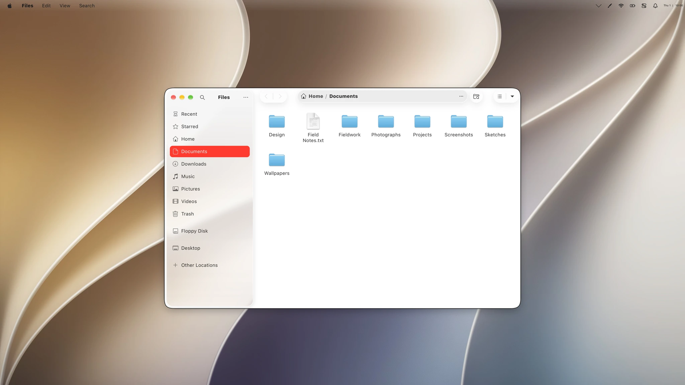</a></td><td><a href="src/screenshots/previews/readme-golden-gate-dark-finder-red-928d44f325a4.webp">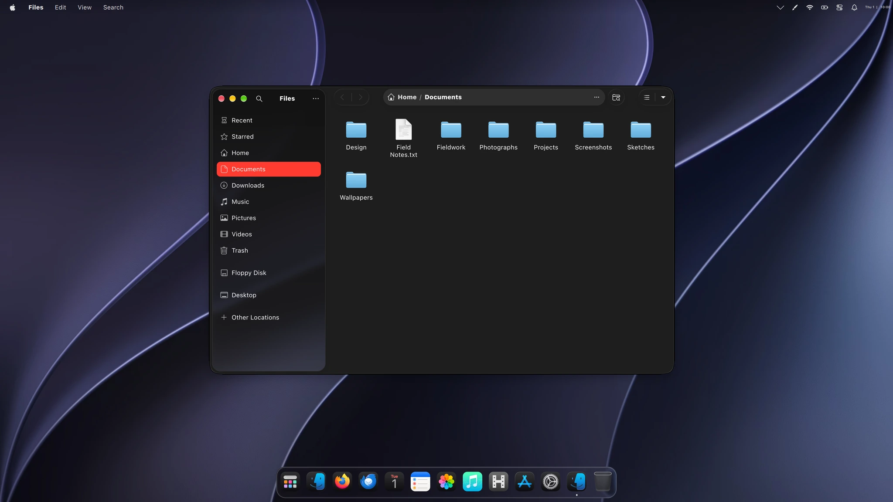</a></td></tr>
</table>

</details>

<br>

### Launchpad (Alpha)

Trouvez des applications, parcourez les catégories et gardez vos favoris à portée de main. La grille utilise un verre dépoli teinté de blanc ou de noir. Le champ de recherche conserve le même dégradé du noir au doré dans les deux modes.

<p align="center">
  
  
</p>

<br>

### Dock (Alpha)

Réfraction du verre, agrandissement au survol, bulles rouges de comptage des notifications et masquage automatique.

<p align="center">
  <strong>Light</strong><br>
  <a href="src/screenshots/previews/readme-golden-gate-light-dock-regular-ab3f15dc4638.webp">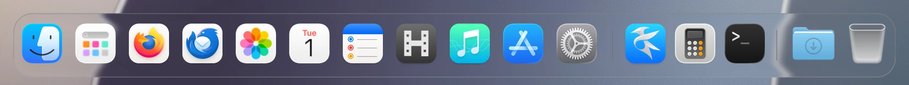</a>
</p>

<p align="center">
  <strong>Dark</strong><br>
  <a href="src/screenshots/previews/readme-golden-gate-dark-dock-regular-10bd3f5e3f7a.webp">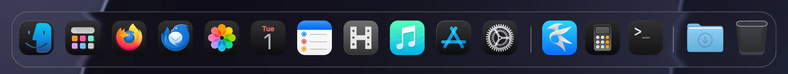</a>
</p>

<p align="center">
  <strong>Clear Light</strong><br>
  <a href="src/screenshots/previews/readme-golden-gate-light-dock-clear-90ade834a80a.webp">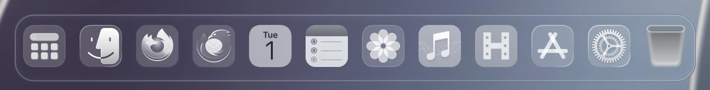</a>
</p>

<p align="center">
  <strong>Clear Dark</strong><br>
  <a href="src/screenshots/previews/readme-golden-gate-dark-dock-clear-168be084ef75.webp">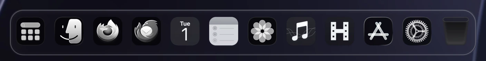</a>
</p>

<p align="center">
  <strong>Blue Light</strong><br>
  <a href="src/screenshots/previews/readme-golden-gate-light-dock-blue-66f49f74fb75.webp">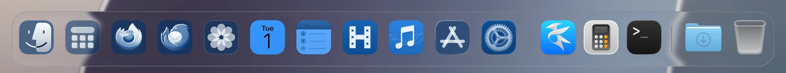</a>
</p>

<p align="center">
  <strong>Blue Dark</strong><br>
  <a href="src/screenshots/previews/readme-golden-gate-dark-dock-blue-42692e6defe8.webp">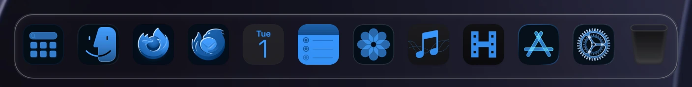</a>
</p>

<p align="center">
  <strong>Purple Light</strong><br>
  <a href="src/screenshots/previews/readme-golden-gate-light-dock-purple-f505c90f757a.webp">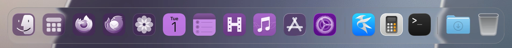</a>
</p>

<p align="center">
  <strong>Purple Dark</strong><br>
  <a href="src/screenshots/previews/readme-golden-gate-dark-dock-purple-de2ddd0fdac7.webp">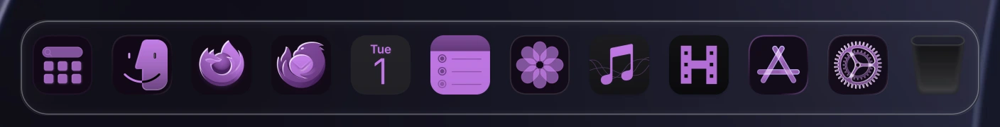</a>
</p>

<p align="center">
  <strong>Pink Light</strong><br>
  <a href="src/screenshots/previews/readme-golden-gate-light-dock-pink-8a5dddb388f5.webp">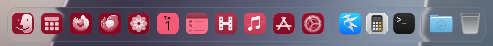</a>
</p>

<p align="center">
  <strong>Pink Dark</strong><br>
  <a href="src/screenshots/previews/readme-golden-gate-dark-dock-pink-35b9f3ee83b9.webp">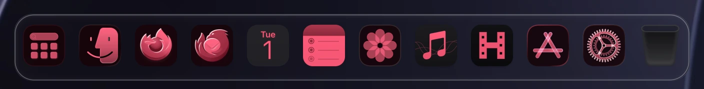</a>
</p>

<p align="center">
  <strong>Red Light</strong><br>
  <a href="src/screenshots/previews/readme-golden-gate-light-dock-red-4f92758a9626.webp">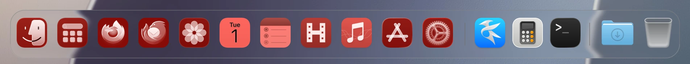</a>
</p>

<p align="center">
  <strong>Red Dark</strong><br>
  <a href="src/screenshots/previews/readme-golden-gate-dark-dock-red-95f297477353.webp">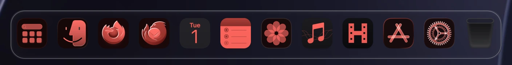</a>
</p>

<p align="center">
  <strong>Orange Light</strong><br>
  <a href="src/screenshots/previews/readme-golden-gate-light-dock-orange-9a56e2ebccdf.webp">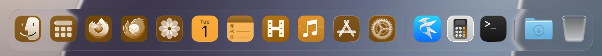</a>
</p>

<p align="center">
  <strong>Orange Dark</strong><br>
  <a href="src/screenshots/previews/readme-golden-gate-dark-dock-orange-cf8fa5dc1f63.webp">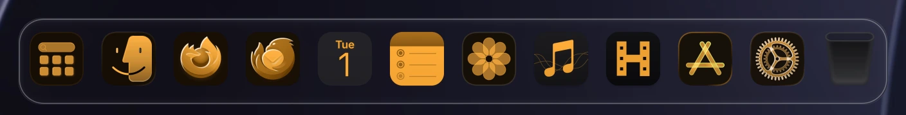</a>
</p>

<p align="center">
  <strong>Yellow Light</strong><br>
  <a href="src/screenshots/previews/readme-golden-gate-light-dock-yellow-2acdddb4feb4.webp">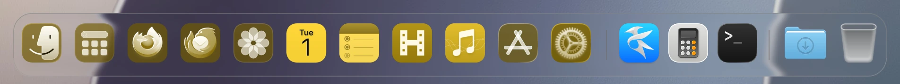</a>
</p>

<p align="center">
  <strong>Yellow Dark</strong><br>
  <a href="src/screenshots/previews/readme-golden-gate-dark-dock-yellow-9dcd8b6de570.webp"></a>
</p>

<p align="center">
  <strong>Green Light</strong><br>
  <a href="src/screenshots/previews/readme-golden-gate-light-dock-green-0feca8496131.webp">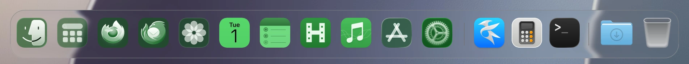</a>
</p>

<p align="center">
  <strong>Green Dark</strong><br>
  <a href="src/screenshots/previews/readme-golden-gate-dark-dock-green-524aa37bd27b.webp">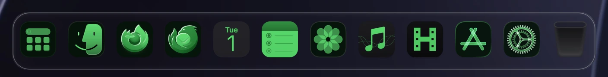</a>
</p>

<p align="center">
  <strong>Gray Light</strong><br>
  <a href="src/screenshots/previews/readme-golden-gate-light-dock-gray-fed59e6cbc46.webp">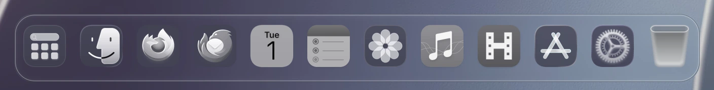</a>
</p>

<p align="center">
  <strong>Gray Dark</strong><br>
  <a href="src/screenshots/previews/readme-golden-gate-dark-dock-gray-0e1e1330d670.webp">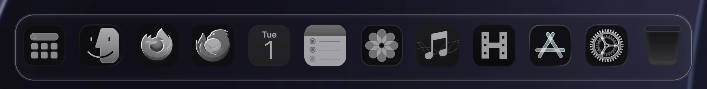</a>
</p>

<br>

### Shell (Alpha)

Les menus de l’application suivent la fenêtre active. Le menu système donne accès aux réglages et aux commandes de session.

<p align="center">
  
  
</p>

<br>

### Calendrier (Alpha)

Ouvrez l’horloge du panneau pour afficher le mois sur fond de verre. Utilisez la molette ou les flèches pour changer de mois et la touche Début pour revenir au mois en cours.

<p align="center">
  
  
</p>

<br>

### Centre de contrôle (Alpha)

Wi-Fi, son, luminosité et notifications dans un menu en verre. Le bouton d’apparence affiche un soleil en mode clair, une lune en mode sombre et un cercle bicolore en mode automatique.

<p align="center">
  
  
</p>

<p align="center">
  <strong>Wi-Fi</strong><br>
  
  
</p>

<p align="center">
  <strong>Batterie</strong><br>
  
  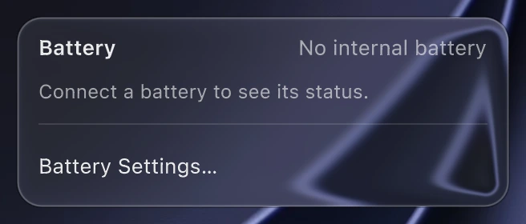
</p>

<br>

### Notifications (Alpha)

Bannières en verre et historique groupé avec actions des applications et réponses directes.

<p align="center">
  
  
  
  
</p>

<br>

### Historique du presse-papiers (Alpha)

Retrouvez et réutilisez le texte et les images copiés directement depuis Launchpad.

<p align="center">
  
  
</p>

<br>

### Informations système (Alpha)

Informations sur le matériel, les logiciels et le thème avec une teinte de texte adaptative.

<p align="center">
  
  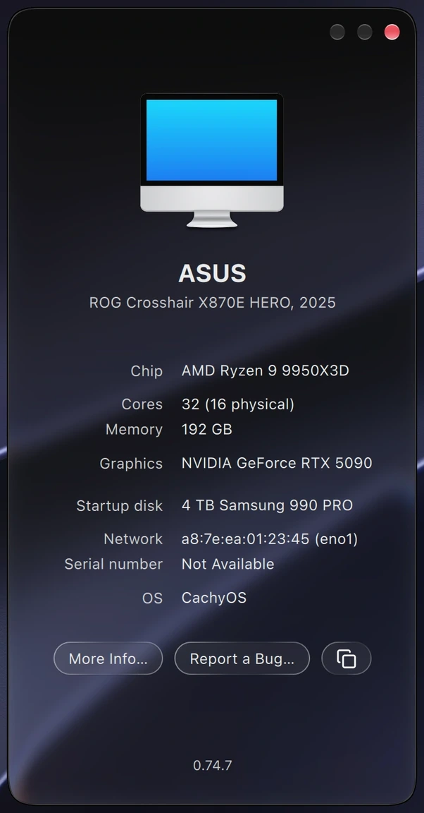
</p>

<br>

### Thème Plasma (Alpha)

Menus et fenêtres contextuelles translucides avec des couleurs claires et sombres coordonnées.

<p align="center">
  
  
</p>

<br>

### Écran de démarrage (Alpha)

Une apparence assortie du démarrage à l’arrêt, avec déverrouillage intégré des disques chiffrés LUKS2.

<p align="center">
  
</p>

<br>


- **Apparence :** Thèmes clairs et sombres coordonnés pour le bureau, les applications, les icônes et les décorations de fenêtres, avec basculement automatique et fonds d’écran par moniteur.
- **Effets de verre :** Flou, réfraction et teinte réglables, avec du texte qui s’adapte à l’arrière-plan dans les menus compatibles.
- **Dock :** Applications épinglées, agrandissement au survol, badges de notification et masquage configurable. Le Dock vous suit d’un écran à l’autre.
- **Barre de menus et Centre de contrôle :** Menus globaux des applications et réglages rapides du système, avec des paramètres de barre de menus partagés entre les écrans.
- **Launchpad :** Recherchez des applications, parcourez les catégories et enregistrez vos favoris dans l’une des deux dispositions.
- **Widgets de bureau :** Ajoutez des widgets Liquid Glass directement sur votre bureau.
- **Notifications :** Bannières en verre et historique groupé, avec actions rapides et réponses dans les applications compatibles.
- **Historique du presse-papiers :** Retrouvez et réutilisez le texte et les images copiés, et épinglez les éléments à conserver.
- **Intégration des applications :** Navigation façon Finder dans Nautilus, intégration des menus GTK et thème Firefox avec sauvegarde des profils.
- **Informations système et démarrage :** Fenêtre d’informations système et écran de démarrage facultatif assortis au thème.
- **Installation et restauration :** Installateur graphique avec les ressources du thème, les mises à jour et la sauvegarde des paramètres, restaurables lors de la désinstallation.
- **Langues :** Installateur disponible en anglais, espagnol, chinois simplifié, portugais du Brésil, allemand et français. Les widgets Plasma sont aussi traduits.
- **Compatibilité :** Plasma 6.6–6.8 sur les systèmes basés sur Arch ou Fedora, openSUSE, Debian et KDE neon.
- **Fonctions facultatives :** Protection des écrans OLED et prise en charge expérimentale de NixOS et Home Manager.

<br>


Téléchargez et ouvrez l’installateur :

```bash
git clone --filter=blob:none https://github.com/lestercorderomurillo/macos-golden-gate-liquid-kde.git
cd macos-golden-gate-liquid-kde
./installer
```

Choisissez **Express** pour installer. Rouvrez `./installer` pour mettre à jour ou désinstaller.

Pour libérer de l’espace disque tout en conservant votre copie Git et votre travail local :

```bash
./installer --free-space
```

| Langue de l’installateur | État |
| --- | --- |
| 🇺🇸 Anglais |  |
| 🇪🇸 Espagnol |  |
| 🇨🇳 Chinois simplifié |  |
| 🇧🇷 Portugais du Brésil |  |
| 🇩🇪 Allemand |  |
| 🇫🇷 Français |  |
| 🇮🇹 Italien |  |
| 🇯🇵 Japonais |  |
| 🇰🇷 Coréen |  |
| 🇷🇺 Russe |  |
| 🇸🇦 Arabe |  |
| 🇮🇳 Hindi |  |
| 🇳🇱 Néerlandais |  |
| 🇵🇱 Polonais |  |
| 🇹🇷 Turc |  |

<details>
<summary><b>Prérequis</b></summary>

Bureau, outils de compilation et paquets système requis.

- KDE Plasma 6.6+
- Python 3.10+ et PyQt6
- `sudo`
- Outils de développement Qt 6
- Paquets de développement KDE et Qt 6 pour les plasmoïdes compilés et les effets KWin
- `cmake`, `g++` et `pkg-config` lorsque des fonctionnalités compilées sont sélectionnées
- `dbus-send`
- `systemctl` ou `crontab` pour les fonctionnalités planifiées

Un accès à internet est nécessaire pour les téléchargements, les dépendances manquantes et KDE Rounded Corners facultatif.

| Distribution | Outils Qt 6 | Paquets de développement KDE Plasma 6 |
|--------|------------|-----------------------------------|
| Famille Arch | `pacman -S qt6-tools` | `pacman -S extra-cmake-modules plasma-workspace kdecoration libplasma libnotificationmanager libksysguard plasma-activities-stats` |
| Famille Fedora | `dnf install qt6-qttools-devel` | `dnf install extra-cmake-modules plasma-workspace-devel kdecoration-devel libplasma-devel knotifications-devel libksysguard-devel kf6-plasma-activities-devel` |
| openSUSE Tumbleweed | `zypper install qt6-tools-devel` | `zypper install extra-cmake-modules plasma6-workspace-devel kdecoration-devel libKF6Plasma-devel libnotificationmanager6-devel libksysguard6-devel libKF6PlasmaActivitiesStats6-devel` |

</details>

<details>
<summary><b>Protection OLED</b></summary>

Décalages facultatifs des panneaux ; désactivés par défaut.

Activez-la sur la page **Protection OLED**. Choisissez-y l’intervalle et le déplacement maximal en pixels ; elle est désactivée par défaut.

**Commandes manuelles**

```bash
mac-tahoe-oled-care shift
mac-tahoe-oled-care restore
mac-tahoe-oled-care status
```

</details>

<details>
<summary><b>Tester dans une machine virtuelle</b></summary>

Essayez le thème dans un bureau Plasma isolé.

```bash
./vm <os>
```

**OS:** `cachyos` · `arch` · `manjaro` · `endeavouros` · `garuda` · `fedora` · `nobara` · `opensuse` · `neon` · `debian` · `artix` · `kubuntu`

`all` lance toutes les distributions. [Guide de configuration et de validation des VM](https://github.com/lestercorderomurillo/macos-tahoe-liquid-kde/blob/main/tests/vm/README.md).

`./vm kubuntu` démarre l’ISO Kubuntu 26.04.1 LTS épinglée par SHA-256 sur le port SSH de boucle locale `2234` après configuration de l’invité. Cette cible de régression du lanceur attend une validation complète en conditions réelles.

</details>


<br>


Vérifiez la prise en charge de votre distribution, de votre système d’initialisation et de votre version de Plasma.

<details>
<summary><b>Distributions</b></summary>

Les 11 distributions de ce tableau ont réussi la validation en VM réelle. Sélectionnez un badge d’état pour consulter les captures examinées et les résultats des tests.

| | Nom | État |
|:--:|------|---------|
|  | CachyOS | [](https://github.com/lestercorderomurillo/macos-tahoe-liquid-kde/blob/main/tests/vm/PROOF.md#cachyos) |
|  | Arch Linux | [](https://github.com/lestercorderomurillo/macos-tahoe-liquid-kde/blob/main/tests/vm/PROOF.md#arch) |
|  | EndeavourOS | [](https://github.com/lestercorderomurillo/macos-tahoe-liquid-kde/blob/main/tests/vm/PROOF.md#endeavouros) |
|  | Fedora | [](https://github.com/lestercorderomurillo/macos-tahoe-liquid-kde/blob/main/tests/vm/PROOF.md#fedora) |
|  | Manjaro | [](https://github.com/lestercorderomurillo/macos-tahoe-liquid-kde/blob/main/tests/vm/PROOF.md#manjaro) |
|  | Artix Linux (OpenRC) | [](https://github.com/lestercorderomurillo/macos-tahoe-liquid-kde/blob/main/tests/vm/PROOF.md#artix) |
|  | Garuda Linux | [](https://github.com/lestercorderomurillo/macos-tahoe-liquid-kde/blob/main/tests/vm/PROOF.md#garuda) |
|  | Nobara | [](https://github.com/lestercorderomurillo/macos-tahoe-liquid-kde/blob/main/tests/vm/PROOF.md#nobara) |
|  | openSUSE Tumbleweed | [](https://github.com/lestercorderomurillo/macos-tahoe-liquid-kde/blob/main/tests/vm/PROOF.md#opensuse) |
|  | KDE neon | [](https://github.com/lestercorderomurillo/macos-tahoe-liquid-kde/blob/main/tests/vm/PROOF.md#neon) |
|  | Debian testing / sid (Plasma 6.6+) | [](https://github.com/lestercorderomurillo/macos-tahoe-liquid-kde/blob/main/tests/vm/PROOF.md#debian) |

</details>

<details>
<summary><b>Systèmes d’initialisation</b></summary>

Le changement automatique de thème et la protection OLED utilisent les backends de planification suivants :

| Système d’initialisation | Planification | Tests consignés |
| --- | --- | --- |
| systemd | Minuteries utilisateur |  |
| OpenRC | Cron par utilisateur |  |
| dinit | Cron par utilisateur |   |

OpenRC et dinit nécessitent un démon cron actif.
[Résultats des tests du bureau](https://github.com/lestercorderomurillo/macos-tahoe-liquid-kde/blob/main/tests/vm/PROOF.md) · [Vérification de la planification dinit](https://github.com/lestercorderomurillo/macos-tahoe-liquid-kde/blob/main/CONTRIBUTING.md#setup).

</details>

<details>
<summary><b>Versions de Plasma</b></summary>

Plasma 6.6–6.8 est pris en charge ; les effets compilés utilisent le SDK de l’hôte.

| Plasma | Prise en charge | Depuis |
|--------|---------|-------|
| 6.5 et antérieures |  | Sans objet |
| 6.6 |  | v0.1.0 |
| 6.7 |  | v0.19.0 |
| 6.8 |  | v0.54.1 |

</details>

<br>


Ce qui fonctionne aujourd’hui et ce que nous prévoyons d’ajouter.

<details>
<summary><b>État des composants</b></summary>

L’état actuel de chaque composant.

| Composant | État |
|-----------|--------|
| Palettes de couleurs |  |
| Fonds d’écran |  |
| Polices |  |
| Curseurs |  |
| Thème Plasma |  |
| Thème Kvantum |  |
| Thème GTK |  |
| Acrylic Glass |  |
| KDE Rounded Corners |  |
| Commutateur automatique de thème |  |
| Protection OLED |  |
| Interface de l’installateur |  |
| Localisation |  |
| Décorations Aurorae |  |
| Menu global |  |
| Dock |  |
| Nautilus de style Finder |  |
| Launchpad |  |
| Shell |  |
| Historique du presse-papiers |  |
| Informations système |  |
| Corbeille |  |
| Sons |  |
| Écran de démarrage |  |
| Écran d’arrêt |  |
| Thème Firefox |  |
| Icônes |  |
| Prise en charge de plusieurs distributions |  |
| Tests OpenRC |  |
| Thème Konsole |  |
| Thème Kate |  |
| Thème SDDM |  |
| Calendrier |  |
| Centre de contrôle, Wi-Fi, batterie et notifications |  |
| Préférences système |  |
| Sélecteur de système d’exploitation |  |

</details>

<br>

**[Signalez un bogue](https://github.com/lestercorderomurillo/macos-golden-gate-liquid-kde/issues/new)** ou utilisez **Menu Apple → À propos de cet ordinateur → Signaler un bogue…**.

Indiquez :

- Votre version de Plasma : `plasmashell --version`
- Votre distribution : `grep PRETTY_NAME /etc/os-release`
- La version du thème indiquée dans **À propos de cet ordinateur**
- Une capture ou un enregistrement pour les problèmes visuels

Gardez les pull requests ciblées et validez avec `./vm`. Consultez [CONTRIBUTING.md](https://github.com/lestercorderomurillo/macos-tahoe-liquid-kde/blob/main/CONTRIBUTING.md).

L’[ensemble partagé d’outils de génération d’icônes](https://github.com/lestercorderomurillo/macos-tahoe-liquid-kde/blob/main/CONTRIBUTING.md#icon-generation-toolset) crée des apparences claires, sombres, monochromes et en verre translucide à partir des icônes incluses de Tahoe, avec toute teinte RGB. Exécutez `./icon-toolset` depuis une copie de Tahoe pour générer, prévisualiser, vérifier et emballer les icônes hors ligne pour l’une ou l’autre édition. Toute l’implémentation et les ressources des icônes restent dans Tahoe.

<br>


Il s’agit d’une réimplémentation indépendante inspirée de l’esthétique macOS. Elle n’est ni affiliée à Apple ou KDE, ni approuvée par eux. « macOS » et « Apple » sont des marques d’Apple Inc.

L’emblème macOS 27, les fonds d’écran inclus, les sons système et les polices SF Pro / SF Mono restent la propriété d’Apple et ne sont pas couverts par la licence de ce projet. Les autres composants conservent leurs licences et avis de droit d’auteur ; consultez l’index des avis de tiers ci-dessous pour leur portée et les lacunes de provenance connues.

L’ensemble est sous licence [GPL-3.0](LICENSE) ; les licences de chaque composant et les droits des tiers restent applicables. Consultez les [avis de droit d’auteur](NOTICE), la [licence et l’identité du projet](LICENSING.md) et les [avis de tiers](THIRD_PARTY_NOTICES.md).

<br>


Références du projet et composants tiers :

- **[EliverLara](https://github.com/EliverLara/TahoeLauncher)**: `TahoeLauncher`: Référence de conception de Launchpad.
- **[vinceliuice](https://github.com/vinceliuice)**: `MacTahoe-icon-theme`: icônes et curseurs de base ; référence de conception GTK.
- **[taj-ny](https://github.com/taj-ny/kwin-effects-forceblur)** et **[4v3ngR](https://github.com/4v3ngR/kwin-effects-glass)**: Better Blur et son fork de verre : code amont utilisé par Acrylic Glass.
- **[luisbocanegra](https://github.com/luisbocanegra/plasma-panel-colorizer)**: `plasma-panel-colorizer`, inclus hors ligne pour teinter les panneaux.
- **[jaxparrow07](https://github.com/jaxparrow07/liquidglass-kde-widgets)** : `liquidglass-kde-widgets` fournit la collection de widgets de bureau Liquid Glass incluse avec le thème (GPL-3.0, licence incluse).
- **[RoxasYTB](https://github.com/RoxasYTB)** : Le [widget Photos](https://github.com/jaxparrow07/liquidglass-kde-widgets/pull/41) affiche des photos sur le bureau. Le [basculement automatique entre Solid et Glass](https://github.com/jaxparrow07/liquidglass-kde-widgets/pull/40) active le style Glass lorsqu’une fenêtre est ouverte à l’écran.
- **[Matin Lotfaliei](https://github.com/matinlotfali/KDE-Rounded-Corners)**: `KDE-Rounded-Corners`, l’effet KWin de fenêtres arrondies compilé contre le SDK KWin de l’hôte.
- **[ful1e5](https://github.com/ful1e5)**: `apple_cursor`: référence alternative de conception des curseurs.
- **[sahibjotsaggu](https://github.com/sahibjotsaggu)**: `San-Francisco-Pro-Fonts`: source du lot SF Pro / SF Mono.
- **[Lucide](https://github.com/lucide-icons/lucide)**: icônes de copie incluses dans le menu global.
- **[512pixels.net](https://512pixels.net/projects/default-mac-wallpapers-in-5k/)**: archive de fonds d’écran macOS en haute résolution.

Réimplémentation indépendante inspirée de l’esthétique macOS, sans affiliation ni approbation d’Apple. « macOS » et « Apple » sont des marques d’Apple Inc. ; les fonds d’écran inclus et les polices SF restent la propriété d’Apple. Sous licence GPL-3.0.


[Captures de l’installateur et tests](TESTING.md).
