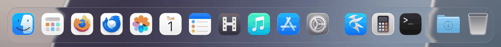
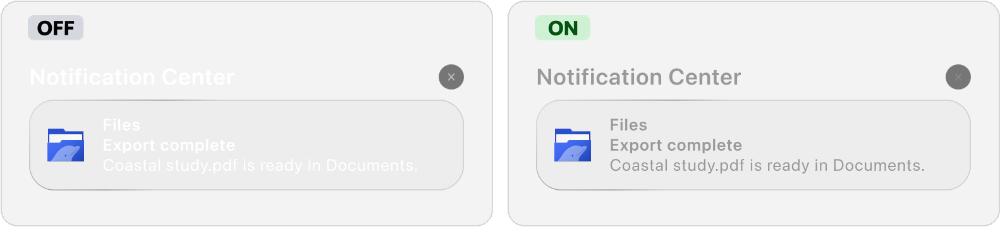
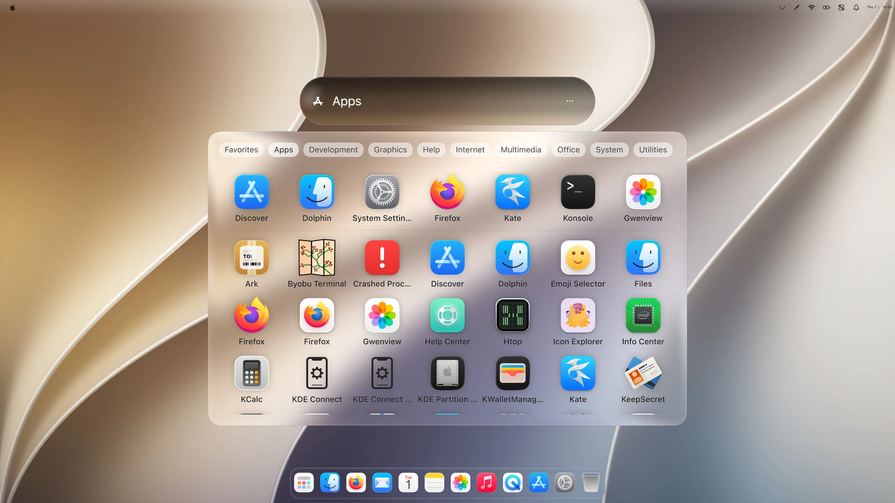
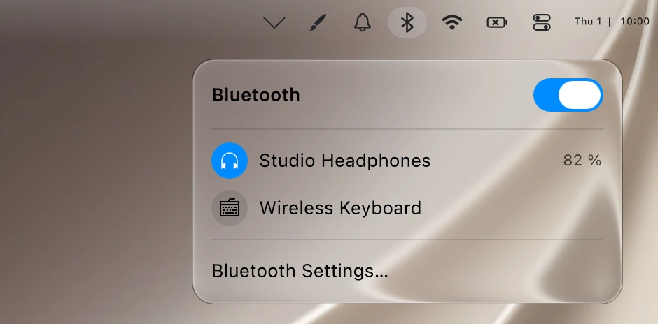
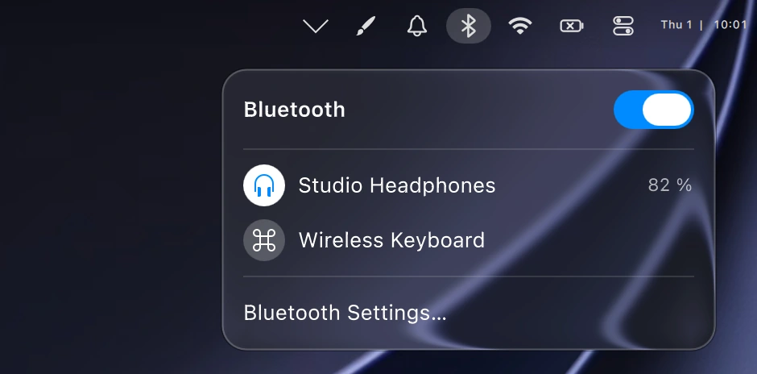
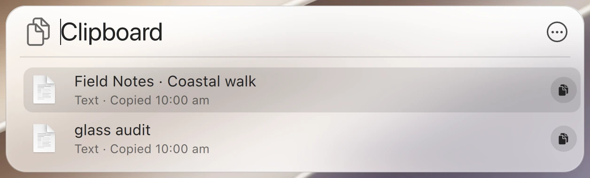
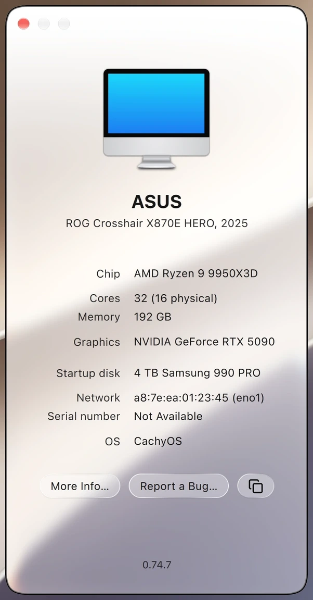

<p align="center">
  <!-- Adapted with ImageGen from artwork by Apple: https://developer.apple.com/macos/. Tux design by Larry Ewing. -->
  <picture>
    <source media="(prefers-color-scheme: dark)" srcset="docs/artwork/glass-tux-golden-gate-dark-8a2f000e0c83.png">
    
  </picture>
</p>

<h1 align="center">macOS Golden Gate Shell for KDE Linux</h1>

<p align="center">
  <a href="README.md" lang="en" hreflang="en">🇺🇸 English</a> ·
  <a href="README.es.md" lang="es" hreflang="es">🇪🇸 Español</a> ·
  <a href="README.zh-CN.md" lang="zh-CN" hreflang="zh-CN">🇨🇳 简体中文</a> ·
  <a href="README.pt-BR.md" lang="pt-BR" hreflang="pt-BR">🇧🇷 Português (Brasil)</a> ·
  <a href="README.de.md" lang="de" hreflang="de">🇩🇪 Deutsch</a> ·
  <a href="README.fr.md" lang="fr" hreflang="fr">🇫🇷 Français</a> ·
  <a href="README.it.md" lang="it" hreflang="it" aria-current="page">🇮🇹 Italiano</a> ·
  <a href="README.ja.md" lang="ja" hreflang="ja">🇯🇵 日本語</a> ·
  <a href="README.ko.md" lang="ko" hreflang="ko">🇰🇷 한국어</a> ·
  <a href="README.ru.md" lang="ru" hreflang="ru">🇷🇺 Русский</a> ·
  <a href="README.ar.md" lang="ar" hreflang="ar">🇸🇦 العربية</a> ·
  <a href="README.hi.md" lang="hi" hreflang="hi">🇮🇳 हिन्दी</a> ·
  <a href="README.nl.md" lang="nl" hreflang="nl">🇳🇱 Nederlands</a> ·
  <a href="README.pl.md" lang="pl" hreflang="pl">🇵🇱 Polski</a> ·
  <a href="README.tr.md" lang="tr" hreflang="tr">🇹🇷 Türkçe</a>
</p>

<p align="center">
  <a href="https://github.com/lestercorderomurillo/macos-golden-gate-liquid-kde/releases"></a>
  <a href="https://kde.org/plasma-desktop/"></a>
  <a href="LICENSE"></a>
  <a href="https://github.com/lestercorderomurillo/macos-golden-gate-liquid-kde/issues/new"></a>
</p>


<p align="center">
  <sub>Selezionare una distribuzione per visualizzare lo stato di prova.</sub>
</p>

<p align="center">
  <a href="https://github.com/lestercorderomurillo/macos-tahoe-liquid-kde/blob/main/tests/vm/PROOF.md#cachyos" title="CachyOS"></a>
  <a href="https://github.com/lestercorderomurillo/macos-tahoe-liquid-kde/blob/main/tests/vm/PROOF.md#arch" title="Arch Linux"></a>
  <a href="https://github.com/lestercorderomurillo/macos-tahoe-liquid-kde/blob/main/tests/vm/PROOF.md#endeavouros" title="EndeavourOS"></a>
  <a href="https://github.com/lestercorderomurillo/macos-tahoe-liquid-kde/blob/main/tests/vm/PROOF.md#fedora" title="Fedora"></a>
  <a href="https://github.com/lestercorderomurillo/macos-tahoe-liquid-kde/blob/main/tests/vm/PROOF.md#manjaro" title="Manjaro"></a>
  <a href="https://github.com/lestercorderomurillo/macos-tahoe-liquid-kde/blob/main/tests/vm/PROOF.md#artix" title="Artix Linux (OpenRC)"></a>
  <a href="https://github.com/lestercorderomurillo/macos-tahoe-liquid-kde/blob/main/tests/vm/PROOF.md#garuda" title="Garuda Linux"></a>
  <a href="https://github.com/lestercorderomurillo/macos-tahoe-liquid-kde/blob/main/tests/vm/PROOF.md#nobara" title="Nobara Linux"></a>
  <a href="https://github.com/lestercorderomurillo/macos-tahoe-liquid-kde/blob/main/tests/vm/PROOF.md#opensuse" title="openSUSE Tumbleweed"></a>
  <a href="https://github.com/lestercorderomurillo/macos-tahoe-liquid-kde/blob/main/tests/vm/PROOF.md#neon" title="KDE neon"></a>
  <a href="https://github.com/lestercorderomurillo/macos-tahoe-liquid-kde/blob/main/tests/vm/PROOF.md#debian" title="Debian testing / sid (Plasma 6.6+)"></a>
  <a href="https://github.com/lestercorderomurillo/macos-tahoe-liquid-kde/blob/main/tests/vm/PROOF.md#nixos" title="NixOS (experimental)"></a>
</p>

Questo progetto personalizza l'aspetto e la sensazione del desktop KDE su Linux. Non include né si connette ai servizi di Apple. Se avete bisogno dei servizi di Apple, [negozi direttamente con Apple](https://www.apple.com/store).

> [!CAUTION]
> **Aggiornamenti continui**
> Sperimentale. Riceve aggiornamenti giornalieri. Gli aggiornamenti possono interrompere la compatibilità. Evita i sistemi di produzione; [segnala qui i problemi](https://github.com/lestercorderomurillo/macos-golden-gate-liquid-kde/issues/new).

> [!NOTE]
> Il congelamento delle funzionalità è in vigore per la serie 0.8x, con rilasci focalizzati sulle correzioni di bug fino a 0.90.

> [!WARNING]
> **Attenzione ai repackers di paywall: questo tema è GRATUITO.**
>
> Se avete trovato questo tema tramite un canale di terze parti, non è necessario pagare per ottenerlo: scaricatelo direttamente da questo archivio. Manteniamo questo progetto libero, cosi' che tutti possano goderlo senza un muro di pagamento. Non è richiesto acquisto o sottoscrizione.

<br>


Rapporti di bug, correzioni, test e documentazione: vedere il [guida dei contributi](CONTRIBUTING.md).

I collaboratori del codice e i giornalisti di emissione in Tahoe e Golden Gate:

<p>
  <a href="https://github.com/lestercorderomurillo"></a>
  <a href="https://github.com/yanhenrique-dev"></a>
  <a href="https://github.com/naevui"></a>
  <a href="https://github.com/caioniehues"></a>
  <a href="https://github.com/404-not-found129"></a>
  <a href="https://github.com/myakupozluk"></a>
  <a href="https://github.com/EMS1998"></a>
  <a href="https://github.com/allfritz"></a>
  <a href="https://github.com/elegos"></a>
  <a href="https://github.com/kozeki-uii"></a>
  <a href="https://github.com/imightbelosthere"></a>
  <a href="https://github.com/evaildev"></a>
  <a href="https://github.com/xarblu"></a>
  <a href="https://github.com/PKMNPlatin"></a>
  <a href="https://github.com/matinlotfali"></a>
  <a href="https://github.com/luisbocanegra"></a>
  <a href="https://github.com/OliverChase2003"></a>
  <a href="https://github.com/RoxasYTB"></a>
  <a href="https://github.com/Flagwill"></a>
  <a href="https://github.com/4l3j0Ok"></a>
  <a href="https://github.com/0xrushi"></a>
  <a href="https://github.com/aenriii"></a>
  <a href="https://github.com/andreas399"></a>
  <a href="https://github.com/Andrew-Sor"></a>
  <a href="https://github.com/ardashir77"></a>
  <a href="https://github.com/azizaktas"></a>
  <a href="https://github.com/binary-pleb"></a>
  <a href="https://github.com/bneils"></a>
  <a href="https://github.com/FAYZER77"></a>
  <a href="https://github.com/fxrncyyisingithub"></a>
  <a href="https://github.com/germanbagutteorsomething"></a>
  <a href="https://github.com/iNarrow12"></a>
  <a href="https://github.com/IsaiahSHanson"></a>
  <a href="https://github.com/kuau"></a>
  <a href="https://github.com/Lando0007"></a>
  <a href="https://github.com/LilT59"></a>
  <a href="https://github.com/marcosfantonio"></a>
  <a href="https://github.com/moulikanand12345-lang"></a>
  <a href="https://github.com/nanechi"></a>
  <a href="https://github.com/nousernameget"></a>
  <a href="https://github.com/OpalSand"></a>
  <a href="https://github.com/P0sixSplo1t-2"></a>
  <a href="https://github.com/rokan00"></a>
  <a href="https://github.com/RussH"></a>
  <a href="https://github.com/Salkio"></a>
  <a href="https://github.com/Shivamingale3"></a>
  <a href="https://github.com/shoko3756"></a>
  <a href="https://github.com/Sonicx9876"></a>
  <a href="https://github.com/Tias-dev"></a>
  <a href="https://github.com/txhammer68"></a>
  <a href="https://github.com/vanshdev0101"></a>
  <a href="https://github.com/vialolis"></a>
  <a href="https://github.com/Whiddu"></a>
  <a href="https://github.com/yingmanwumen"></a>
  <a href="https://github.com/yofriendfromschool1"></a>
  <a href="https://github.com/zhaokelei"></a>
  <a href="https://github.com/blaykelarue"></a>
  <a href="https://github.com/JacobJS34"></a>
  <a href="https://github.com/Leon-Swains"></a>
  <a href="https://github.com/LucipurrsDad"></a>
  <a href="https://github.com/SinglerGold2"></a>
</p>

<br>


### Dock multicolore

Abbina il colore delle icone del Dock al desktop.

<p align="center">
  
</p>

<br>

### Quickbar

Accedi ai menu dell’app attiva dalla barra superiore.

<p align="center">
  
  
</p>

<br>

### Contrasto adattivo

Il colore del testo si adatta allo sfondo per mantenere leggibili le etichette.

<p align="center">
  
</p>

<br>

### Launchpad

Cerca le app o sfogliale per categoria.

<p align="center">
  
  
</p>

<br>

### Centro di controllo

Regola Wi-Fi, audio e luminosità da un unico menu.

<p align="center">
  
  
</p>

<br>

### Notifiche

Leggi le notifiche recenti raggruppate per app.

<p align="center">
  
  
  
  
</p>

<br>

### Finder

Sfoglia i file in una finestra in stile Finder.

<p align="center">
  <a href="src/screenshots/previews/readme-golden-gate-light-finder-362858f81e2b.webp"></a>
  <a href="src/screenshots/previews/readme-golden-gate-dark-finder-b835bc92a197.webp"></a>
</p>

<br>

### Calendario

Apri l’orologio per consultare il calendario del mese.

<p align="center">
  
  
</p>

<br>

### Bluetooth

Connetti i dispositivi associati e controlla la loro batteria.

<p align="center">
  
  
</p>

### Wi-Fi

Visualizza le reti disponibili e lo stato della connessione.

<p align="center">
  
  
  <br><sub>Connesso a Harbor Studio. Modalità luce (a sinistra) e modalità buia (a destra).</sub>
</p>

<br>

### Batteria

Controlla il livello della batteria e lo stato di carica.

<p align="center">
  
  
  <br><sub>Nessuna batteria interna è rilevata. Modalità luce (a sinistra) e modalità buia (a destra).</sub>
</p>

<br>

### Cronologia degli appunti

Riutilizza il testo e le immagini che hai copiato.

<p align="center">
  
  
</p>

<br>

### Informazioni del sistema

Consulta i dettagli di hardware, software e tema.

<p align="center">
  
  
</p>

<br>

### Tema Plasma

I menu e le finestre a comparsa seguono il tema chiaro o scuro.

<p align="center">
  
  
</p>

<br>

### Schermata di avvio

All’avvio appare una schermata coordinata con il tema.

<p align="center">
  
</p>

<br>


- **Apparizione:** Tematiche di luce e scura coordinate per desktop, app, icone e decorazioni delle finestre, con commutazione automatica e wallpaper per monitor. [Impostazioni specifiche per la decorazione delle finestre](https://github.com/lestercorderomurillo/macos-tahoe-liquid-kde/blob/dev/docs/app-window-decorations.md)
- **Effetti di vetro:** Disfusione, rifrazione e tonalità regolabili, con testo che si adatta allo sfondo nei menu supportati.
- **- Il porto:** Applications pin, zoom hover, badge di notifica e nascondigli configurabili. Il Dock ti segue tra le mostre.
- **Barretta menù e Centro di controllo:** Menù globali di app e controlli sistemi rapidi, con impostazioni della barra dei menu condivise su tutti i display.
- **- Pad di lancio:** Cerca app, scorri le categorie e salva i preferiti in uno dei due layout.
- **Widget desktop:** Aggiungi e organizza i widget di Liquid Glass sul tuo desktop.
- **Notifiche:** Banner di vetro e storia raggruppata, con azioni veloci e risposte in cui le app li supportano.
- **Storia della clipboard:** Trova e riutilizza il testo copiato, le immagini e i punti di pin che vuoi conservare.
- **Integrazione delle applicazioni:** Navigare in stile Finder in Nautilus, integrazione del menu GTK e Firefox con backup di profilo.
- **Informazioni sul sistema e avvio:** Una finestra di informazioni a tema e un'opzione di accoppiamento.
- **Impostazione e recupero:** Un'installazione grafica con risorse di tema, aggiornamenti e backup delle impostazioni che possono essere ripristinati dopo la disinstallazione.
- **Lingue:** Scegli il linguaggio di installazione nelle impostazioni. I widget plasma seguono il linguaggio del desktop.
- **Compatibilità:** Plasma 6.6 ⁇ 6.8 su sistemi basati su Arch e Fedora, openSUSE, Debian e KDE neon.
- **Caratteristiche opzionali:** Protezione OLED e supporto sperimentale di NixOS e Home Manager.

<br>


Scaricare e aprire l'installazione:

```bash
git clone --filter=blob:none https://github.com/lestercorderomurillo/macos-golden-gate-liquid-kde.git
cd macos-golden-gate-liquid-kde
./installer
```

Per installare, scegli **Express**. Per aggiornare o disinstallare, riapri `./installer`.

Per liberare spazio su disco conservando la copia Git e le modifiche locali:

```bash
./installer --free-space
```

| Lingua dell'installazione | Stato |
| --- | --- |
| 🇺🇸 English |  |
| 🇪🇸 Español |  |
| 🇨🇳 简体中文 |  |
| 🇧🇷 Português (Brasil) |  |
| 🇩🇪 Deutsch |  |
| 🇫🇷 Français |  |
| 🇮🇹 Italiano |  |
| 🇯🇵 日本語 |  |
| 🇰🇷 한국어 |  |
| 🇷🇺 Русский |  |
| 🇸🇦 العربية |  |
| 🇮🇳 हिन्दी |  |
| 🇳🇱 Nederlands |  |
| 🇵🇱 Polski |  |
| 🇹🇷 Türkçe |  |

<details>
<summary><b>Requisiti</b></summary>

Requisiti desktop, strumenti di costruzione e pacchetti di sistema.

- KDE Plasma 6.6+
- Python 3.10+ e PyQt6
- `sudo`
- Qt 6 strumenti di sviluppo
- KDE e Qt 6 pacchetti di sviluppo per i plasmoidi compilati ed effetti KWin
- `cmake`, `g++`, e `pkg-config` quando vengono selezionate le caratteristiche compilate
- `dbus-send`
- `systemctl` o `crontab` per le caratteristiche di programmazione

È necessario l'accesso a Internet per i download, le dipendenze mancanti e gli angoli arrotondati KDE opzionali.

| Distribuzione | Qt 6 strumenti | KDE Plasma 6 pacchetti di sviluppo |
|--------|------------|-----------------------------------|
| Famiglia Arch | `pacman -S qt6-tools` | `pacman -S extra-cmake-modules plasma-workspace kdecoration libplasma libnotificationmanager libksysguard plasma-activities-stats` |
| Famiglia Fedora | `dnf install qt6-qttools-devel` | `dnf install extra-cmake-modules plasma-workspace-devel kdecoration-devel libplasma-devel knotifications-devel libksysguard-devel kf6-plasma-activities-devel` |
| openSUSE Tumbleweed | `zypper install qt6-tools-devel` | `zypper install extra-cmake-modules plasma6-workspace-devel kdecoration-devel libKF6Plasma-devel libnotificationmanager6-devel libksysguard6-devel libKF6PlasmaActivitiesStats6-devel` |

Su Fedora, l'installator installa Fedora ⁇ s GTK 3 global menu exporter, `unity-gtk3-module`, e lo carica al login per le applicazioni GTK 3.

</details>

<details>
<summary><b>Servizi di assistenza OLED</b></summary>

Trasferimenti facoltativi del pannello disabilitato per impostazione predefinita.

Abilitare il **Protezione OLED** pagina. Scegli l'intervallo di spostamento e lo spostamento massimo dei pixel lì è disabilitato per impostazione predefinita.

**Controlli manuali**

```bash
mac-tahoe-oled-care shift
mac-tahoe-oled-care restore
mac-tahoe-oled-care status
```

</details>


<br>


Controlla il supporto per la distribuzione, il sistema init e la versione Plasma.

<details>
<summary><b>Test delle distribuzioni</b></summary>

Prova il tema in un desktop Plasma isolato.

```bash
./vm <os>
```

**OS:** `cachyos` · `arch` · `manjaro` · `endeavouros` · `garuda` · `fedora` · `nobara` · `opensuse` · `neon` · `debian` · `artix` · `kubuntu`

`all` lancia ogni distribuzione. [Guida di configurazione e qualificazione della macchina](https://github.com/lestercorderomurillo/macos-tahoe-liquid-kde/blob/main/tests/vm/README.md).

`./vm kubuntu` avviene il Kubuntu 26.04.1 LTS ISO con pin SHA-256 su porta SSH a loopback `2234` dopo l'installazione degli ospiti. Questo obiettivo di regressione del lanciatore è in attesa della qualificazione completa.

Tutte le undici distribuzioni di questa tabella hanno superato la qualifica VM in diretta. Selezionare un badge di stato per le screenshot e i risultati dei test esaminati.

| | Nome | Stato |
|:--:|------|---------|
|  | CachyOS | [](https://github.com/lestercorderomurillo/macos-tahoe-liquid-kde/blob/main/tests/vm/PROOF.md#cachyos) |
|  | Arch Linux | [](https://github.com/lestercorderomurillo/macos-tahoe-liquid-kde/blob/main/tests/vm/PROOF.md#arch) |
|  | EndeavourOS | [](https://github.com/lestercorderomurillo/macos-tahoe-liquid-kde/blob/main/tests/vm/PROOF.md#endeavouros) |
|  | Fedora | [](https://github.com/lestercorderomurillo/macos-tahoe-liquid-kde/blob/main/tests/vm/PROOF.md#fedora) |
|  | Manjaro | [](https://github.com/lestercorderomurillo/macos-tahoe-liquid-kde/blob/main/tests/vm/PROOF.md#manjaro) |
|  | Artix Linux (OpenRC) | [](https://github.com/lestercorderomurillo/macos-tahoe-liquid-kde/blob/main/tests/vm/PROOF.md#artix) |
|  | Garuda Linux | [](https://github.com/lestercorderomurillo/macos-tahoe-liquid-kde/blob/main/tests/vm/PROOF.md#garuda) |
|  | Nobara | [](https://github.com/lestercorderomurillo/macos-tahoe-liquid-kde/blob/main/tests/vm/PROOF.md#nobara) |
|  | openSUSE Tumbleweed | [](https://github.com/lestercorderomurillo/macos-tahoe-liquid-kde/blob/main/tests/vm/PROOF.md#opensuse) |
|  | KDE neon | [](https://github.com/lestercorderomurillo/macos-tahoe-liquid-kde/blob/main/tests/vm/PROOF.md#neon) |
|  | Test di Debian / sid (Plasma 6.6+) | [](https://github.com/lestercorderomurillo/macos-tahoe-liquid-kde/blob/main/tests/vm/PROOF.md#debian) |

**NixOS / Home Manager**

[Validazione del desktop in attesa](https://github.com/lestercorderomurillo/macos-tahoe-liquid-kde/blob/main/tests/vm/PROOF.md#nixos).

</details>

<details>
<summary><b>Sistemi di inizio</b></summary>

Il cambio automatico di tema e la cura OLED utilizzano i seguenti backend di programmazione:

| Sistema init | Calcolo | Prova registrata |
| --- | --- | --- |
| systemd | Timer degli utenti |  |
| OpenRC | Cron per utente |  |
| dinit | Cron per utente |   |

OpenRC e dinit richiedono un cron daemon in esecuzione. [Risultati dei test desktop](https://github.com/lestercorderomurillo/macos-tahoe-liquid-kde/blob/main/tests/vm/PROOF.md) · [sonda di programmazione di dinit](https://github.com/lestercorderomurillo/macos-tahoe-liquid-kde/blob/main/CONTRIBUTING.md#setup).

</details>

<details>
<summary><b>Versioni di plasma</b></summary>

Il plasma 6.6 ⁇ 6.8 è supportato gli effetti compilati utilizzano l'SDK host.

| Plasma | Supporto | Da quando |
|--------|---------|-------|
| 6.5 e precedenti |  | Non applicabile |
| 6.6 |  | v0.1.0 |
| 6.7 |  | v0.19.0 |
| 6.8 |  | v0.54.1 |

</details>

<br>


Questa reimplementazione indipendente si ispira all’estetica di macOS. Non è affiliata ad Apple o a KDE e non ha il loro avallo. «macOS» e «Apple» sono marchi di Apple Inc.

L’emblema di macOS 27, gli sfondi inclusi, i suoni di sistema e i caratteri SF Pro e SF Mono sono di proprietà di Apple e non rientrano nella licenza del progetto. Gli altri componenti mantengono le rispettive licenze e note di copyright. L’indice delle note di terze parti specifica l’ambito e le lacune note nella documentazione della provenienza.

Il progetto nel suo insieme è distribuito con licenza [GPL-3.0](LICENSE). Restano validi i diritti di terzi e le licenze dei singoli componenti. Consulta le [note di copyright](NOTICE), le [licenze e l’identità del progetto](LICENSING.md) e le [note di terze parti](THIRD_PARTY_NOTICES.md).

<br>


Referenze di progetto e componenti di terzi:

- **[EliverLara](https://github.com/EliverLara/TahoeLauncher)**: `TahoeLauncher`: riferimento alla progettazione del lanciatore.
- **[vinceliuice](https://github.com/vinceliuice)**: `MacTahoe-icon-theme`: icone di base e cursori Riferimento al design GTK.
- **[taj-ny](https://github.com/taj-ny/kwin-effects-forceblur)** e **[4v3ngR](https://github.com/4v3ngR/kwin-effects-glass)**: Better Blur e la sua forchetta di vetro: codice upstream utilizzato da Acrylic Glass.
- **[luisbocanegra](https://github.com/luisbocanegra/plasma-panel-colorizer)**: `plasma-panel-colorizer`, combinato offline per colorare i pannelli.
- **[jaxparrow07](https://github.com/jaxparrow07/liquidglass-kde-widgets)**: `liquidglass-kde-widgets` fornisce la collezione bundled di widget desktop Liquid Glass (GPL-3.0, licenza inclusa).
- **[RoxasYTB](https://github.com/RoxasYTB)**: [Widget foto](https://github.com/jaxparrow07/liquidglass-kde-widgets/pull/41) visualizza le foto sul desktop. [Scensione automatica di solido/ vetro](https://github.com/jaxparrow07/liquidglass-kde-widgets/pull/40) cambia i widget a Glass quando una finestra è aperta sullo schermo.
- **[Matin Lotfaliei](https://github.com/matinlotfali/KDE-Rounded-Corners)**: `KDE-Rounded-Corners`, l'effetto KWin a finestra arrotondata costruito contro il KWin SDK ospitante.
- **[ful1e5](https://github.com/ful1e5)**: `apple_cursor`: riferimento al design del cursore alternativo.
- **[sahibjotsaggu](https://github.com/sahibjotsaggu)**: `San-Francisco-Pro-Fonts`: fonte del pacchetto SF Pro / SF Mono.
- **[Lucide](https://github.com/lucide-icons/lucide)**: coprire le icone nel menu globale.
- **[512pixels.net](https://512pixels.net/projects/default-mac-wallpapers-in-5k/)**: archivio di cartelloni da parati macOS ad alta risoluzione.

Riimplementazione indipendente ispirata all'estetica di macOS, non affiliata o approvata da Apple. "macOS" e "Apple" sono marchi commerciali di Apple Inc. le pagine da parati e i caratteri SF rimangono proprietà di Apple. Con licenza GPL-3.0.


[Scatto di schermo e test dell'installazione](TESTING.md).
