<p align="center">
  <!-- Adapted with ImageGen from artwork by Apple: https://developer.apple.com/macos/ -->
  <picture>
    <source media="(prefers-color-scheme: dark)" srcset="docs/artwork/kde-27-dark-bc048fb145ee.png">
    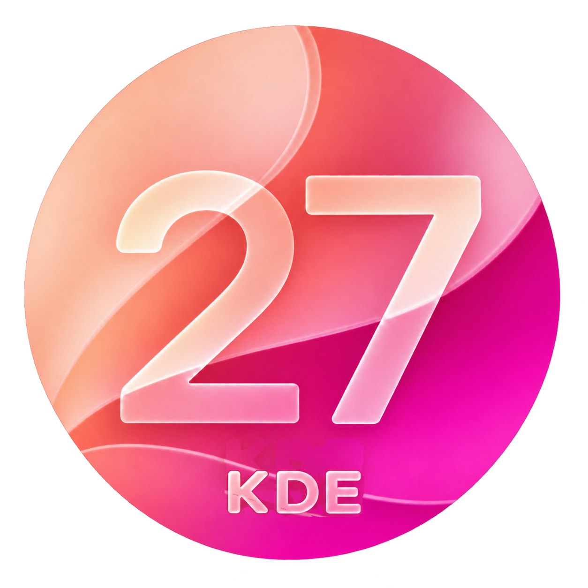
  </picture>
</p>

<h1 align="center">macOS Golden Gate Look &amp; Feel for KDE Linux</h1>

<p align="center">
  <a href="README.md" lang="en" hreflang="en" aria-current="page">🇺🇸 English</a> ·
  <a href="README.es.md" lang="es" hreflang="es">🇪🇸 Español</a> ·
  <a href="README.zh-CN.md" lang="zh-CN" hreflang="zh-CN">🇨🇳 简体中文</a> ·
  <a href="README.pt-BR.md" lang="pt-BR" hreflang="pt-BR">🇧🇷 Português (Brasil)</a> ·
  <a href="README.de.md" lang="de" hreflang="de">🇩🇪 Deutsch</a> ·
  <a href="README.fr.md" lang="fr" hreflang="fr">🇫🇷 Français</a>
</p>

<p align="center">
  <a href="https://github.com/lestercorderomurillo/macos-golden-gate-liquid-kde/releases"></a>
  <a href="https://kde.org/plasma-desktop/"></a>
  <a href="LICENSE"></a>
  <a href="https://github.com/lestercorderomurillo/macos-golden-gate-liquid-kde/issues/new"></a>
</p>


<p align="center">
  macOS Golden Gate style for KDE Plasma 6.6, 6.7 and 6.8+.
</p>

<p align="center">
  <sub>Select a distro to view its testing status.</sub>
</p>

<p align="center">
  <a href="https://github.com/lestercorderomurillo/macos-tahoe-liquid-kde/blob/main/tests/vm/PROOF.md#cachyos" title="CachyOS"></a>
  <a href="https://github.com/lestercorderomurillo/macos-tahoe-liquid-kde/blob/main/tests/vm/PROOF.md#arch" title="Arch Linux"></a>
  <a href="https://github.com/lestercorderomurillo/macos-tahoe-liquid-kde/blob/main/tests/vm/PROOF.md#endeavouros" title="EndeavourOS"></a>
  <a href="https://github.com/lestercorderomurillo/macos-tahoe-liquid-kde/blob/main/tests/vm/PROOF.md#fedora" title="Fedora"></a>
  <a href="https://github.com/lestercorderomurillo/macos-tahoe-liquid-kde/blob/main/tests/vm/PROOF.md#manjaro" title="Manjaro"></a>
  <a href="https://github.com/lestercorderomurillo/macos-tahoe-liquid-kde/blob/main/tests/vm/PROOF.md#artix" title="Artix Linux (OpenRC)"></a>
  <a href="https://github.com/lestercorderomurillo/macos-tahoe-liquid-kde/blob/main/tests/vm/PROOF.md#garuda" title="Garuda Linux"></a>
  <a href="https://github.com/lestercorderomurillo/macos-tahoe-liquid-kde/blob/main/tests/vm/PROOF.md#nobara" title="Nobara Linux"></a>
  <a href="https://github.com/lestercorderomurillo/macos-tahoe-liquid-kde/blob/main/tests/vm/PROOF.md#opensuse" title="openSUSE Tumbleweed"></a>
  <a href="https://github.com/lestercorderomurillo/macos-tahoe-liquid-kde/blob/main/tests/vm/PROOF.md#neon" title="KDE neon"></a>
  <a href="https://github.com/lestercorderomurillo/macos-tahoe-liquid-kde/blob/main/tests/vm/PROOF.md#debian" title="Debian testing / sid (Plasma 6.6+)"></a>
  <a href="https://github.com/lestercorderomurillo/macos-tahoe-liquid-kde/blob/main/tests/vm/PROOF.md#nixos" title="NixOS (experimental)"></a>
</p>

This project customizes the look and feel of your KDE desktop on Linux. It does not include or connect to Apple services. If you need Apple services, [shop directly with Apple](https://www.apple.com/store).

> [!CAUTION]
> **Rolling Release Philosophy**
> Experimental. Receives daily updates. Updates may break compatibility. Avoid production systems; [report issues here](https://github.com/lestercorderomurillo/macos-golden-gate-liquid-kde/issues/new).

> [!WARNING]
> **Beware of paywall repackers: this theme is FREE.**
>
> If you found this theme through any third-party channel, you do not need to pay to get it: download it directly from this repository. We keep this project free so everyone can enjoy it without a paywall. No purchase or subscription is required.

<br>


Bug reports, fixes, testing and documentation: see the [contribution guide](CONTRIBUTING.md).

Code contributors and issue reporters across Tahoe and Golden Gate:

<p>
  <a href="https://github.com/lestercorderomurillo"></a>
  <a href="https://github.com/yanhenrique-dev"></a>
  <a href="https://github.com/naevui"></a>
  <a href="https://github.com/caioniehues"></a>
  <a href="https://github.com/404-not-found129"></a>
  <a href="https://github.com/myakupozluk"></a>
  <a href="https://github.com/EMS1998"></a>
  <a href="https://github.com/allfritz"></a>
  <a href="https://github.com/elegos"></a>
  <a href="https://github.com/kozeki-uii"></a>
  <a href="https://github.com/imightbelosthere"></a>
  <a href="https://github.com/evaildev"></a>
  <a href="https://github.com/xarblu"></a>
  <a href="https://github.com/PKMNPlatin"></a>
  <a href="https://github.com/matinlotfali"></a>
  <a href="https://github.com/luisbocanegra"></a>
  <a href="https://github.com/OliverChase2003"></a>
  <a href="https://github.com/RoxasYTB"></a>
  <a href="https://github.com/Flagwill"></a>
  <a href="https://github.com/4l3j0Ok"></a>
  <a href="https://github.com/0xrushi"></a>
  <a href="https://github.com/aenriii"></a>
  <a href="https://github.com/andreas399"></a>
  <a href="https://github.com/Andrew-Sor"></a>
  <a href="https://github.com/ardashir77"></a>
  <a href="https://github.com/azizaktas"></a>
  <a href="https://github.com/binary-pleb"></a>
  <a href="https://github.com/bneils"></a>
  <a href="https://github.com/FAYZER77"></a>
  <a href="https://github.com/fxrncyyisingithub"></a>
  <a href="https://github.com/germanbagutteorsomething"></a>
  <a href="https://github.com/iNarrow12"></a>
  <a href="https://github.com/IsaiahSHanson"></a>
  <a href="https://github.com/kuau"></a>
  <a href="https://github.com/Lando0007"></a>
  <a href="https://github.com/LilT59"></a>
  <a href="https://github.com/marcosfantonio"></a>
  <a href="https://github.com/moulikanand12345-lang"></a>
  <a href="https://github.com/nanechi"></a>
  <a href="https://github.com/nousernameget"></a>
  <a href="https://github.com/OpalSand"></a>
  <a href="https://github.com/P0sixSplo1t-2"></a>
  <a href="https://github.com/rokan00"></a>
  <a href="https://github.com/RussH"></a>
  <a href="https://github.com/Salkio"></a>
  <a href="https://github.com/Shivamingale3"></a>
  <a href="https://github.com/shoko3756"></a>
  <a href="https://github.com/Sonicx9876"></a>
  <a href="https://github.com/Tias-dev"></a>
  <a href="https://github.com/txhammer68"></a>
  <a href="https://github.com/vanshdev0101"></a>
  <a href="https://github.com/vialolis"></a>
  <a href="https://github.com/Whiddu"></a>
  <a href="https://github.com/yingmanwumen"></a>
  <a href="https://github.com/yofriendfromschool1"></a>
  <a href="https://github.com/zhaokelei"></a>
</p>

<br>


### Golden Gate Finder (Alpha)

Finder-style file browsing with Golden Gate glass.

<p align="center">
  <a href="src/screenshots/previews/readme-golden-gate-light-finder-362858f81e2b.webp"></a>
  <a href="src/screenshots/previews/readme-golden-gate-dark-finder-b835bc92a197.webp"></a>
</p>

<details>
<summary><strong>Red and blue accents in light and dark mode</strong></summary>

<table>
<tr><th>Accent</th><th>Light</th><th>Dark</th></tr>
<tr><td>Blue</td><td><a href="src/screenshots/previews/readme-golden-gate-light-finder-blue-362858f81e2b.webp"></a></td><td><a href="src/screenshots/previews/readme-golden-gate-dark-finder-blue-b835bc92a197.webp"></a></td></tr>
<tr><td>Red</td><td><a href="src/screenshots/previews/readme-golden-gate-light-finder-red-64f13f0002bb.webp">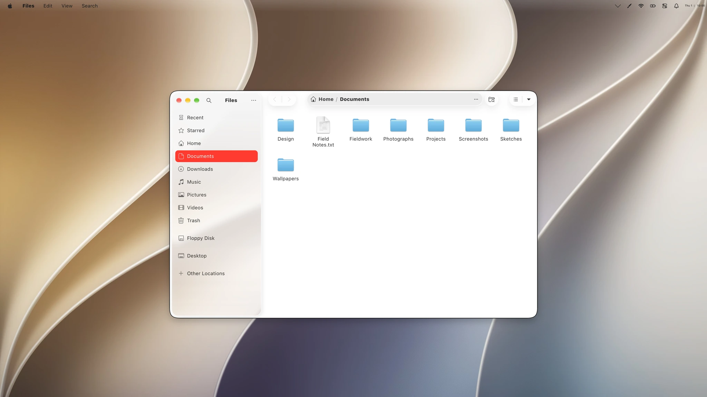</a></td><td><a href="src/screenshots/previews/readme-golden-gate-dark-finder-red-928d44f325a4.webp">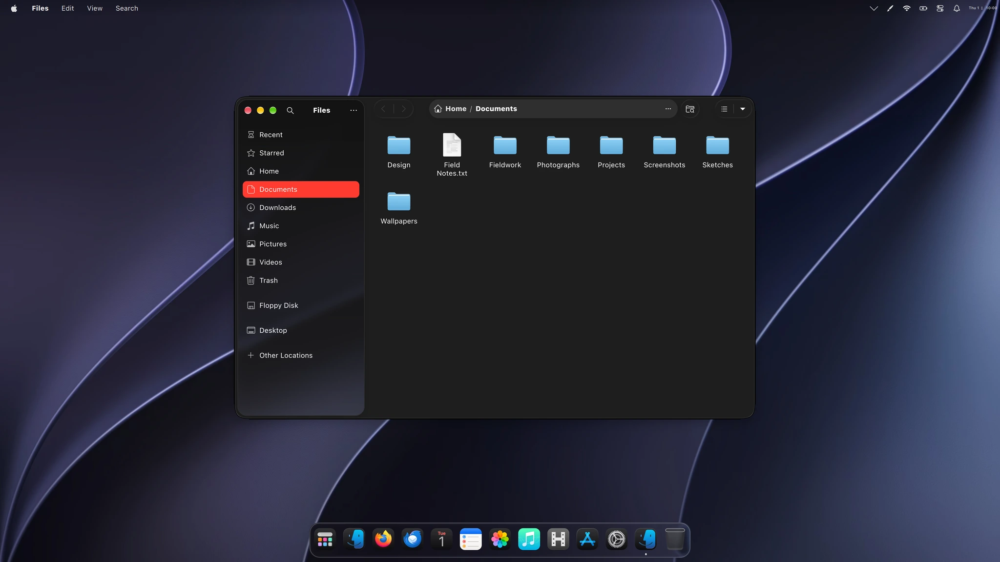</a></td></tr>
</table>

</details>

<br>

### Golden Gate Launchpad (Alpha)

Find apps, browse categories and keep your favorites within reach. The frosted app grid has a translucent white or black tint. The search field uses the same dark gold gradient in both modes.

<p align="center">
  
  
</p>

<br>

### Golden Gate Dock (Alpha)

Glass refraction, hover zoom, red notification count bubbles and auto-hide.

<p align="center">
  <strong>Light</strong><br>
  <a href="src/screenshots/previews/readme-golden-gate-light-dock-regular-ae28f4208eeb.webp">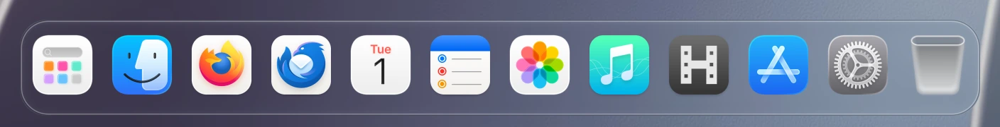</a>
</p>

<p align="center">
  <strong>Dark</strong><br>
  <a href="src/screenshots/previews/readme-golden-gate-dark-dock-regular-97a5f7ec9906.webp">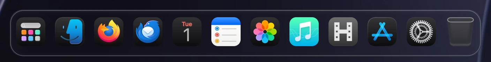</a>
</p>

<p align="center">
  <strong>Clear Light</strong><br>
  <a href="src/screenshots/previews/readme-golden-gate-light-dock-clear-90ade834a80a.webp">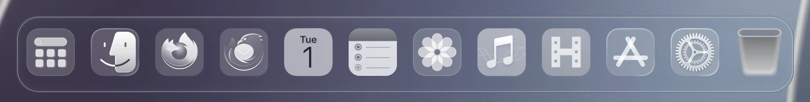</a>
</p>

<p align="center">
  <strong>Clear Dark</strong><br>
  <a href="src/screenshots/previews/readme-golden-gate-dark-dock-clear-168be084ef75.webp">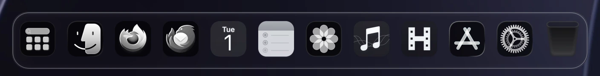</a>
</p>

<p align="center">
  <strong>Blue Light</strong><br>
  <a href="src/screenshots/previews/readme-golden-gate-light-dock-blue-d5bd6bb19bd7.webp">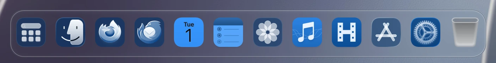</a>
</p>

<p align="center">
  <strong>Blue Dark</strong><br>
  <a href="src/screenshots/previews/readme-golden-gate-dark-dock-blue-42692e6defe8.webp">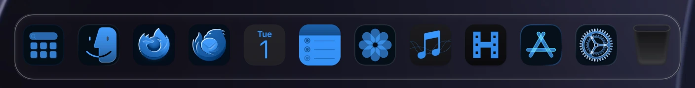</a>
</p>

<p align="center">
  <strong>Purple Light</strong><br>
  <a href="src/screenshots/previews/readme-golden-gate-light-dock-purple-4cf7088ccbf6.webp">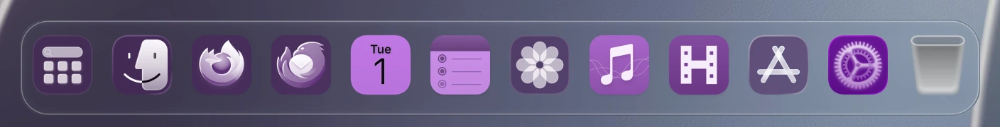</a>
</p>

<p align="center">
  <strong>Purple Dark</strong><br>
  <a href="src/screenshots/previews/readme-golden-gate-dark-dock-purple-de2ddd0fdac7.webp">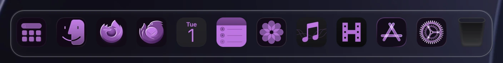</a>
</p>

<p align="center">
  <strong>Pink Light</strong><br>
  <a href="src/screenshots/previews/readme-golden-gate-light-dock-pink-ab8be352515b.webp">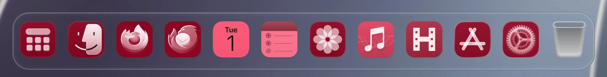</a>
</p>

<p align="center">
  <strong>Pink Dark</strong><br>
  <a href="src/screenshots/previews/readme-golden-gate-dark-dock-pink-35b9f3ee83b9.webp">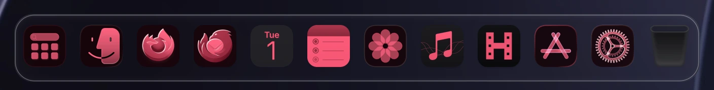</a>
</p>

<p align="center">
  <strong>Red Light</strong><br>
  <a href="src/screenshots/previews/readme-golden-gate-light-dock-red-a72a1c8174df.webp">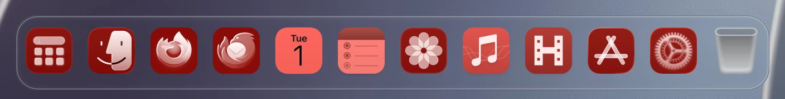</a>
</p>

<p align="center">
  <strong>Red Dark</strong><br>
  <a href="src/screenshots/previews/readme-golden-gate-dark-dock-red-95f297477353.webp">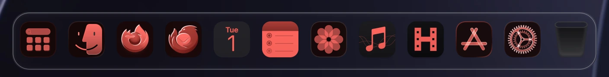</a>
</p>

<p align="center">
  <strong>Orange Light</strong><br>
  <a href="src/screenshots/previews/readme-golden-gate-light-dock-orange-85091fbfe050.webp">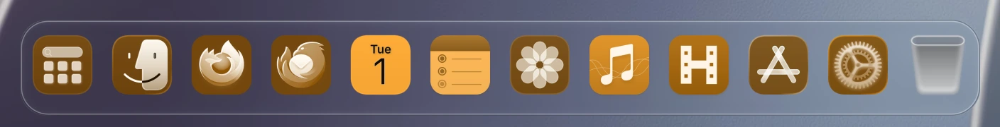</a>
</p>

<p align="center">
  <strong>Orange Dark</strong><br>
  <a href="src/screenshots/previews/readme-golden-gate-dark-dock-orange-cf8fa5dc1f63.webp">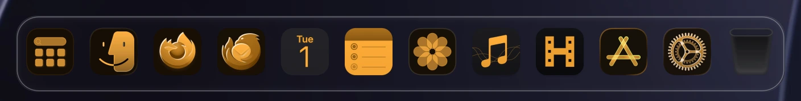</a>
</p>

<p align="center">
  <strong>Yellow Light</strong><br>
  <a href="src/screenshots/previews/readme-golden-gate-light-dock-yellow-8baf587f16fc.webp">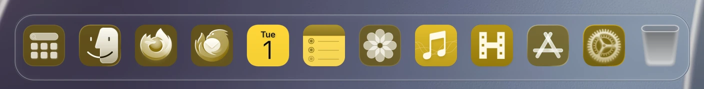</a>
</p>

<p align="center">
  <strong>Yellow Dark</strong><br>
  <a href="src/screenshots/previews/readme-golden-gate-dark-dock-yellow-9dcd8b6de570.webp"></a>
</p>

<p align="center">
  <strong>Green Light</strong><br>
  <a href="src/screenshots/previews/readme-golden-gate-light-dock-green-d9c53ffc24bc.webp">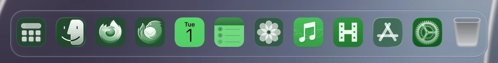</a>
</p>

<p align="center">
  <strong>Green Dark</strong><br>
  <a href="src/screenshots/previews/readme-golden-gate-dark-dock-green-524aa37bd27b.webp">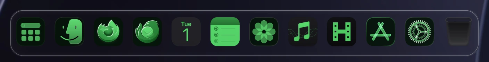</a>
</p>

<p align="center">
  <strong>Gray Light</strong><br>
  <a href="src/screenshots/previews/readme-golden-gate-light-dock-gray-fed59e6cbc46.webp">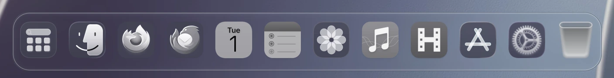</a>
</p>

<p align="center">
  <strong>Gray Dark</strong><br>
  <a href="src/screenshots/previews/readme-golden-gate-dark-dock-gray-0e1e1330d670.webp">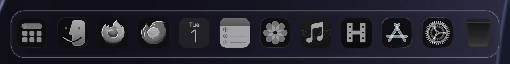</a>
</p>

<br>

### Golden Gate Shell (Alpha)

File, Edit and the other application menus follow the active window. Open the system menu for settings and session controls.

<p align="center">
  
  
</p>

<br>

### Golden Gate Calendar (Alpha)

Open the panel clock to see the month on glass. Scroll or use the arrow keys to browse months. Press Home to return to the current month.

<p align="center">
  
  
</p>

<br>

### Golden Gate Control Center (Alpha)

Wi-Fi, sound, brightness and notifications in one glass menu. The appearance button shows a sun for Light, a moon for Dark and a split circle for Automatic.

<p align="center">
  
  
</p>

<p align="center">
  <strong>Wi-Fi</strong><br>
  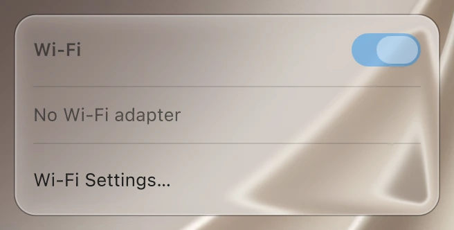
  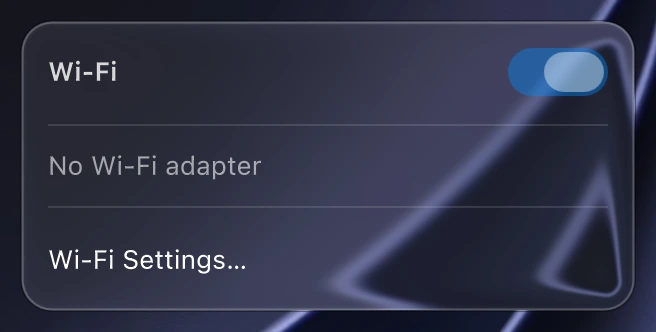
</p>

<p align="center">
  <strong>Battery</strong><br>
  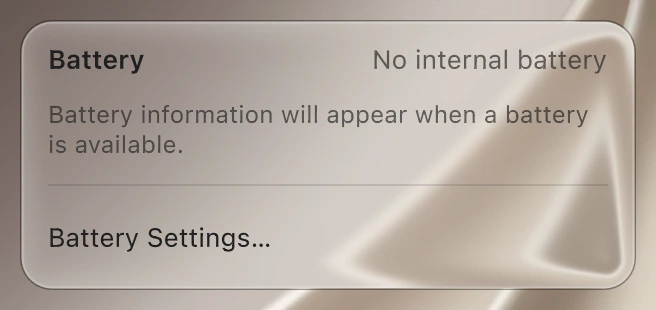
  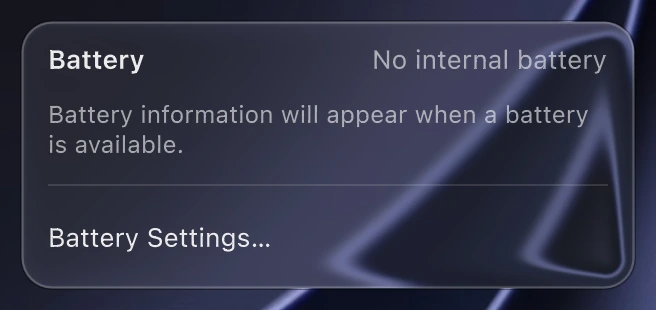
</p>

<br>

### Golden Gate Notifications (Alpha)

Glass notification banners and grouped history with app actions and reply support.

<p align="center">
  
  
  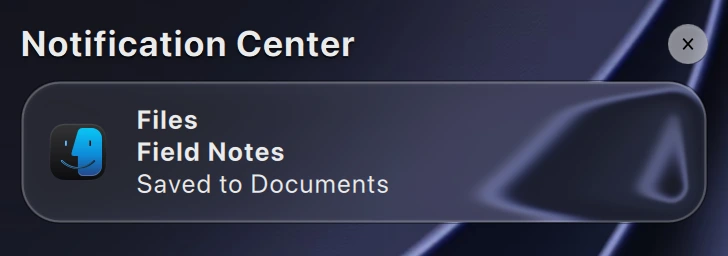
  
</p>

<br>

### Golden Gate Clipboard History (Alpha)

Find and reuse copied text and images directly from Launchpad.

<p align="center">
  
  
</p>

<br>

### Golden Gate System Information (Alpha)

Your hardware, software and theme details at a glance.

<p align="center">
  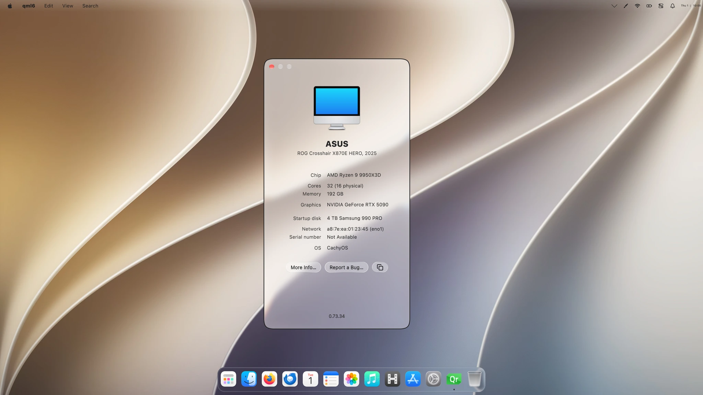
  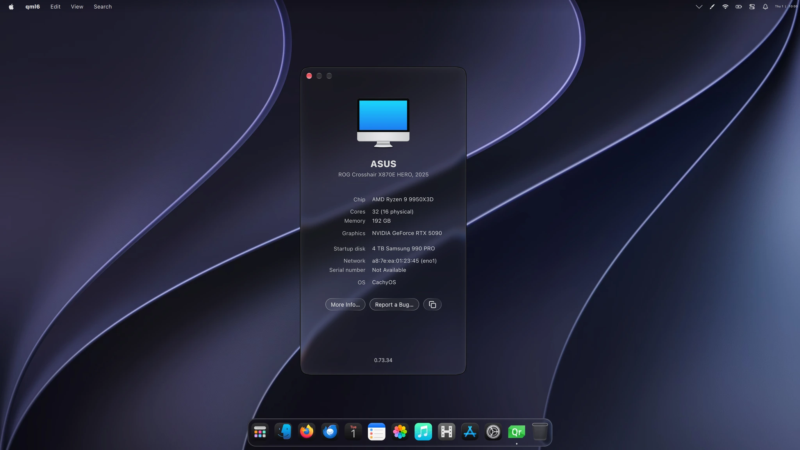
</p>

<br>

### Golden Gate Plasma Theme (Alpha)

Translucent menus and popups with matching light and dark colors.

<p align="center">
  
  
</p>

<br>

### Golden Gate Boot Splash (Alpha)

A matching look from startup to shutdown, with built-in unlocking for LUKS2-encrypted drives.

<p align="center">
  
</p>

<br>


- **Languages:** English, Spanish, Simplified Chinese, Brazilian Portuguese, German and French installer; translated Plasma widgets.
- **Installer:** graphical component selection, bundled theme assets and update support.
- **Distributions:** dependency installation for Arch-based, Fedora-based, openSUSE, Debian and KDE neon systems.
- **Scheduling:** automatic theme switching and OLED care through systemd user timers or cron on OpenRC.
- **Glass effects:** adjustable blur, refraction and three-color gradients for light and dark modes.
- **Compatibility:** Plasma 6.6–6.8, with native effects compiled against the installed Qt and KWin versions.
- **Launchpad:** two layouts, integrated or detached search, favorites and scrollable app categories.
- **Dock:** hover zoom, notification badges, auto-hide and preserved pins on reinstall.
- **Appearance:** synchronized light/dark styles for the desktop, apps, icons and window decorations; per-monitor wallpapers.
- **App integration:** global menus, GTK menu fixes, Finder-style Nautilus and Firefox theming with profile backups.
- **Recovery:** requirement checks, settings backups and uninstall restoration.
- **Optional features:** OLED panel shifts and experimental NixOS and Home Manager modules.
- **Testing:** regression tests, distro containers and Plasma VMs.

<br>


Download and open the installer:

```bash
git clone --filter=blob:none https://github.com/lestercorderomurillo/macos-golden-gate-liquid-kde.git
cd macos-golden-gate-liquid-kde
./installer
```

Choose **Express** to install. Open `./installer` again to update or uninstall.

To free disk space while keeping your Git checkout and local work:

```bash
./installer --free-space
```

| Installer language | Status |
| --- | --- |
| 🇺🇸 English |  |
| 🇪🇸 Spanish |  |
| 🇨🇳 Simplified Chinese |  |
| 🇧🇷 Brazilian Portuguese |  |
| 🇩🇪 German |  |
| 🇫🇷 French |  |
| 🇮🇹 Italian |  |
| 🇯🇵 Japanese |  |
| 🇰🇷 Korean |  |
| 🇷🇺 Russian |  |
| 🇸🇦 Arabic |  |
| 🇮🇳 Hindi |  |
| 🇳🇱 Dutch |  |
| 🇵🇱 Polish |  |
| 🇹🇷 Turkish |  |

<details>
<summary><b>Requirements</b></summary>

Required desktop, build tools and system packages.

- KDE Plasma 6.6+
- Python 3.10+ and PyQt6
- `sudo`
- Qt 6 development tools
- KDE and Qt 6 development packages for the compiled plasmoids and KWin effects
- `cmake`, `g++`, and `pkg-config` when compiled features are selected
- `dbus-send`
- `systemctl` or `crontab` for scheduled features

Internet access is required for downloads, missing dependencies and optional KDE Rounded Corners.

| Distro | Qt 6 tools | KDE Plasma 6 development packages |
|--------|------------|-----------------------------------|
| Arch family | `pacman -S qt6-tools` | `pacman -S extra-cmake-modules plasma-workspace kdecoration libplasma libnotificationmanager libksysguard plasma-activities-stats` |
| Fedora family | `dnf install qt6-qttools-devel` | `dnf install extra-cmake-modules plasma-workspace-devel kdecoration-devel libplasma-devel knotifications-devel libksysguard-devel kf6-plasma-activities-devel` |
| openSUSE Tumbleweed | `zypper install qt6-tools-devel` | `zypper install extra-cmake-modules plasma6-workspace-devel kdecoration-devel libKF6Plasma-devel libnotificationmanager6-devel libksysguard6-devel libKF6PlasmaActivitiesStats6-devel` |

</details>

<details>
<summary><b>OLED care</b></summary>

Optional panel shifts; disabled by default.

Enable it on the **OLED protection** page. Choose the shift interval and maximum
pixel displacement there; it is disabled by default.

**Manual controls**

```bash
mac-tahoe-oled-care shift
mac-tahoe-oled-care restore
mac-tahoe-oled-care status
```

</details>

<details>
<summary><b>Test in a virtual machine</b></summary>

Try the theme in an isolated Plasma desktop.

```bash
./vm <os>
```

**OS:** `cachyos` · `arch` · `manjaro` · `endeavouros` · `garuda` · `fedora` · `nobara` · `opensuse` · `neon` · `debian` · `artix` · `kubuntu`

`all` launches every distro. [VM setup and qualification guide](https://github.com/lestercorderomurillo/macos-tahoe-liquid-kde/blob/main/tests/vm/README.md).

`./vm kubuntu` boots the SHA-256-pinned Kubuntu 26.04.1 LTS ISO on loopback
SSH port `2234` after guest setup. This launcher regression target is pending
full live qualification.

</details>


<br>


Check support for your distribution, init system and Plasma version.

<details>
<summary><b>Distributions</b></summary>

All 11 distributions in this table passed live VM qualification. Select a status badge for reviewed screenshots and test results.

| | Name | Status |
|:--:|------|---------|
|  | CachyOS | [](https://github.com/lestercorderomurillo/macos-tahoe-liquid-kde/blob/main/tests/vm/PROOF.md#cachyos) |
|  | Arch Linux | [](https://github.com/lestercorderomurillo/macos-tahoe-liquid-kde/blob/main/tests/vm/PROOF.md#arch) |
|  | EndeavourOS | [](https://github.com/lestercorderomurillo/macos-tahoe-liquid-kde/blob/main/tests/vm/PROOF.md#endeavouros) |
|  | Fedora | [](https://github.com/lestercorderomurillo/macos-tahoe-liquid-kde/blob/main/tests/vm/PROOF.md#fedora) |
|  | Manjaro | [](https://github.com/lestercorderomurillo/macos-tahoe-liquid-kde/blob/main/tests/vm/PROOF.md#manjaro) |
|  | Artix Linux (OpenRC) | [](https://github.com/lestercorderomurillo/macos-tahoe-liquid-kde/blob/main/tests/vm/PROOF.md#artix) |
|  | Garuda Linux | [](https://github.com/lestercorderomurillo/macos-tahoe-liquid-kde/blob/main/tests/vm/PROOF.md#garuda) |
|  | Nobara | [](https://github.com/lestercorderomurillo/macos-tahoe-liquid-kde/blob/main/tests/vm/PROOF.md#nobara) |
|  | openSUSE Tumbleweed | [](https://github.com/lestercorderomurillo/macos-tahoe-liquid-kde/blob/main/tests/vm/PROOF.md#opensuse) |
|  | KDE neon | [](https://github.com/lestercorderomurillo/macos-tahoe-liquid-kde/blob/main/tests/vm/PROOF.md#neon) |
|  | Debian testing / sid (Plasma 6.6+) | [](https://github.com/lestercorderomurillo/macos-tahoe-liquid-kde/blob/main/tests/vm/PROOF.md#debian) |

</details>

<details>
<summary><b>Init systems</b></summary>

Automatic theme switching and OLED care use the following scheduling backends:

| Init system | Scheduling | Recorded testing |
| --- | --- | --- |
| systemd | User timers |  |
| OpenRC | Per-user cron |  |
| dinit | Per-user cron |   |

OpenRC and dinit require a running cron daemon.
[Desktop test results](https://github.com/lestercorderomurillo/macos-tahoe-liquid-kde/blob/main/tests/vm/PROOF.md) · [dinit scheduling probe](https://github.com/lestercorderomurillo/macos-tahoe-liquid-kde/blob/main/CONTRIBUTING.md#setup).

</details>

<details>
<summary><b>Plasma versions</b></summary>

Plasma 6.6–6.8 is supported; compiled effects use the host SDK.

| Plasma | Support | Since |
|--------|---------|-------|
| 6.5 and older |  | Not applicable |
| 6.6 |  | v0.1.0 |
| 6.7 |  | v0.19.0 |
| 6.8 |  | v0.54.1 |

</details>

<br>


What works now and what we plan to add.

<details>
<summary><b>Component status</b></summary>

The current status of each component.

| Component | Status |
|-----------|--------|
| Color Schemes |  |
| Wallpapers |  |
| Fonts |  |
| Cursors |  |
| Plasma Theme |  |
| Kvantum Theme |  |
| GTK Theme |  |
| Acrylic Glass |  |
| KDE Rounded Corners |  |
| Auto Theme Switcher |  |
| OLED Care |  |
| Installer UI |  |
| Localization |  |
| Aurorae Decorations |  |
| Global Menu |  |
| Dock |  |
| Finder-style Nautilus |  |
| Launchpad |  |
| Shell |  |
| Clipboard History |  |
| System Information |  |
| Trash |  |
| Sounds |  |
| Boot Screen |  |
| Shutdown Screen |  |
| Firefox Theme |  |
| Icons |  |
| Multi-Distro Support |  |
| OpenRC Testing |  |
| Konsole Theme |  |
| Kate Theme |  |
| SDDM Theme |  |
| Calendar |  |
| Control Center, Wi-Fi, Battery and Notifications |  |
| System Preferences |  |
| OS Selector |  |

</details>

<br>

**[Report a bug](https://github.com/lestercorderomurillo/macos-golden-gate-liquid-kde/issues/new)** or use **Apple menu → About This Computer → Report a Bug…**.

Include:

- Your Plasma version: `plasmashell --version`
- Your distro: `grep PRETTY_NAME /etc/os-release`
- The theme version shown in **About This Computer**
- A screenshot or recording for visual issues

Keep pull requests focused and validate with `./vm`. See [CONTRIBUTING.md](https://github.com/lestercorderomurillo/macos-tahoe-liquid-kde/blob/main/CONTRIBUTING.md).

The shared [icon generation toolset](https://github.com/lestercorderomurillo/macos-tahoe-liquid-kde/blob/main/CONTRIBUTING.md#icon-generation-toolset)
creates light, dark, monochrome and translucent glass appearances from Tahoe's
bundled icons, with any RGB tint. Run `./icon-toolset` from a Tahoe checkout to
build, preview, verify and package icons offline for either edition. All icon
implementation and assets remain in Tahoe.

<br>


This is an independent reimplementation inspired by the macOS aesthetic. It is not affiliated with or endorsed by Apple or KDE. "macOS" and "Apple" are trademarks of Apple Inc.

The macOS 27 emblem, bundled wallpapers, system sounds, and SF Pro / SF Mono fonts remain Apple's property and are not covered by this project's license. Other components retain their own licenses and copyright notices; see the third-party notice index below for scope and known provenance gaps.

Licensed [GPL-3.0](LICENSE) as a whole; individual component licenses and third-party rights remain applicable. See [copyright notices](NOTICE), [licensing and project identity](LICENSING.md), and [third-party notices](THIRD_PARTY_NOTICES.md).

<br>


Project references and third-party components:

- **[EliverLara](https://github.com/EliverLara/TahoeLauncher)**: `TahoeLauncher`: Launchpad design reference.
- **[vinceliuice](https://github.com/vinceliuice)**: `MacTahoe-icon-theme`: base icons and cursors; GTK design reference.
- **[taj-ny](https://github.com/taj-ny/kwin-effects-forceblur)** and **[4v3ngR](https://github.com/4v3ngR/kwin-effects-glass)**: Better Blur and its glass fork: upstream code used by Acrylic Glass.
- **[luisbocanegra](https://github.com/luisbocanegra/plasma-panel-colorizer)**: `plasma-panel-colorizer`, bundled offline to tint the panels.
- **[Matin Lotfaliei](https://github.com/matinlotfali/KDE-Rounded-Corners)**: `KDE-Rounded-Corners`, the KWin rounded-window effect built against the host KWin SDK.
- **[ful1e5](https://github.com/ful1e5)**: `apple_cursor`: alternate cursor design reference.
- **[sahibjotsaggu](https://github.com/sahibjotsaggu)**: `San-Francisco-Pro-Fonts`: source of the SF Pro / SF Mono bundle.
- **[Lucide](https://github.com/lucide-icons/lucide)**: copy icons bundled in the global menu.
- **[512pixels.net](https://512pixels.net/projects/default-mac-wallpapers-in-5k/)**: high-resolution macOS wallpaper archive.

Independent reimplementation inspired by the macOS aesthetic, not affiliated with or endorsed by Apple. "macOS" and "Apple" are trademarks of Apple Inc.; the bundled wallpapers and SF fonts remain Apple's property. Licensed GPL-3.0.


[Installer screenshots and testing](TESTING.md).
