<p align="center">
  <!-- Adapted with ImageGen from artwork by Apple: https://developer.apple.com/macos/. Tux design by Larry Ewing. -->
  <picture>
    <source media="(prefers-color-scheme: dark)" srcset="docs/artwork/glass-tux-golden-gate-dark-8a2f000e0c83.png">
    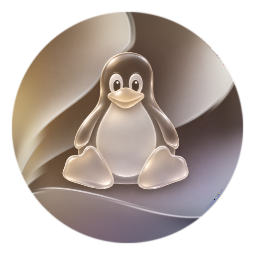
  </picture>
</p>

<h1 align="center">macOS Golden Gate Shell for KDE Linux</h1>

<p align="center">
  <a href="README.md" lang="en" hreflang="en">🇺🇸 English</a> ·
  <a href="README.es.md" lang="es" hreflang="es">🇪🇸 Español</a> ·
  <a href="README.zh-CN.md" lang="zh-CN" hreflang="zh-CN">🇨🇳 简体中文</a> ·
  <a href="README.pt-BR.md" lang="pt-BR" hreflang="pt-BR">🇧🇷 Português (Brasil)</a> ·
  <a href="README.de.md" lang="de" hreflang="de">🇩🇪 Deutsch</a> ·
  <a href="README.fr.md" lang="fr" hreflang="fr">🇫🇷 Français</a> ·
  <a href="README.it.md" lang="it" hreflang="it">🇮🇹 Italiano</a> ·
  <a href="README.ja.md" lang="ja" hreflang="ja">🇯🇵 日本語</a> ·
  <a href="README.ko.md" lang="ko" hreflang="ko">🇰🇷 한국어</a> ·
  <a href="README.ru.md" lang="ru" hreflang="ru" aria-current="page">🇷🇺 Русский</a> ·
  <a href="README.ar.md" lang="ar" hreflang="ar">🇸🇦 العربية</a> ·
  <a href="README.hi.md" lang="hi" hreflang="hi">🇮🇳 हिन्दी</a> ·
  <a href="README.nl.md" lang="nl" hreflang="nl">🇳🇱 Nederlands</a> ·
  <a href="README.pl.md" lang="pl" hreflang="pl">🇵🇱 Polski</a> ·
  <a href="README.tr.md" lang="tr" hreflang="tr">🇹🇷 Türkçe</a>
</p>

<p align="center">
  <a href="https://github.com/lestercorderomurillo/macos-golden-gate-liquid-kde/releases"></a>
  <a href="https://kde.org/plasma-desktop/"></a>
  <a href="LICENSE"></a>
  <a href="https://github.com/lestercorderomurillo/macos-golden-gate-liquid-kde/issues/new"></a>
</p>


<p align="center">
  <sub>Выберите дистрибутив, чтобы просмотреть его состояние тестирования.</sub>
</p>

<p align="center">
  <a href="https://github.com/lestercorderomurillo/macos-tahoe-liquid-kde/blob/main/tests/vm/PROOF.md#cachyos" title="CachyOS"></a>
  <a href="https://github.com/lestercorderomurillo/macos-tahoe-liquid-kde/blob/main/tests/vm/PROOF.md#arch" title="Arch Linux"></a>
  <a href="https://github.com/lestercorderomurillo/macos-tahoe-liquid-kde/blob/main/tests/vm/PROOF.md#endeavouros" title="EndeavourOS"></a>
  <a href="https://github.com/lestercorderomurillo/macos-tahoe-liquid-kde/blob/main/tests/vm/PROOF.md#fedora" title="Fedora"></a>
  <a href="https://github.com/lestercorderomurillo/macos-tahoe-liquid-kde/blob/main/tests/vm/PROOF.md#manjaro" title="Manjaro"></a>
  <a href="https://github.com/lestercorderomurillo/macos-tahoe-liquid-kde/blob/main/tests/vm/PROOF.md#artix" title="Artix Linux (OpenRC)"></a>
  <a href="https://github.com/lestercorderomurillo/macos-tahoe-liquid-kde/blob/main/tests/vm/PROOF.md#garuda" title="Garuda Linux"></a>
  <a href="https://github.com/lestercorderomurillo/macos-tahoe-liquid-kde/blob/main/tests/vm/PROOF.md#nobara" title="Nobara Linux"></a>
  <a href="https://github.com/lestercorderomurillo/macos-tahoe-liquid-kde/blob/main/tests/vm/PROOF.md#opensuse" title="openSUSE Tumbleweed"></a>
  <a href="https://github.com/lestercorderomurillo/macos-tahoe-liquid-kde/blob/main/tests/vm/PROOF.md#neon" title="KDE neon"></a>
  <a href="https://github.com/lestercorderomurillo/macos-tahoe-liquid-kde/blob/main/tests/vm/PROOF.md#debian" title="Debian testing / sid (Plasma 6.6+)"></a>
  <a href="https://github.com/lestercorderomurillo/macos-tahoe-liquid-kde/blob/main/tests/vm/PROOF.md#nixos" title="NixOS (experimental)"></a>
</p>

Этот проект настраивает внешний вид и ощущение вашего рабочего стола KDE на Linux. Он не включает и не подключается к услугам Apple. Если вам нужны услуги Apple, [торговать непосредственно с Apple](https://www.apple.com/store).

> [!CAUTION]
> **Непрерывный выпуск обновлений**
> Экспериментально. Ежедневно получает обновления. Обновления могут нарушить совместимость. избегать производственных систем; [сообщайте об ошибках здесь](https://github.com/lestercorderomurillo/macos-golden-gate-liquid-kde/issues/new).

> [!NOTE]
> Замораживание функций действует для серии 0.8x, с выпусками, ориентированными на исправления ошибок до 0.90.

> [!WARNING]
> **Осторожно с перепакерами платных стен: эта тема бесплатна.**
>
> Если вы нашли эту тему через какую-либо третью сторону, вам не нужно платить, чтобы получить ее: скачать ее непосредственно из этого хранилища. Мы держим этот проект свободным, чтобы все могли наслаждаться им без оплаты. Не требуется покупка или подписка.

<br>


Отчеты о ошибках, исправления, тестирование и документация: см. [руководство по вкладам](CONTRIBUTING.md).

Код-содействующие и журналисты по всем Тахое и Голден-Гейту:

<p>
  <a href="https://github.com/lestercorderomurillo"></a>
  <a href="https://github.com/yanhenrique-dev"></a>
  <a href="https://github.com/naevui"></a>
  <a href="https://github.com/caioniehues"></a>
  <a href="https://github.com/404-not-found129"></a>
  <a href="https://github.com/myakupozluk"></a>
  <a href="https://github.com/EMS1998"></a>
  <a href="https://github.com/allfritz"></a>
  <a href="https://github.com/elegos"></a>
  <a href="https://github.com/kozeki-uii"></a>
  <a href="https://github.com/imightbelosthere"></a>
  <a href="https://github.com/evaildev"></a>
  <a href="https://github.com/xarblu"></a>
  <a href="https://github.com/PKMNPlatin"></a>
  <a href="https://github.com/matinlotfali"></a>
  <a href="https://github.com/luisbocanegra"></a>
  <a href="https://github.com/OliverChase2003"></a>
  <a href="https://github.com/RoxasYTB"></a>
  <a href="https://github.com/Flagwill"></a>
  <a href="https://github.com/4l3j0Ok"></a>
  <a href="https://github.com/0xrushi"></a>
  <a href="https://github.com/aenriii"></a>
  <a href="https://github.com/andreas399"></a>
  <a href="https://github.com/Andrew-Sor"></a>
  <a href="https://github.com/ardashir77"></a>
  <a href="https://github.com/azizaktas"></a>
  <a href="https://github.com/binary-pleb"></a>
  <a href="https://github.com/bneils"></a>
  <a href="https://github.com/FAYZER77"></a>
  <a href="https://github.com/fxrncyyisingithub"></a>
  <a href="https://github.com/germanbagutteorsomething"></a>
  <a href="https://github.com/iNarrow12">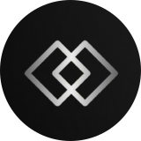</a>
  <a href="https://github.com/IsaiahSHanson"></a>
  <a href="https://github.com/kuau"></a>
  <a href="https://github.com/Lando0007"></a>
  <a href="https://github.com/LilT59"></a>
  <a href="https://github.com/marcosfantonio"></a>
  <a href="https://github.com/moulikanand12345-lang"></a>
  <a href="https://github.com/nanechi"></a>
  <a href="https://github.com/nousernameget"></a>
  <a href="https://github.com/OpalSand"></a>
  <a href="https://github.com/P0sixSplo1t-2"></a>
  <a href="https://github.com/rokan00"></a>
  <a href="https://github.com/RussH"></a>
  <a href="https://github.com/Salkio"></a>
  <a href="https://github.com/Shivamingale3"></a>
  <a href="https://github.com/shoko3756"></a>
  <a href="https://github.com/Sonicx9876"></a>
  <a href="https://github.com/Tias-dev"></a>
  <a href="https://github.com/txhammer68"></a>
  <a href="https://github.com/vanshdev0101"></a>
  <a href="https://github.com/vialolis"></a>
  <a href="https://github.com/Whiddu"></a>
  <a href="https://github.com/yingmanwumen"></a>
  <a href="https://github.com/yofriendfromschool1"></a>
  <a href="https://github.com/zhaokelei"></a>
  <a href="https://github.com/blaykelarue"></a>
  <a href="https://github.com/JacobJS34"></a>
  <a href="https://github.com/Leon-Swains"></a>
  <a href="https://github.com/LucipurrsDad"></a>
  <a href="https://github.com/SinglerGold2"></a>
  <a href="https://github.com/CiderGuru"></a>
  <a href="https://github.com/soumyadeep70"></a>
</p>

<br>


### Многоцветная панель Dock

Подберите цвет значков Dock под рабочий стол.

<p align="center">
  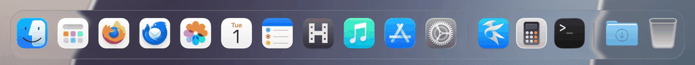
</p>

<br>

### Quickbar

Открывайте меню активного приложения с верхней панели.

<p align="center">
  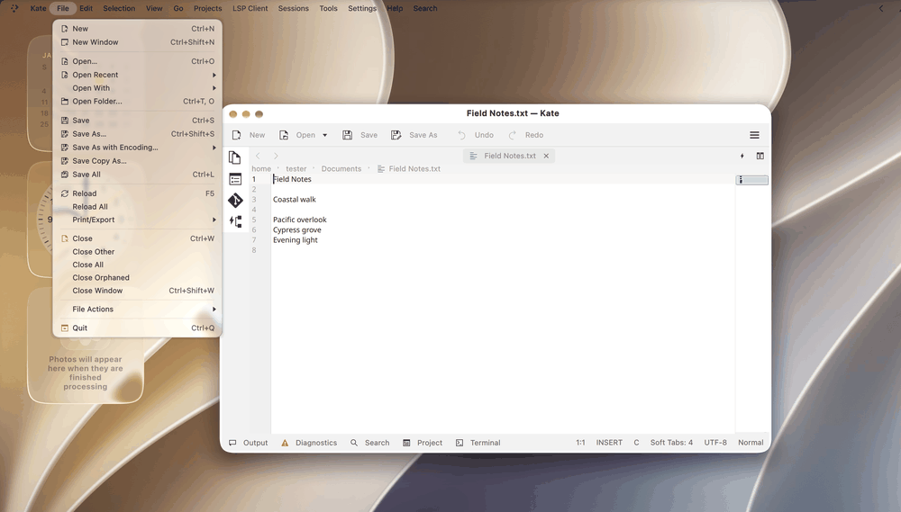
</p>

<br>

### Launchpad

Ищите приложения или просматривайте их по категориям.

<p align="center">
  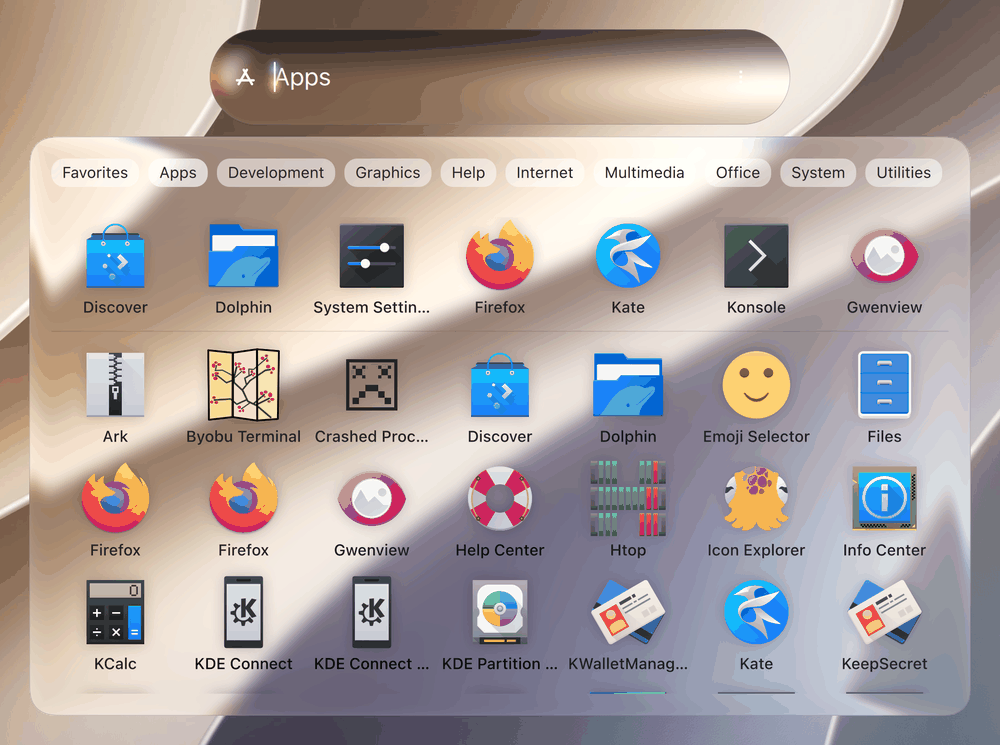
</p>

<br>

### Центр управления

Настраивайте Wi-Fi, звук и яркость в одном меню.

<p align="center">
  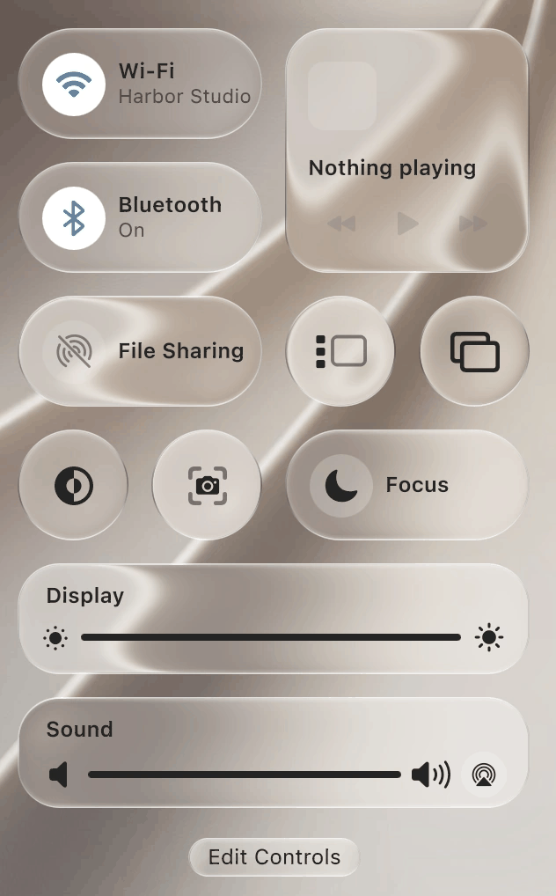
</p>

<br>

### Уведомления

Просматривайте недавние уведомления, сгруппированные по приложениям.

<p align="center">
  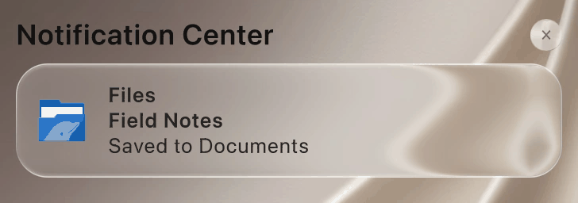
</p>

<br>

### Finder

Просматривайте файлы в окне в стиле Finder.

<p align="center">
  <a href="src/screenshots/previews/golden-gate-finder-light-dark-c29cb3a3472e.gif">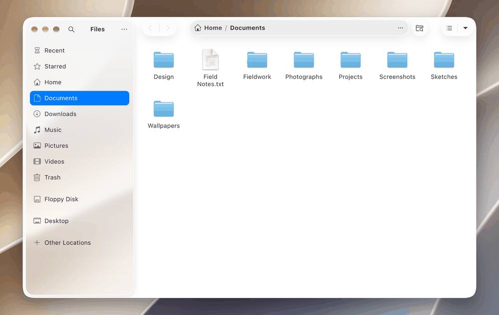</a>
</p>

<br>

### Календарь

Нажмите на часы, чтобы открыть календарь на месяц.

<p align="center">
  
</p>

<br>

### Bluetooth

Подключайте сопряжённые устройства и проверяйте их заряд.

<p align="center">
  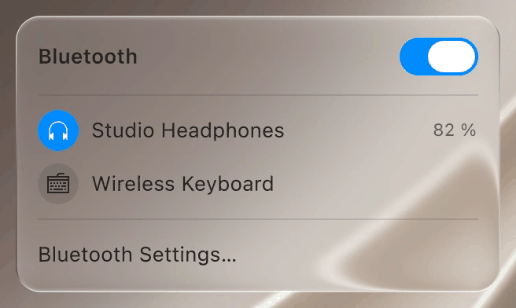
</p>

### Wi-Fi

Просматривайте доступные сети и состояние подключения.

<p align="center">
  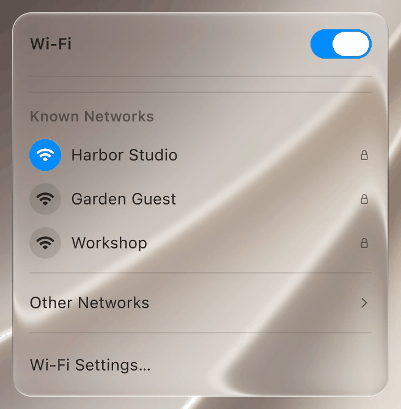
</p>

<br>

### Батарея

Проверяйте уровень заряда батареи и состояние зарядки.

<p align="center">
  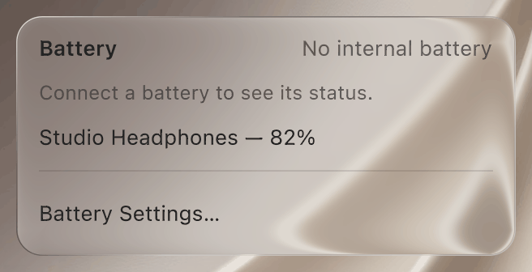
</p>

<br>

### История буфера обмена

Повторно используйте скопированные текст и изображения.

<p align="center">
  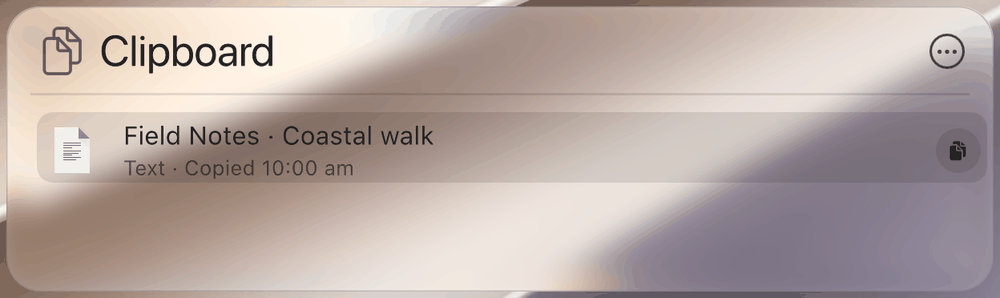
</p>

<br>

### Информационная система

Просматривайте сведения об оборудовании, программах и теме оформления.

<p align="center">
  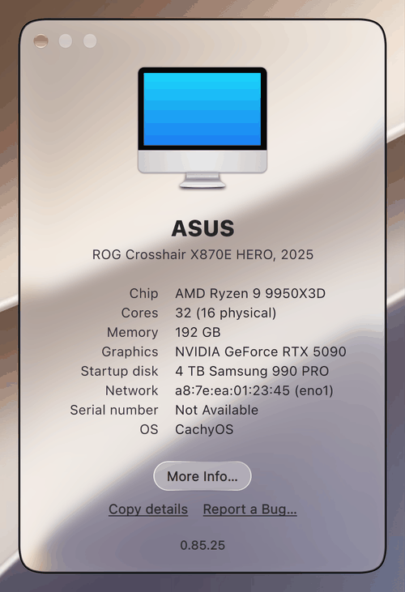
</p>

<br>

### Тема Plasma

Меню и всплывающие окна используют светлую или тёмную тему.

<p align="center">
  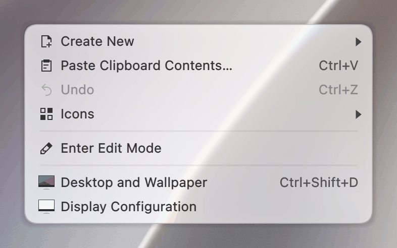
</p>

<br>

### Загрузочная заставка

При запуске появляется заставка в стиле выбранной темы.

<p align="center">
  
</p>

<br>

### Адаптивный контраст

Цвет текста подстраивается под фон, чтобы надписи оставались разборчивыми.

<p align="center">
  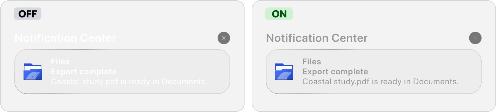
</p>

<br>


- **По внешнему виду:** Координированные светлые и темные темы для рабочего стола, приложений, икон и украшений окон с автоматическим переключением и обоев на мониторе. [Настройки отделки окон для приложений](https://github.com/lestercorderomurillo/macos-tahoe-liquid-kde/blob/dev/docs/app-window-decorations.md)
- **Эффекты стекла:** Составляемая размывка, рефракция и оттенок с текстом, который адаптируется к фону в поддерживаемых меню.
- **Док:** Вставленные приложения, загрузка, значки уведомления и конфигурируемое скрытие. Док следит за вами между экранами.
- **Площадь меню и центр управления:** Глобальные меню приложений и быстрые системные управления, с общими настройками панели меню на дисплеях.
- **Запускная панель:** Поиск приложений, просмотр категорий и сохранение любимых в любом из двух макетов.
- **Рабочие панели:** Добавьте и разместите на рабочем столе сборные виджетов Liquid Glass.
- **Уведомления:** Стеклянные баннеры и группированная история, с быстрыми действиями и ответами, где приложения поддерживают их.
- **История клипа:** Найдите и используйте копированный текст, изображения и нажмите предметы, которые вы хотите сохранить.
- **Интеграция приложений:** Просмотр в стиле Finder в Nautilus, интеграция меню GTK и тематика Firefox с резервными копиями профиля.
- **Информация о системе и запуск:** Тематическое информационное окно системы и опциональный сходный пусковый пробник.
- **Установка и восстановление:** Графический установщик с объединенными тематическими активами, обновлениями и резервными копиями настроек, которые можно восстановить при отводе.
- **Языки:** Выберите язык установки в настройках. Плазменные виджеты следуют языку рабочего стола.
- **Совместимость:** Плазма 6.6 ⁇ 6.8 на системах Arch и Fedora, openSUSE, Debian и KDE neon.
- **Необходимые функции:** ОКЗ защитные панели и экспериментальная поддержка NixOS и Home Manager.

<br>


**Прежде чем запускать установщик на своём ПК, проверьте его в виртуальной машине с тем же дистрибутивом и той же версией Plasma.**

```bash
git clone --filter=blob:none https://github.com/lestercorderomurillo/macos-golden-gate-liquid-kde.git
cd macos-golden-gate-liquid-kde
./installer
```

Для установки выберите **Express**. Для обновления или удаления снова запустите `./installer`.

Чтобы освободить место на диске и сохранить рабочую копию Git и локальные изменения:

```bash
./installer --free-space
```

| Язык установки | Статус |
| --- | --- |
| 🇺🇸 English |  |
| 🇪🇸 Español |  |
| 🇨🇳 简体中文 |  |
| 🇧🇷 Português (Brasil) |  |
| 🇩🇪 Deutsch |  |
| 🇫🇷 Français |  |
| 🇮🇹 Italiano |  |
| 🇷🇺 Русский |  |
| 🇯🇵 日本語 |  |
| 🇰🇷 한국어 |  |
| 🇸🇦 العربية |  |
| 🇮🇳 हिन्दी |  |
| 🇳🇱 Nederlands |  |
| 🇵🇱 Polski |  |
| 🇹🇷 Türkçe |  |

<details>
<summary><b>Требования</b></summary>

Требуется рабочий стол, инструменты и системные пакеты.

- KDE Plasma 6.6+
- Python 3.10+ и PyQt6
- `sudo`
- Qt 6 Инструменты развития
- Комплексы KDE и Qt 6 для разработки скомпилированных плазмоидов и эффектов KWin
- `cmake`, `g++`, и `pkg-config` при выборе составленных функций
- `dbus-send`
- `systemctl` или `crontab` для расписания

Доступ к Интернету необходим для загрузки, отсутствующих зависимостей и дополнительных KDE Rounded Corners.

| Дистро | Qt 6 инструменты | KDE Plasma 6 пакеты разработки |
|--------|------------|-----------------------------------|
| Семейство Арка | `pacman -S qt6-tools` | `pacman -S extra-cmake-modules plasma-workspace kdecoration libplasma libnotificationmanager libksysguard plasma-activities-stats` |
| Семейство Федоры | `dnf install qt6-qttools-devel` | `dnf install extra-cmake-modules plasma-workspace-devel kdecoration-devel libplasma-devel knotifications-devel libksysguard-devel kf6-plasma-activities-devel` |
| openSUSE Tumbleweed | `zypper install qt6-tools-devel` | `zypper install extra-cmake-modules plasma6-workspace-devel kdecoration-devel libKF6Plasma-devel libnotificationmanager6-devel libksysguard6-devel libKF6PlasmaActivitiesStats6-devel` |

На Fedora установщик устанавливает Fedora  ⁇ s GTK 3 глобальный экспортер меню, `unity-gtk3-module`, и загружает его на логин для приложений GTK 3.

</details>

<details>
<summary><b>Охота на OLED</b></summary>

Факультативные сдвиги панелей отключен по умолчанию.

Включить его на **ОЗО защищенность** Страница. Выберите интервал смены и максимальное перемещение пикселей там Он отключен по умолчанию.

**Руковые управления**

```bash
mac-tahoe-oled-care shift
mac-tahoe-oled-care restore
mac-tahoe-oled-care status
```

</details>


<br>


Проверьте поддержку для вашего дистрибутива, системы init и плазменной версии.

<details>
<summary><b>Тестирование дистрибутивов</b></summary>

Попробуйте тему в изолированном рабочем столе Plasma.

```bash
./vm <os>
```

**OS:** `cachyos` · `arch` · `manjaro` · `endeavouros` · `garuda` · `fedora` · `nobara` · `opensuse` · `neon` · `debian` · `artix` · `kubuntu`

`all` запускает все дистрибутивы. [Установка и квалификационный справочник ВМ](https://github.com/lestercorderomurillo/macos-tahoe-liquid-kde/blob/main/tests/vm/README.md).

`./vm kubuntu` запускает SHA-256-пристегнутый Kubuntu 26.04.1 LTS ISO на порту SSH с обратной версией `2234` После установки гостей. Эта цель регрессии стартера ожидает полной квалификации.

Все 11 распределений в этой таблице прошли прямую квалификацию ВМ. Выберите значок статуса для проверенных скриншотов и результатов тестов.

| | Имя | Статус |
|:--:|------|---------|
|  | CachyOS | [](https://github.com/lestercorderomurillo/macos-tahoe-liquid-kde/blob/main/tests/vm/PROOF.md#cachyos) |
|  | Arch Linux | [](https://github.com/lestercorderomurillo/macos-tahoe-liquid-kde/blob/main/tests/vm/PROOF.md#arch) |
|  | EndeavourOS | [](https://github.com/lestercorderomurillo/macos-tahoe-liquid-kde/blob/main/tests/vm/PROOF.md#endeavouros) |
|  | Fedora | [](https://github.com/lestercorderomurillo/macos-tahoe-liquid-kde/blob/main/tests/vm/PROOF.md#fedora) |
|  | Manjaro | [](https://github.com/lestercorderomurillo/macos-tahoe-liquid-kde/blob/main/tests/vm/PROOF.md#manjaro) |
|  | Artix Linux (OpenRC) | [](https://github.com/lestercorderomurillo/macos-tahoe-liquid-kde/blob/main/tests/vm/PROOF.md#artix) |
|  | Garuda Linux | [](https://github.com/lestercorderomurillo/macos-tahoe-liquid-kde/blob/main/tests/vm/PROOF.md#garuda) |
|  | Nobara | [](https://github.com/lestercorderomurillo/macos-tahoe-liquid-kde/blob/main/tests/vm/PROOF.md#nobara) |
|  | openSUSE Tumbleweed | [](https://github.com/lestercorderomurillo/macos-tahoe-liquid-kde/blob/main/tests/vm/PROOF.md#opensuse) |
|  | KDE neon | [](https://github.com/lestercorderomurillo/macos-tahoe-liquid-kde/blob/main/tests/vm/PROOF.md#neon) |
|  | Тесты Debian / sid (Plasma 6.6+) | [](https://github.com/lestercorderomurillo/macos-tahoe-liquid-kde/blob/main/tests/vm/PROOF.md#debian) |

**NixOS / Home Manager**

[Ожидается проверка на рабочем столе](https://github.com/lestercorderomurillo/macos-tahoe-liquid-kde/blob/main/tests/vm/PROOF.md#nixos).

</details>

<details>
<summary><b>Инитные системы</b></summary>

Автоматическое переключение темы и OLED-обслуживание используют следующие плановые заголовки:

| Система иннитов | Расписание | Зарегистрированное испытание |
| --- | --- | --- |
| systemd | Время пользователя |  |
| OpenRC | Продолжение времени на пользователя |  |
| dinit | Продолжение времени на пользователя |   |

OpenRC и dinit требуют работы cron daemon. [Результаты тестовых работ на рабочем столе](https://github.com/lestercorderomurillo/macos-tahoe-liquid-kde/blob/main/tests/vm/PROOF.md) · [Зонд планирования днита](https://github.com/lestercorderomurillo/macos-tahoe-liquid-kde/blob/main/CONTRIBUTING.md#setup).

</details>

<details>
<summary><b>Плазменные версии</b></summary>

Поддерживается плазма 6.6 ⁇ 6.8 компилированные эффекты используют хост SDK.

| Plasma | Поддержка | С тех пор |
|--------|---------|-------|
| 6.5 и более ранние версии |  | Не применимо |
| 6.6 |  | v0.1.0 |
| 6.7 |  | v0.19.0 |
| 6.8 |  | v0.54.1 |

</details>

<br>


Это независимая реализация, вдохновлённая оформлением macOS. Проект не связан с Apple или KDE и не получил их официального одобрения. macOS и Apple — товарные знаки Apple Inc.

Эмблема macOS 27, поставляемые обои, системные звуки и шрифты SF Pro и SF Mono принадлежат Apple. Лицензия проекта на них не распространяется. Остальные компоненты сохраняют собственные лицензии и уведомления об авторских правах. В перечне уведомлений третьих лиц указаны область их применения и известные пробелы в сведениях о происхождении.

Проект в целом распространяется по лицензии [GPL-3.0](LICENSE). Лицензии отдельных компонентов и права третьих лиц сохраняют силу. См. [уведомления об авторских правах](NOTICE), [лицензирование и наименование проекта](LICENSING.md) и [уведомления третьих лиц](THIRD_PARTY_NOTICES.md).

<br>


Ссылки на проекты и компоненты третьих лиц:

- **[EliverLara](https://github.com/EliverLara/TahoeLauncher)**: `TahoeLauncher`: Ссылка на конструкцию стартового щита.
- **[vinceliuice](https://github.com/vinceliuice)**: `MacTahoe-icon-theme`: базовые иконы и курсоры Ссылка на дизайн GTK.
- **[taj-ny](https://github.com/taj-ny/kwin-effects-forceblur)** и **[4v3ngR](https://github.com/4v3ngR/kwin-effects-glass)**: Better Blur и его стеклянная вилка: код вверх поток, используемый акриловым стеклом.
- **[luisbocanegra](https://github.com/luisbocanegra/plasma-panel-colorizer)**: `plasma-panel-colorizer`, сделанные в пакете для оттенка панелей.
- **[jaxparrow07](https://github.com/jaxparrow07/liquidglass-kde-widgets)**: `liquidglass-kde-widgets` предоставляет сборную рабочих столовых виджетов Liquid Glass (включая лицензию GPL-3.0).
- **[RoxasYTB](https://github.com/RoxasYTB)**: [Виджет Фотографии](https://github.com/jaxparrow07/liquidglass-kde-widgets/pull/41) показывает фотографии на рабочем столе. [Автоматический переключатель твердых и стеклянных](https://github.com/jaxparrow07/liquidglass-kde-widgets/pull/40) переключает виджеты на стекло, когда окно открыто на экране.
- **[Matin Lotfaliei](https://github.com/matinlotfali/KDE-Rounded-Corners)**: `KDE-Rounded-Corners`, эффект KWin закругленного окна, созданный против SDK KWin хозяина.
- **[ful1e5](https://github.com/ful1e5)**: `apple_cursor`: альтернативная ссылка на конструкцию курсора.
- **[sahibjotsaggu](https://github.com/sahibjotsaggu)**: `San-Francisco-Pro-Fonts`: источник пакета SF Pro / SF Mono.
- **[Lucide](https://github.com/lucide-icons/lucide)**: копировать иконы в глобальном меню.
- **[512pixels.net](https://512pixels.net/projects/default-mac-wallpapers-in-5k/)**: архив обоев macOS высокого разрешения.

Независимая реинтеграция, вдохновленная эстетикой macOS, не связанная с Apple или не одобренная Apple. "macOS" и "Apple" являются товарными знаками Apple Inc. сборные обоев и шрифты SF остаются собственностью Apple. Лицензировано GPL-3.0.


[Скриншоты и тестирование установки](TESTING.md).
