<p align="center">
  <!-- Adapted with ImageGen from artwork by Apple: https://developer.apple.com/macos/ -->
  <picture>
    <source media="(prefers-color-scheme: dark)" srcset="docs/artwork/kde-27-dark-bc048fb145ee.png">
    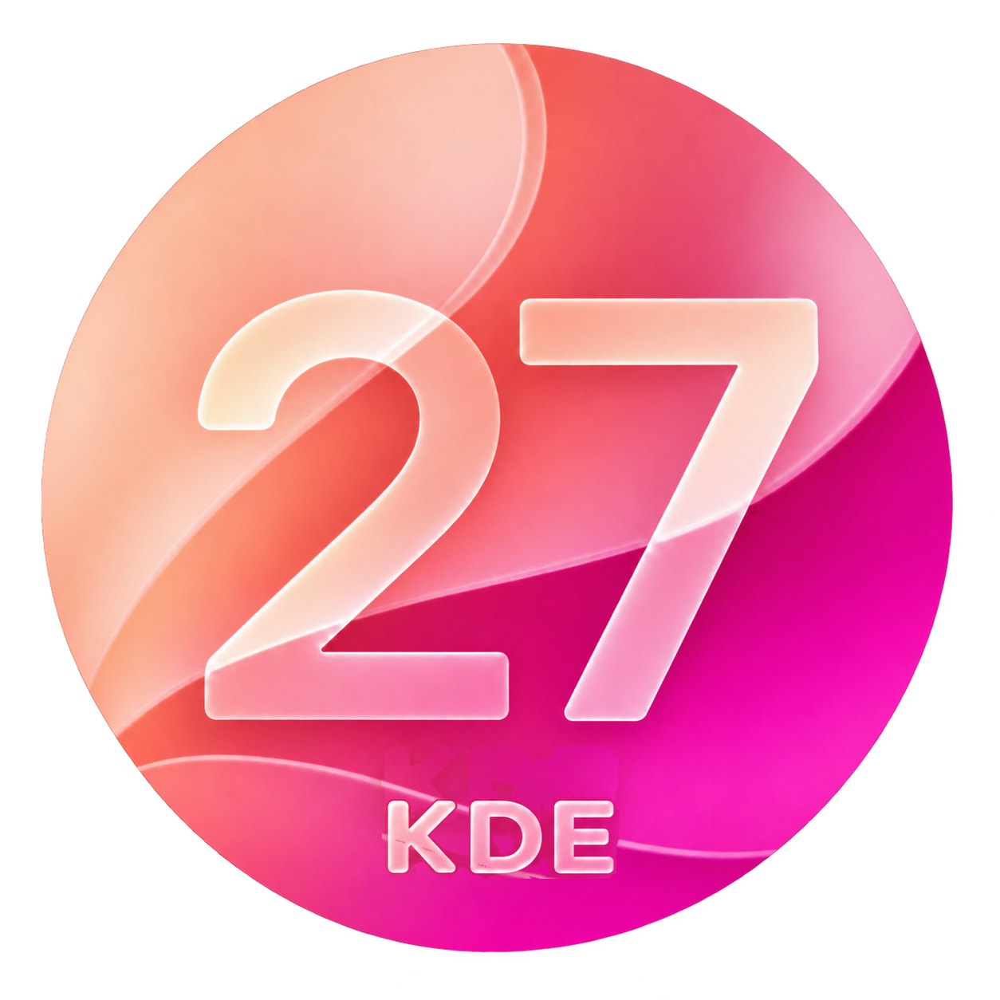
  </picture>
</p>

<h1 align="center">适用于 Linux KDE 桌面的 macOS Golden Gate 外观与操作体验</h1>

<p align="center">
  <a href="README.md" lang="en" hreflang="en">🇺🇸 English</a> ·
  <a href="README.es.md" lang="es" hreflang="es">🇪🇸 Español</a> ·
  <a href="README.zh-CN.md" lang="zh-CN" hreflang="zh-CN" aria-current="page">🇨🇳 简体中文</a> ·
  <a href="README.pt-BR.md" lang="pt-BR" hreflang="pt-BR">🇧🇷 Português (Brasil)</a> ·
  <a href="README.de.md" lang="de" hreflang="de">🇩🇪 Deutsch</a> ·
  <a href="README.fr.md" lang="fr" hreflang="fr">🇫🇷 Français</a>
</p>

<p align="center">
  <a href="https://github.com/lestercorderomurillo/macos-golden-gate-liquid-kde/releases"></a>
  <a href="https://kde.org/plasma-desktop/"></a>
  <a href="LICENSE"></a>
  <a href="https://github.com/lestercorderomurillo/macos-golden-gate-liquid-kde/issues/new"></a>
</p>


<p align="center">
  macOS Golden Gate 风格，适用于 KDE Plasma 6.6、6.7 和 6.8+。
</p>

<p align="center">
  <sub>选择发行版以查看其测试状态。</sub>
</p>

<p align="center">
  <a href="https://github.com/lestercorderomurillo/macos-tahoe-liquid-kde/blob/main/tests/vm/PROOF.md#cachyos" title="CachyOS"></a>
  <a href="https://github.com/lestercorderomurillo/macos-tahoe-liquid-kde/blob/main/tests/vm/PROOF.md#arch" title="Arch Linux"></a>
  <a href="https://github.com/lestercorderomurillo/macos-tahoe-liquid-kde/blob/main/tests/vm/PROOF.md#endeavouros" title="EndeavourOS"></a>
  <a href="https://github.com/lestercorderomurillo/macos-tahoe-liquid-kde/blob/main/tests/vm/PROOF.md#fedora" title="Fedora"></a>
  <a href="https://github.com/lestercorderomurillo/macos-tahoe-liquid-kde/blob/main/tests/vm/PROOF.md#manjaro" title="Manjaro"></a>
  <a href="https://github.com/lestercorderomurillo/macos-tahoe-liquid-kde/blob/main/tests/vm/PROOF.md#artix" title="Artix Linux (OpenRC)"></a>
  <a href="https://github.com/lestercorderomurillo/macos-tahoe-liquid-kde/blob/main/tests/vm/PROOF.md#garuda" title="Garuda Linux"></a>
  <a href="https://github.com/lestercorderomurillo/macos-tahoe-liquid-kde/blob/main/tests/vm/PROOF.md#nobara" title="Nobara Linux"></a>
  <a href="https://github.com/lestercorderomurillo/macos-tahoe-liquid-kde/blob/main/tests/vm/PROOF.md#opensuse" title="openSUSE Tumbleweed"></a>
  <a href="https://github.com/lestercorderomurillo/macos-tahoe-liquid-kde/blob/main/tests/vm/PROOF.md#neon" title="KDE neon"></a>
  <a href="https://github.com/lestercorderomurillo/macos-tahoe-liquid-kde/blob/main/tests/vm/PROOF.md#debian" title="Debian testing / sid (Plasma 6.6+)"></a>
  <a href="https://github.com/lestercorderomurillo/macos-tahoe-liquid-kde/blob/main/tests/vm/PROOF.md#nixos" title="NixOS (experimental)"></a>
</p>

本项目用于自定义 Linux 上 KDE 桌面的外观，不包含任何 Apple 服务，也不会连接到这些服务。如需 Apple 服务，请[直接前往 Apple 官方商店选购](https://www.apple.com/store)。

> [!CAUTION]
> **滚动发布理念**
> 实验性项目。每天接收更新。更新可能破坏兼容性。请避免用于生产系统；[在此报告问题](https://github.com/lestercorderomurillo/macos-golden-gate-liquid-kde/issues/new)。

> [!WARNING]
> **谨防收费的重新打包版本：本主题免费。**
>
> 如果你通过第三方渠道发现本主题，无需付费获取：直接从本仓库下载即可。我们保持项目免费，让所有人都能使用，无需付费。无需购买或订阅。

<br>


错误报告、修复、测试和文档：参阅[贡献指南](CONTRIBUTING.md)。

Tahoe 和 Golden Gate 的代码贡献者及问题报告者：

<p>
  <a href="https://github.com/lestercorderomurillo"></a>
  <a href="https://github.com/yanhenrique-dev"></a>
  <a href="https://github.com/naevui"></a>
  <a href="https://github.com/caioniehues"></a>
  <a href="https://github.com/404-not-found129"></a>
  <a href="https://github.com/myakupozluk"></a>
  <a href="https://github.com/EMS1998"></a>
  <a href="https://github.com/allfritz"></a>
  <a href="https://github.com/elegos"></a>
  <a href="https://github.com/kozeki-uii"></a>
  <a href="https://github.com/imightbelosthere"></a>
  <a href="https://github.com/evaildev"></a>
  <a href="https://github.com/xarblu"></a>
  <a href="https://github.com/PKMNPlatin"></a>
  <a href="https://github.com/matinlotfali"></a>
  <a href="https://github.com/luisbocanegra"></a>
  <a href="https://github.com/OliverChase2003"></a>
  <a href="https://github.com/RoxasYTB"></a>
  <a href="https://github.com/Flagwill"></a>
  <a href="https://github.com/4l3j0Ok"></a>
  <a href="https://github.com/0xrushi"></a>
  <a href="https://github.com/aenriii"></a>
  <a href="https://github.com/andreas399"></a>
  <a href="https://github.com/Andrew-Sor"></a>
  <a href="https://github.com/ardashir77"></a>
  <a href="https://github.com/azizaktas"></a>
  <a href="https://github.com/binary-pleb"></a>
  <a href="https://github.com/bneils"></a>
  <a href="https://github.com/FAYZER77"></a>
  <a href="https://github.com/fxrncyyisingithub"></a>
  <a href="https://github.com/germanbagutteorsomething"></a>
  <a href="https://github.com/iNarrow12"></a>
  <a href="https://github.com/IsaiahSHanson"></a>
  <a href="https://github.com/kuau"></a>
  <a href="https://github.com/Lando0007"></a>
  <a href="https://github.com/LilT59"></a>
  <a href="https://github.com/marcosfantonio"></a>
  <a href="https://github.com/moulikanand12345-lang"></a>
  <a href="https://github.com/nanechi"></a>
  <a href="https://github.com/nousernameget"></a>
  <a href="https://github.com/OpalSand"></a>
  <a href="https://github.com/P0sixSplo1t-2"></a>
  <a href="https://github.com/rokan00"></a>
  <a href="https://github.com/RussH"></a>
  <a href="https://github.com/Salkio"></a>
  <a href="https://github.com/Shivamingale3"></a>
  <a href="https://github.com/shoko3756"></a>
  <a href="https://github.com/Sonicx9876"></a>
  <a href="https://github.com/Tias-dev"></a>
  <a href="https://github.com/txhammer68"></a>
  <a href="https://github.com/vanshdev0101"></a>
  <a href="https://github.com/vialolis"></a>
  <a href="https://github.com/Whiddu"></a>
  <a href="https://github.com/yingmanwumen"></a>
  <a href="https://github.com/yofriendfromschool1"></a>
  <a href="https://github.com/zhaokelei"></a>
</p>

<br>


### Golden Gate Finder (Alpha)

采用 Golden Gate 玻璃效果的 Finder 风格文件浏览。

<p align="center">
  <a href="src/screenshots/previews/readme-golden-gate-light-finder-362858f81e2b.webp"></a>
  <a href="src/screenshots/previews/readme-golden-gate-dark-finder-b835bc92a197.webp"></a>
</p>

<details>
<summary><strong>浅色和深色模式下的红色与蓝色强调色</strong></summary>

<table>
<tr><th>强调色</th><th>浅色</th><th>深色</th></tr>
<tr><td>蓝色</td><td><a href="src/screenshots/previews/readme-golden-gate-light-finder-blue-362858f81e2b.webp"></a></td><td><a href="src/screenshots/previews/readme-golden-gate-dark-finder-blue-b835bc92a197.webp"></a></td></tr>
<tr><td>红色</td><td><a href="src/screenshots/previews/readme-golden-gate-light-finder-red-64f13f0002bb.webp">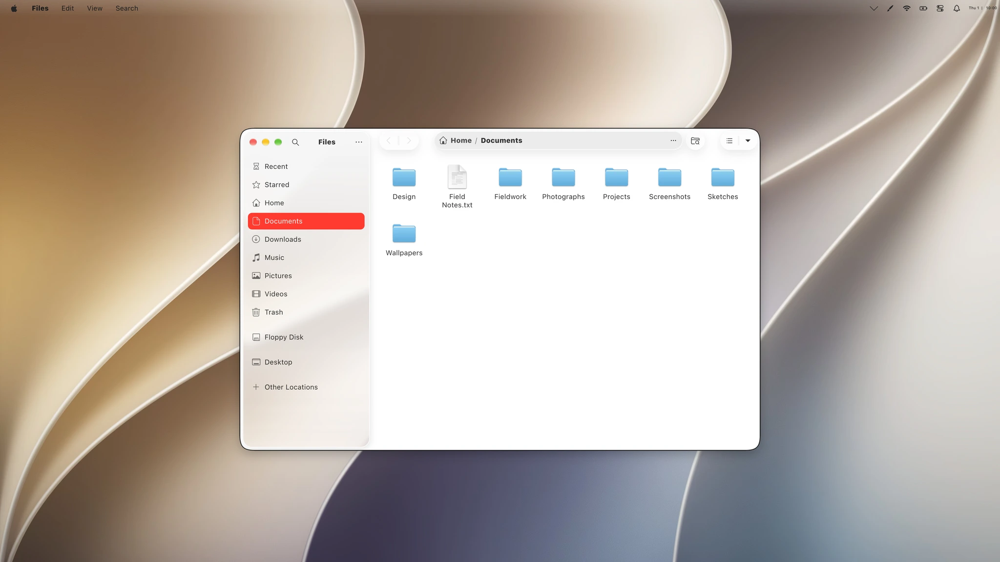</a></td><td><a href="src/screenshots/previews/readme-golden-gate-dark-finder-red-928d44f325a4.webp">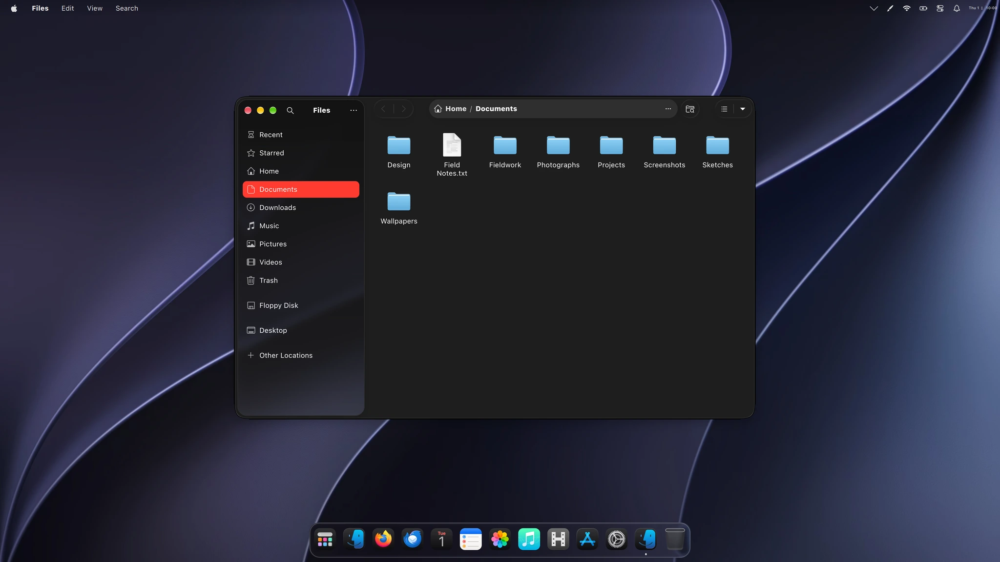</a></td></tr>
</table>

</details>

<br>

### Golden Gate Launchpad (Alpha)

查找应用、浏览分类，让收藏触手可及。应用网格在浅色和深色模式下分别使用半透明的白色和黑色磨砂玻璃。两种模式的搜索框均使用相同的黑金渐变。

<p align="center">
  
  
</p>

<br>

### Golden Gate Dock (Alpha)

玻璃折射、悬停放大、红色通知计数气泡和自动隐藏。

<p align="center">
  <strong>Light</strong><br>
  <a href="src/screenshots/previews/readme-golden-gate-light-dock-regular-ab3f15dc4638.webp">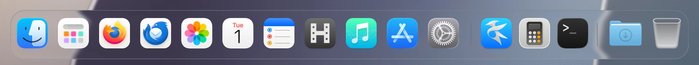</a>
</p>

<p align="center">
  <strong>Dark</strong><br>
  <a href="src/screenshots/previews/readme-golden-gate-dark-dock-regular-10bd3f5e3f7a.webp">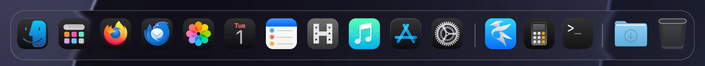</a>
</p>

<p align="center">
  <strong>Clear Light</strong><br>
  <a href="src/screenshots/previews/readme-golden-gate-light-dock-clear-90ade834a80a.webp">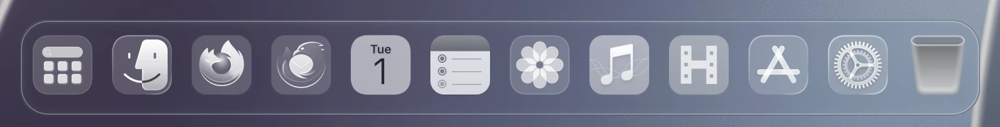</a>
</p>

<p align="center">
  <strong>Clear Dark</strong><br>
  <a href="src/screenshots/previews/readme-golden-gate-dark-dock-clear-168be084ef75.webp">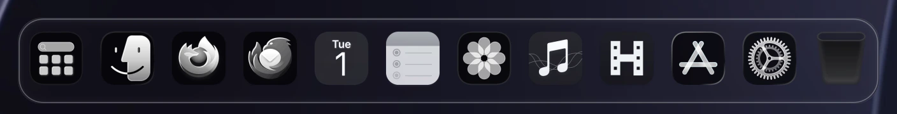</a>
</p>

<p align="center">
  <strong>Blue Light</strong><br>
  <a href="src/screenshots/previews/readme-golden-gate-light-dock-blue-66f49f74fb75.webp">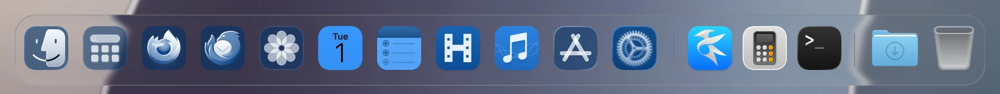</a>
</p>

<p align="center">
  <strong>Blue Dark</strong><br>
  <a href="src/screenshots/previews/readme-golden-gate-dark-dock-blue-42692e6defe8.webp">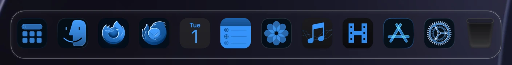</a>
</p>

<p align="center">
  <strong>Purple Light</strong><br>
  <a href="src/screenshots/previews/readme-golden-gate-light-dock-purple-f505c90f757a.webp">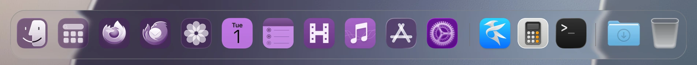</a>
</p>

<p align="center">
  <strong>Purple Dark</strong><br>
  <a href="src/screenshots/previews/readme-golden-gate-dark-dock-purple-de2ddd0fdac7.webp">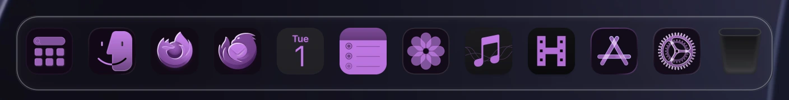</a>
</p>

<p align="center">
  <strong>Pink Light</strong><br>
  <a href="src/screenshots/previews/readme-golden-gate-light-dock-pink-8a5dddb388f5.webp">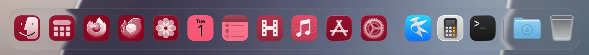</a>
</p>

<p align="center">
  <strong>Pink Dark</strong><br>
  <a href="src/screenshots/previews/readme-golden-gate-dark-dock-pink-35b9f3ee83b9.webp">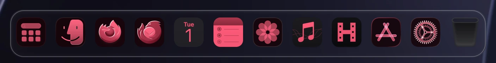</a>
</p>

<p align="center">
  <strong>Red Light</strong><br>
  <a href="src/screenshots/previews/readme-golden-gate-light-dock-red-4f92758a9626.webp">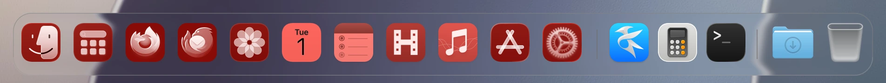</a>
</p>

<p align="center">
  <strong>Red Dark</strong><br>
  <a href="src/screenshots/previews/readme-golden-gate-dark-dock-red-95f297477353.webp">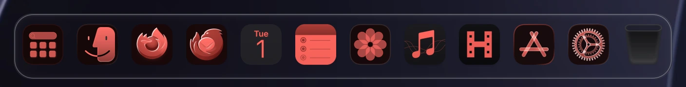</a>
</p>

<p align="center">
  <strong>Orange Light</strong><br>
  <a href="src/screenshots/previews/readme-golden-gate-light-dock-orange-9a56e2ebccdf.webp">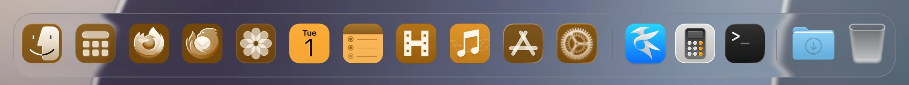</a>
</p>

<p align="center">
  <strong>Orange Dark</strong><br>
  <a href="src/screenshots/previews/readme-golden-gate-dark-dock-orange-cf8fa5dc1f63.webp">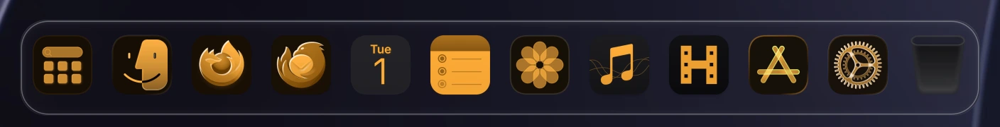</a>
</p>

<p align="center">
  <strong>Yellow Light</strong><br>
  <a href="src/screenshots/previews/readme-golden-gate-light-dock-yellow-2acdddb4feb4.webp">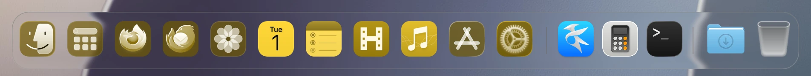</a>
</p>

<p align="center">
  <strong>Yellow Dark</strong><br>
  <a href="src/screenshots/previews/readme-golden-gate-dark-dock-yellow-9dcd8b6de570.webp"></a>
</p>

<p align="center">
  <strong>Green Light</strong><br>
  <a href="src/screenshots/previews/readme-golden-gate-light-dock-green-0feca8496131.webp">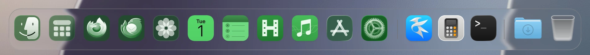</a>
</p>

<p align="center">
  <strong>Green Dark</strong><br>
  <a href="src/screenshots/previews/readme-golden-gate-dark-dock-green-524aa37bd27b.webp">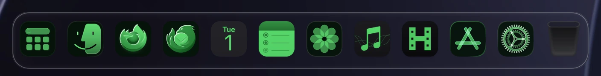</a>
</p>

<p align="center">
  <strong>Gray Light</strong><br>
  <a href="src/screenshots/previews/readme-golden-gate-light-dock-gray-fed59e6cbc46.webp">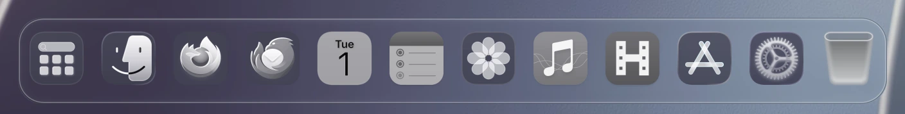</a>
</p>

<p align="center">
  <strong>Gray Dark</strong><br>
  <a href="src/screenshots/previews/readme-golden-gate-dark-dock-gray-0e1e1330d670.webp">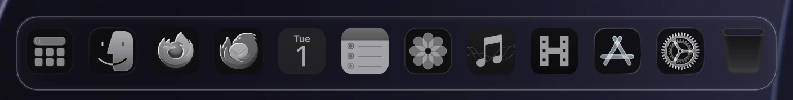</a>
</p>

<br>

### Golden Gate Shell (Alpha)

文件、编辑等菜单随当前窗口切换。系统菜单可打开设置和会话控制。

<p align="center">
  
  
</p>

<br>

### Golden Gate 日历 (Alpha)

点击面板时钟即可打开玻璃背景的月历。滚动鼠标滚轮或使用方向键切换月份，按 Home 键返回本月。

<p align="center">
  
  
</p>

<br>

### Golden Gate 控制中心 (Alpha)

Wi-Fi、声音、亮度和通知集中在一个玻璃菜单中。外观按钮用太阳表示浅色模式，用月亮表示深色模式，用双色圆形表示自动模式。

<p align="center">
  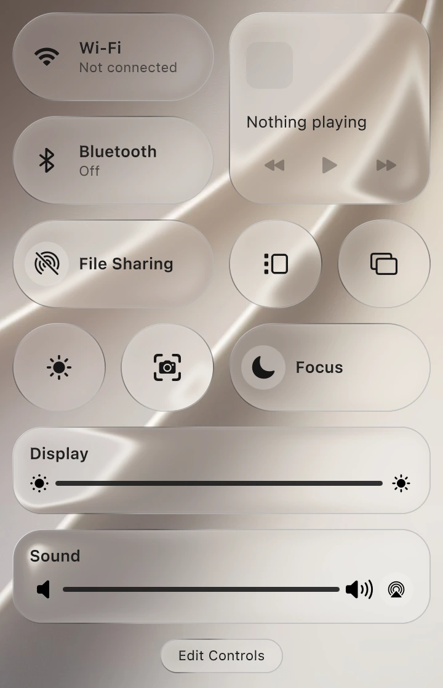
  
</p>

<p align="center">
  <strong>Wi-Fi</strong><br>
  
  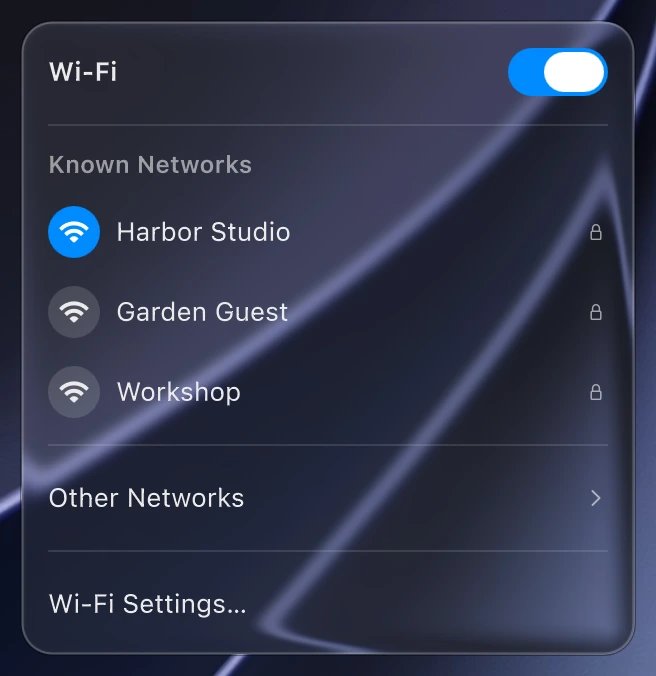
</p>

<p align="center">
  <strong>电池</strong><br>
  
  
</p>

<br>

### Golden Gate 通知 (Alpha)

玻璃质感的通知横幅和分组历史记录，支持应用操作和直接回复。

<p align="center">
  
  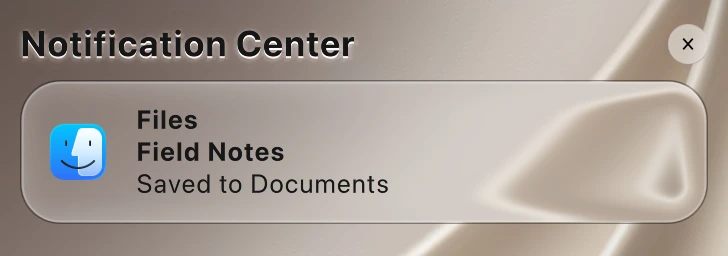
  
  
</p>

<br>

### Golden Gate 剪贴板历史 (Alpha)

直接在 Launchpad 中查找并复用复制的文字和图片。

<p align="center">
  
  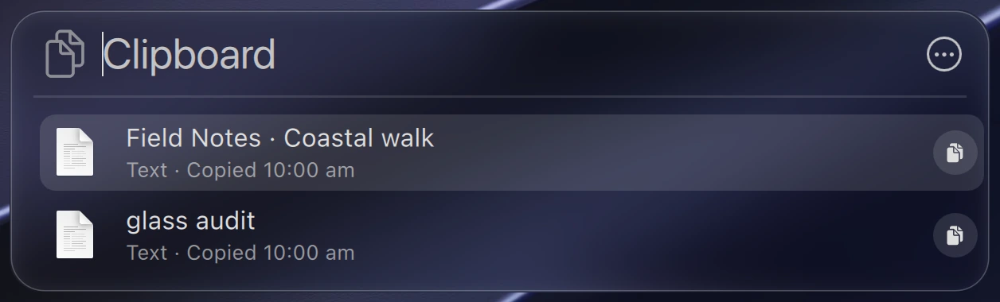
</p>

<br>

### Golden Gate 系统信息 (Alpha)

硬件、软件和主题信息，文字颜色随背景调整。

<p align="center">
  
  
</p>

<br>

### Golden Gate Plasma 主题 (Alpha)

采用协调浅色和深色配色的半透明菜单与弹出窗口。

<p align="center">
  
  
</p>

<br>

### Golden Gate 启动画面 (Alpha)

从启动到关机保持一致外观，内置 LUKS2 加密磁盘解锁功能。

<p align="center">
  
</p>

<br>


- **语言：**安装程序支持英语、西班牙语、简体中文、巴西葡萄牙语、德语和法语；Plasma 组件已翻译。
- **安装程序：**图形化组件选择、随附主题资源和更新支持。
- **发行版：**为基于 Arch、基于 Fedora、openSUSE、Debian 和 KDE neon 的系统安装依赖。
- **调度：**通过 systemd 用户定时器或 OpenRC 上的 cron 自动切换主题并提供 OLED 保护。
- **玻璃特效：**浅色和深色模式下可调节的模糊、折射和三色渐变。
- **兼容性：**Plasma 6.6–6.8，原生特效根据已安装的 Qt 和 KWin 版本编译。
- **Launchpad：**两种布局、内嵌或独立搜索、收藏和可滚动应用分类。
- **Dock：**悬停放大、通知徽章、自动隐藏，重新安装时保留固定项。 多屏时，指针需在另一屏幕底边停留 2 秒 Dock 才会移过去，避免点击窗口底部时 Dock 挡住窗口。 Dock 始终显示时保持悬浮和圆角：在其屏幕上最大化的窗口会停在 Dock 正上方，Dock 则贴紧屏幕底边，与 macOS 一致。
- **菜单栏** 多屏时所有菜单栏保持一致：显示或隐藏托盘图标、更改小组件设置（时钟、苹果菜单、控制中心）会应用到每个屏幕的菜单栏。添加、移除或移动小组件仍只作用于单个菜单栏。
- **外观：**桌面、应用、图标和窗口装饰的浅色/深色风格同步；每个显示器独立壁纸。
- **应用集成：**全局菜单、GTK 菜单修复、Finder 风格 Nautilus，以及带配置备份的 Firefox 主题。
- **恢复：**要求检查、设置备份和卸载还原。
- **可选功能：**OLED 面板位移，以及实验性 NixOS 和 Home Manager 模块。
- **测试：**回归测试、发行版容器和 Plasma 虚拟机。

<br>


下载并打开安装程序：

```bash
git clone --filter=blob:none https://github.com/lestercorderomurillo/macos-golden-gate-liquid-kde.git
cd macos-golden-gate-liquid-kde
./installer
```

选择 **Express** 进行安装。再次打开 `./installer` 即可更新或卸载。

释放磁盘空间并保留 Git 工作副本和本地工作：

```bash
./installer --free-space
```

| 安装程序语言 | 状态 |
| --- | --- |
| 🇺🇸 英语 |  |
| 🇪🇸 西班牙语 |  |
| 🇨🇳 简体中文 |  |
| 🇧🇷 巴西葡萄牙语 |  |
| 🇩🇪 德语 |  |
| 🇫🇷 法语 |  |
| 🇮🇹 意大利语 |  |
| 🇯🇵 日语 |  |
| 🇰🇷 韩语 |  |
| 🇷🇺 俄语 |  |
| 🇸🇦 阿拉伯语 |  |
| 🇮🇳 印地语 |  |
| 🇳🇱 荷兰语 |  |
| 🇵🇱 波兰语 |  |
| 🇹🇷 土耳其语 |  |

<details>
<summary><b>系统要求</b></summary>

所需的桌面环境、构建工具和系统软件包。

- KDE Plasma 6.6+
- Python 3.10+ 和 PyQt6
- `sudo`
- Qt 6 开发工具
- 用于编译型 Plasma 组件和 KWin 特效的 KDE 与 Qt 6 开发包
- `cmake`, `g++`，以及 `pkg-config`（选择编译功能时）
- `dbus-send`
- `systemctl` 或 `crontab`（用于计划功能）

下载文件、缺失依赖和可选的 KDE Rounded Corners 需要网络连接。

| 发行版 | Qt 6 工具 | KDE Plasma 6 开发包 |
|--------|------------|-----------------------------------|
| Arch 系列 | `pacman -S qt6-tools` | `pacman -S extra-cmake-modules plasma-workspace kdecoration libplasma libnotificationmanager libksysguard plasma-activities-stats` |
| Fedora 系列 | `dnf install qt6-qttools-devel` | `dnf install extra-cmake-modules plasma-workspace-devel kdecoration-devel libplasma-devel knotifications-devel libksysguard-devel kf6-plasma-activities-devel` |
| openSUSE Tumbleweed | `zypper install qt6-tools-devel` | `zypper install extra-cmake-modules plasma6-workspace-devel kdecoration-devel libKF6Plasma-devel libnotificationmanager6-devel libksysguard6-devel libKF6PlasmaActivitiesStats6-devel` |

</details>

<details>
<summary><b>OLED 保护</b></summary>

可选的面板位移；默认关闭。

在 **OLED 保护** 页面启用。在此选择位移间隔和最大像素位移；默认关闭。

**手动控制**

```bash
mac-tahoe-oled-care shift
mac-tahoe-oled-care restore
mac-tahoe-oled-care status
```

</details>

<details>
<summary><b>在虚拟机中测试</b></summary>

在隔离的 Plasma 桌面中试用主题。

```bash
./vm <os>
```

**OS:** `cachyos` · `arch` · `manjaro` · `endeavouros` · `garuda` · `fedora` · `nobara` · `opensuse` · `neon` · `debian` · `artix` · `kubuntu`

`all` 启动所有发行版。[虚拟机设置与验证指南](https://github.com/lestercorderomurillo/macos-tahoe-liquid-kde/blob/main/tests/vm/README.md)。

`./vm kubuntu` 启动以 SHA-256 固定的 Kubuntu 26.04.1 LTS ISO；配置来宾后使用回环 SSH 端口 `2234`。此启动器回归测试目标尚待完整的实际运行验证。

</details>


<br>


检查你的发行版、初始化系统和 Plasma 版本的支持情况。

<details>
<summary><b>发行版</b></summary>

此表中的全部 11 个发行版均通过实际虚拟机验证。选择状态徽章以查看已审阅截图和测试结果。

| | 名称 | 状态 |
|:--:|------|---------|
|  | CachyOS | [](https://github.com/lestercorderomurillo/macos-tahoe-liquid-kde/blob/main/tests/vm/PROOF.md#cachyos) |
|  | Arch Linux | [](https://github.com/lestercorderomurillo/macos-tahoe-liquid-kde/blob/main/tests/vm/PROOF.md#arch) |
|  | EndeavourOS | [](https://github.com/lestercorderomurillo/macos-tahoe-liquid-kde/blob/main/tests/vm/PROOF.md#endeavouros) |
|  | Fedora | [](https://github.com/lestercorderomurillo/macos-tahoe-liquid-kde/blob/main/tests/vm/PROOF.md#fedora) |
|  | Manjaro | [](https://github.com/lestercorderomurillo/macos-tahoe-liquid-kde/blob/main/tests/vm/PROOF.md#manjaro) |
|  | Artix Linux (OpenRC) | [](https://github.com/lestercorderomurillo/macos-tahoe-liquid-kde/blob/main/tests/vm/PROOF.md#artix) |
|  | Garuda Linux | [](https://github.com/lestercorderomurillo/macos-tahoe-liquid-kde/blob/main/tests/vm/PROOF.md#garuda) |
|  | Nobara | [](https://github.com/lestercorderomurillo/macos-tahoe-liquid-kde/blob/main/tests/vm/PROOF.md#nobara) |
|  | openSUSE Tumbleweed | [](https://github.com/lestercorderomurillo/macos-tahoe-liquid-kde/blob/main/tests/vm/PROOF.md#opensuse) |
|  | KDE neon | [](https://github.com/lestercorderomurillo/macos-tahoe-liquid-kde/blob/main/tests/vm/PROOF.md#neon) |
|  | Debian testing / sid (Plasma 6.6+) | [](https://github.com/lestercorderomurillo/macos-tahoe-liquid-kde/blob/main/tests/vm/PROOF.md#debian) |

</details>

<details>
<summary><b>初始化系统</b></summary>

自动主题切换和 OLED 保护使用以下调度后端：

| 初始化系统 | 调度 | 已记录测试 |
| --- | --- | --- |
| systemd | 用户定时器 |  |
| OpenRC | 用户 cron |  |
| dinit | 用户 cron |   |

OpenRC 和 dinit 需要运行中的 cron 守护进程。
[桌面测试结果](https://github.com/lestercorderomurillo/macos-tahoe-liquid-kde/blob/main/tests/vm/PROOF.md) · [dinit 调度检查](https://github.com/lestercorderomurillo/macos-tahoe-liquid-kde/blob/main/CONTRIBUTING.md#setup)。

</details>

<details>
<summary><b>Plasma 版本</b></summary>

支持 Plasma 6.6–6.8；编译特效使用宿主 SDK。

| Plasma | 支持 | 起始版本 |
|--------|---------|-------|
| 6.5 及更早版本 |  | 不适用 |
| 6.6 |  | v0.1.0 |
| 6.7 |  | v0.19.0 |
| 6.8 |  | v0.54.1 |

</details>

<br>


目前可用的功能和计划添加的内容。

<details>
<summary><b>组件状态</b></summary>

各组件的当前状态。

| 组件 | 状态 |
|-----------|--------|
| 配色方案 |  |
| 壁纸 |  |
| 字体 |  |
| 光标 |  |
| Plasma 主题 |  |
| Kvantum 主题 |  |
| GTK 主题 |  |
| Acrylic Glass |  |
| KDE Rounded Corners |  |
| 自动主题切换器 |  |
| OLED 保护 |  |
| 安装程序界面 |  |
| 本地化 |  |
| Aurorae 装饰 |  |
| 全局菜单 |  |
| Dock |  |
| Finder 风格 Nautilus |  |
| Launchpad |  |
| Shell |  |
| 剪贴板历史 |  |
| 系统信息 |  |
| 回收站 |  |
| 声音 |  |
| 启动画面 |  |
| 关机画面 |  |
| Firefox 主题 |  |
| 图标 |  |
| 多发行版支持 |  |
| OpenRC 测试 |  |
| Konsole 主题 |  |
| Kate 主题 |  |
| SDDM 主题 |  |
| 日历 |  |
| 控制中心、Wi-Fi、电池和通知 |  |
| 系统偏好设置 |  |
| 操作系统选择器 |  |

</details>

<br>

**[报告错误](https://github.com/lestercorderomurillo/macos-golden-gate-liquid-kde/issues/new)**，或使用 **Apple 菜单 → 关于本机 → 报告错误…**。

请提供：

- 你的 Plasma 版本： `plasmashell --version`
- 你的发行版： `grep PRETTY_NAME /etc/os-release`
- **关于本机**中显示的主题版本
- 显示问题的截图或录屏

请保持拉取请求范围集中，并使用 `./vm` 验证。参阅 [CONTRIBUTING.md](https://github.com/lestercorderomurillo/macos-tahoe-liquid-kde/blob/main/CONTRIBUTING.md)。

共享的[图标生成工具集](https://github.com/lestercorderomurillo/macos-tahoe-liquid-kde/blob/main/CONTRIBUTING.md#icon-generation-toolset)基于 Tahoe 随附图标创建浅色、深色、单色和半透明玻璃外观，支持任意 RGB 色调。从 Tahoe 工作副本运行 `./icon-toolset`，可为任一版本离线生成、预览、验证和打包图标。所有图标实现和资源均保留在 Tahoe 中。

<br>


这是受 macOS 美学启发的独立重新实现。与 Apple 或 KDE 无关联，也未获其背书。“macOS”和“Apple”是 Apple Inc. 的商标。

macOS 27 徽标、随附壁纸、系统声音及 SF Pro / SF Mono 字体仍属于 Apple，不受本项目许可证覆盖。其他组件保留各自许可证和版权声明；有关范围及已知来源缺口，请参阅下方第三方声明索引。

整体以 [GPL-3.0](LICENSE) 授权；各组件许可证和第三方权利仍适用。请参阅[版权声明](NOTICE)、[许可与项目身份](LICENSING.md)及[第三方声明](THIRD_PARTY_NOTICES.md)。

<br>


项目参考与第三方组件：

- **[EliverLara](https://github.com/EliverLara/TahoeLauncher)**: `TahoeLauncher`: Launchpad 设计参考。
- **[vinceliuice](https://github.com/vinceliuice)**: `MacTahoe-icon-theme`: 基础图标和光标；GTK 设计参考。
- **[taj-ny](https://github.com/taj-ny/kwin-effects-forceblur)** 和 **[4v3ngR](https://github.com/4v3ngR/kwin-effects-glass)**: Better Blur 及其玻璃分支：Acrylic Glass 使用的上游代码。
- **[luisbocanegra](https://github.com/luisbocanegra/plasma-panel-colorizer)**: `plasma-panel-colorizer`, 离线随附，用于为面板着色。
- **[Matin Lotfaliei](https://github.com/matinlotfali/KDE-Rounded-Corners)**: `KDE-Rounded-Corners`, 基于宿主 KWin SDK 构建的 KWin 窗口圆角特效。
- **[ful1e5](https://github.com/ful1e5)**: `apple_cursor`: 替代光标设计参考。
- **[sahibjotsaggu](https://github.com/sahibjotsaggu)**: `San-Francisco-Pro-Fonts`: SF Pro / SF Mono 包的来源。
- **[Lucide](https://github.com/lucide-icons/lucide)**: 全局菜单随附的复制图标。
- **[512pixels.net](https://512pixels.net/projects/default-mac-wallpapers-in-5k/)**: 高分辨率 macOS 壁纸档案。

受 macOS 美学启发的独立重新实现，与 Apple 无关联，也未获其背书。“macOS”和“Apple”是 Apple Inc. 的商标；随附壁纸和 SF 字体仍属于 Apple。以 GPL-3.0 授权。


[安装程序截图与测试](TESTING.md)。
