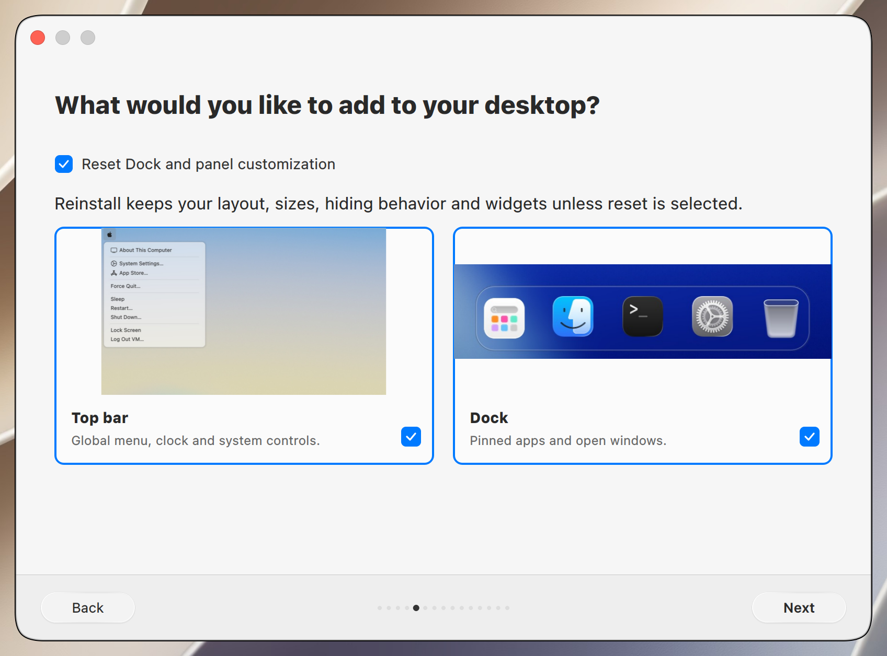
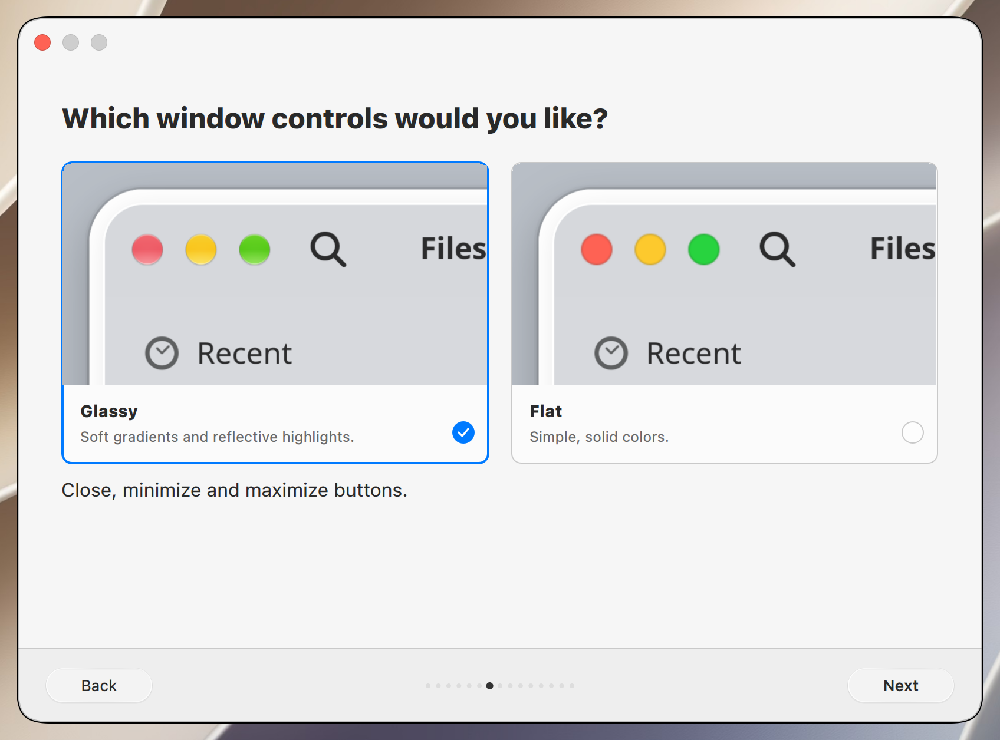
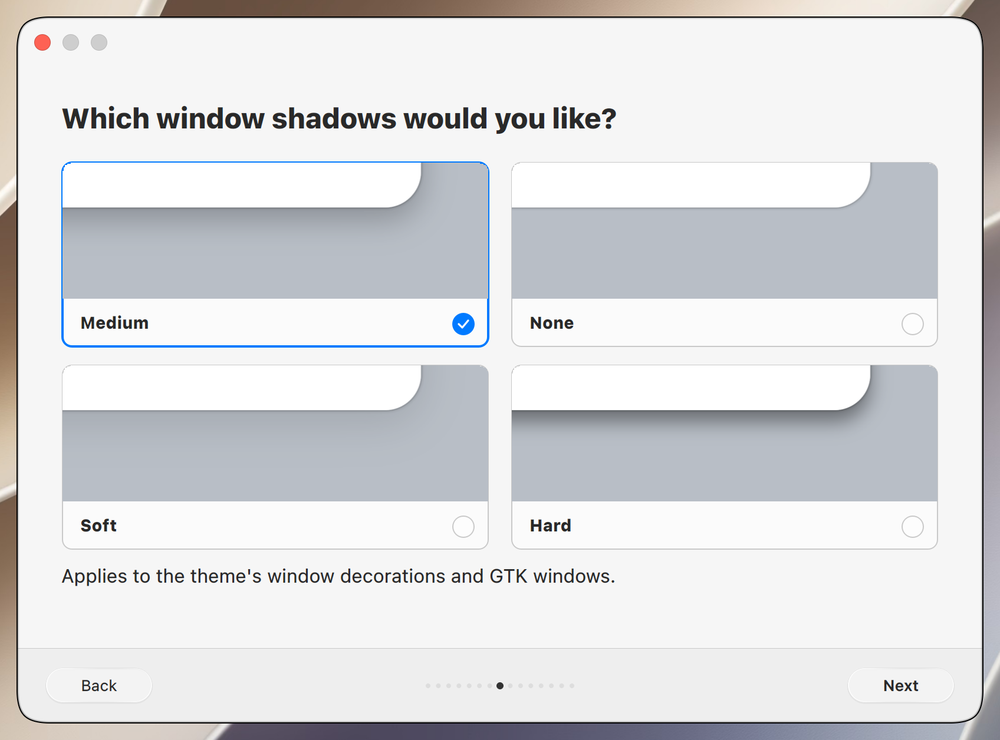
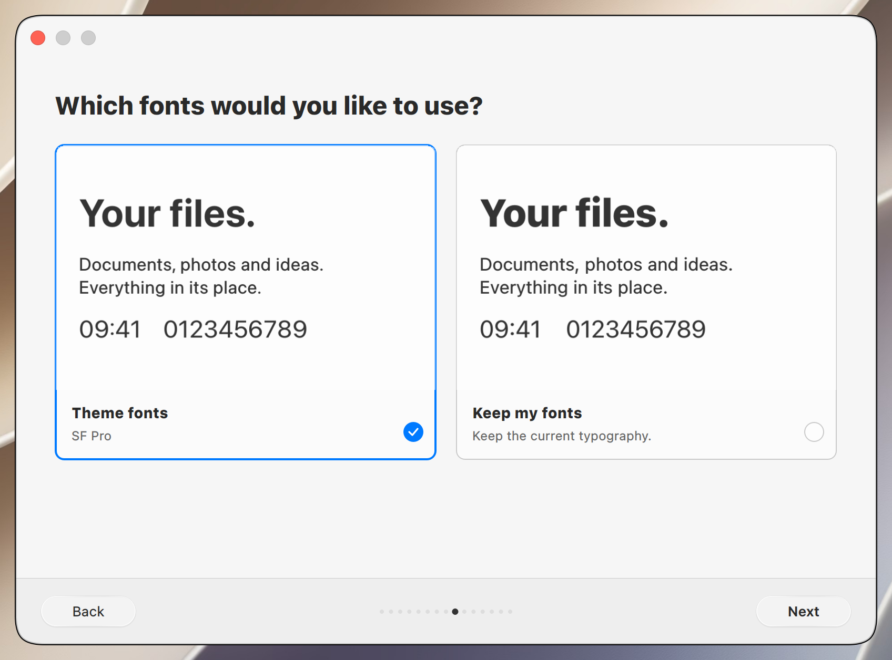
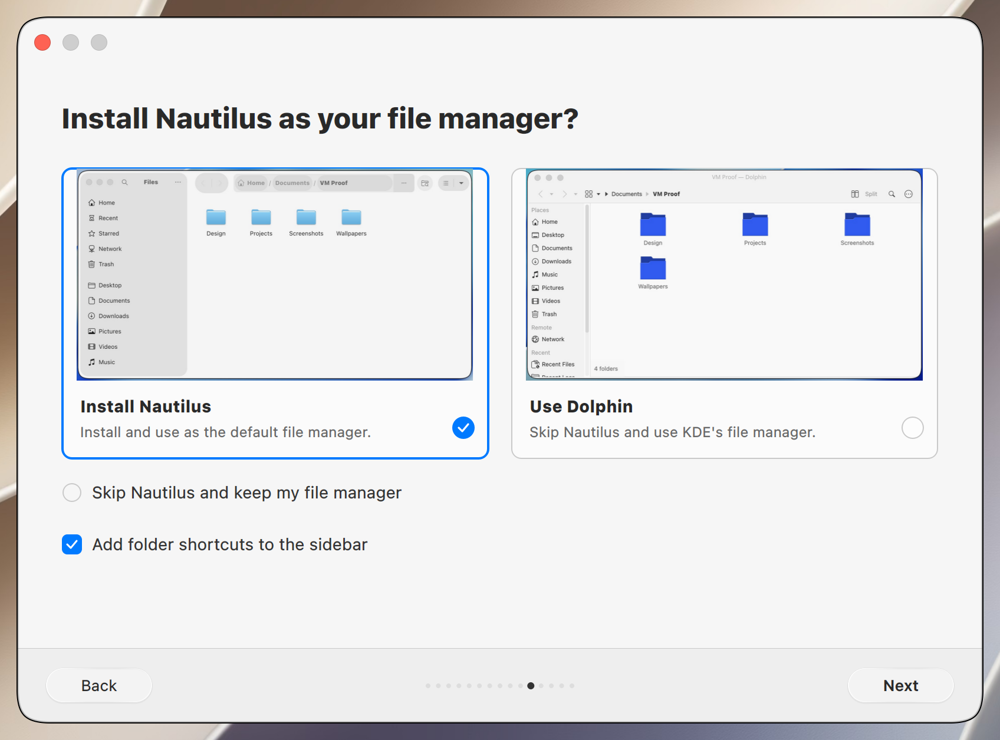
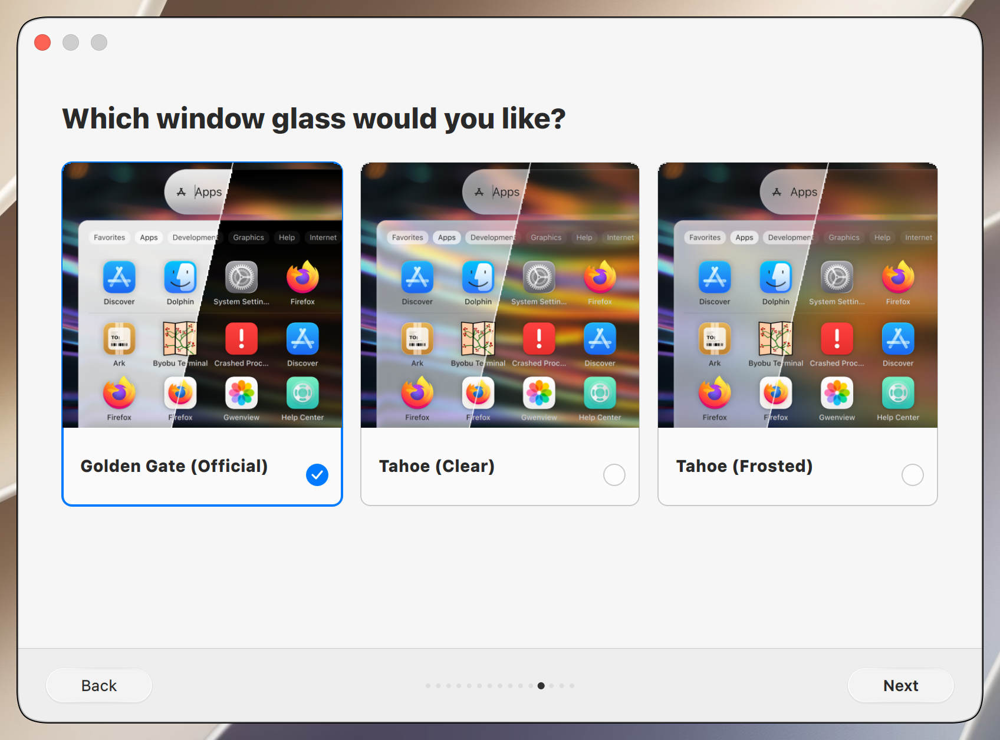
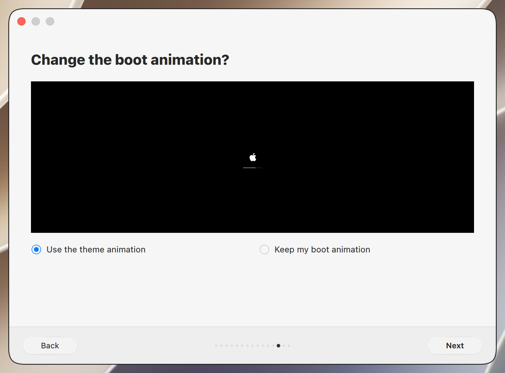
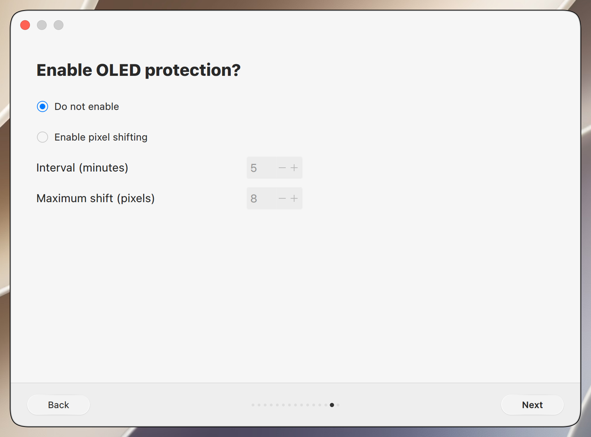
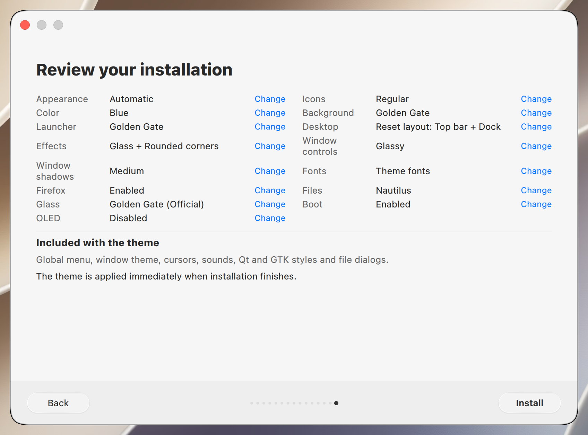

# Installer testing

Golden Gate **v0.63rc2** uses Golden Gate (Official), with a three-stop
gradient and separate light/dark colors. Tahoe (Clear) and Tahoe (Frosted)
remain available in Acrylic Glass settings. The Dock retains fixed v0.62.0
optics independently of window presets and fine tuning; existing blur fixes
and retired controls remain preserved.

The wrapper suite passed **97 tests**. Tahoe's focused screenshot-provenance
and glass-step checks passed **54 tests**, covering selective recapture, original
image provenance and light/dark/automatic previews. Popup fill checks passed
for the more transparent light fill and stronger black dark fill. Shader and
gradient values are unchanged. Seven targeted regression checks also passed for
RC version reading, update ordering, candidate-to-candidate and candidate-to-stable
automatic updates, the installed About version and selective version-frame capture. See the [preset gallery](GLASS_PRESETS.md) for all surface
and fine-tuning values with light/dark photographs. Captures use the pinned
Plasma 6.8.1 VM and do not establish new live qualification on other versions.
The [v0.62 rendering report](https://github.com/lestercorderomurillo/macos-tahoe-liquid-kde/blob/v0.62.0/tests/native/acrylic_glass_062.md)
retains its original version-specific Wayland/X11 evidence.

The photographs below use the pinned disposable VM capture recipe and retain
reviewed, content-hashed provenance. Exact release commits require passing
push CI on both main and dev in both repositories.

## Installation steps

Scroll horizontally through the installation steps.

<table>
<tr>
  <td align="center"> Welcome</td>
  <td align="center"> Appearance</td>
  <td align="center"> Icons and color</td>
  <td align="center"> Wallpaper</td>
  <td align="center"> Launcher</td>
  <td align="center"> Top bar and Dock</td>
  <td align="center"> Effects</td>
  <td align="center"> Window controls</td>
  <td align="center"> Window shadows</td>
  <td align="center"> Fonts</td>
  <td align="center"> Firefox</td>
  <td align="center"> File manager</td>
  <td align="center"> Window glass</td>
  <td align="center"> Boot animation</td>
  <td align="center"> OLED protection</td>
  <td align="center"> Summary</td>
</tr>
</table>
