# Installer testing

Golden Gate **v0.69.0** uses original Apple glyph outlines for the system-menu symbols.
Tahoe shows an icon on every action; Golden Gate shows only About, System Settings
and App Store. The active theme selects this preset across light/dark transitions,
independently of the Launcher preset. The existing App Store drawing is retained.

The native renderer, live cached-menu preset changes and shortcut interactions
pass in an isolated Arch SDK/X11 environment. Both editions passed installation
and reinstallation in disposable KDE neon Plasma/KWin 6.8.1 Wayland VMs, with
four reviewed menu captures. The full remote matrix remains asynchronous.
See [release evidence](release-evidence.json) and the
[original-font glyph provenance](https://github.com/lestercorderomurillo/macos-tahoe-liquid-kde/blob/6f515f188b86db6ee6f997eedee0c669c4c02a36/src/offline/plasmoids/org.kde.mac.tahoe.liquid.globalmenu/systemmenusymbols.json).

[Light menu](src/screenshots/menu_v1-4ccac1191586.webp) · [Dark menu](src/screenshots/menu_dark_v1-e6cda19d04cd.webp) · [Capture provenance](src/screenshots/previews/system-menu-golden-gate-069-provenance-a2ffe6af504b.json)

The README About, Finder and top bar photographs retain their v0.67.0 source from a
disposable VM. Other desktop images and the installer gallery retain their original
reviewed provenance ([capture records](src/screenshots/release-capture.json)). The retained v0.66.2 About previews show the corrected labels
in both modes ([provenance](src/screenshots/previews/about-buttons-provenance.json)).

[Light preview](src/screenshots/previews/about-buttons-light-23dd8b3e3837.png) · [Dark preview](src/screenshots/previews/about-buttons-dark-2e4c5cf8099c.png)

## Installation steps

Scroll horizontally through the installation steps.

<table>
<tr>
  <td align="center"> Welcome</td>
  <td align="center"> Appearance</td>
  <td align="center"> Icons and color</td>
  <td align="center">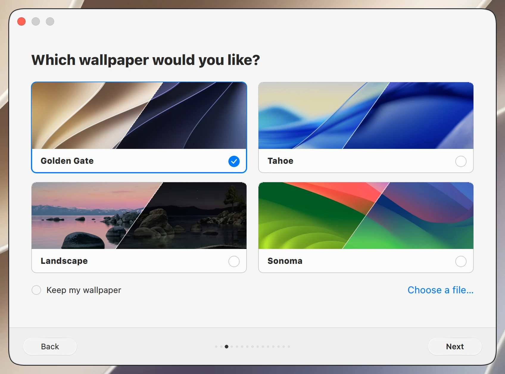 Wallpaper</td>
  <td align="center">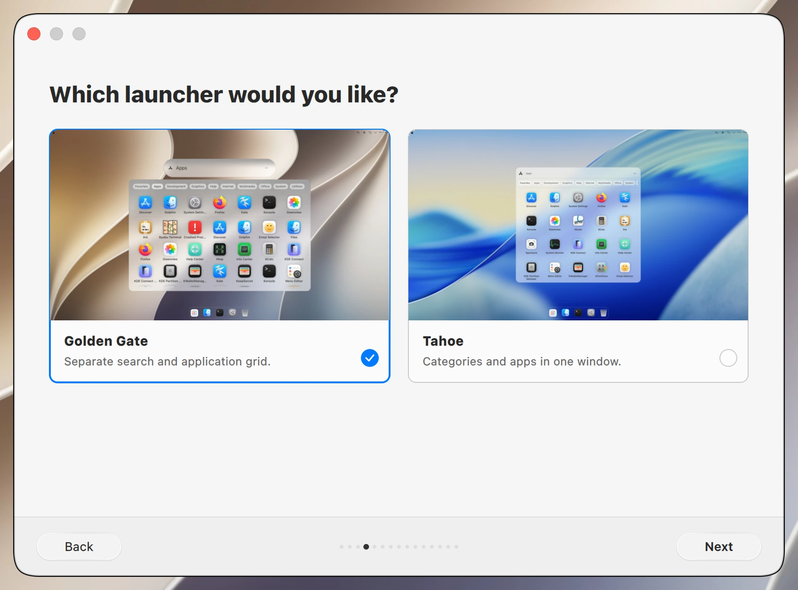 Launcher</td>
  <td align="center">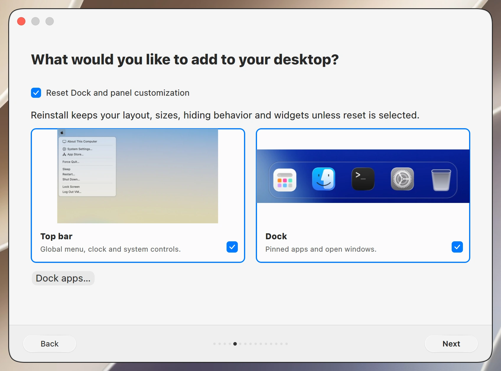 Top bar and Dock</td>
  <td align="center">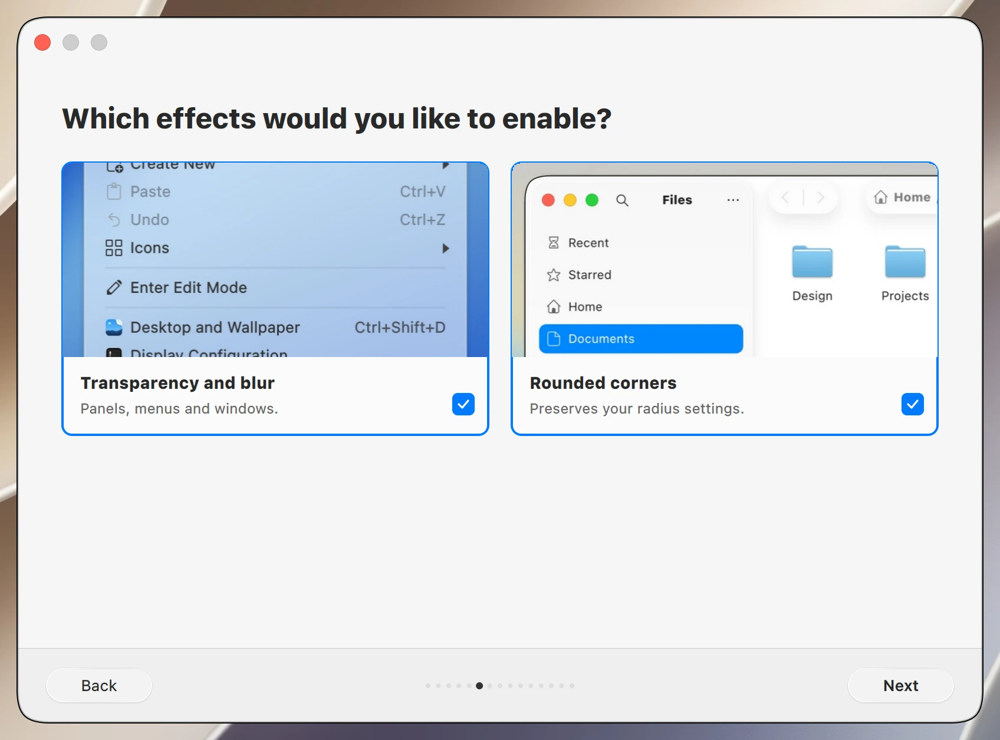 Effects</td>
  <td align="center">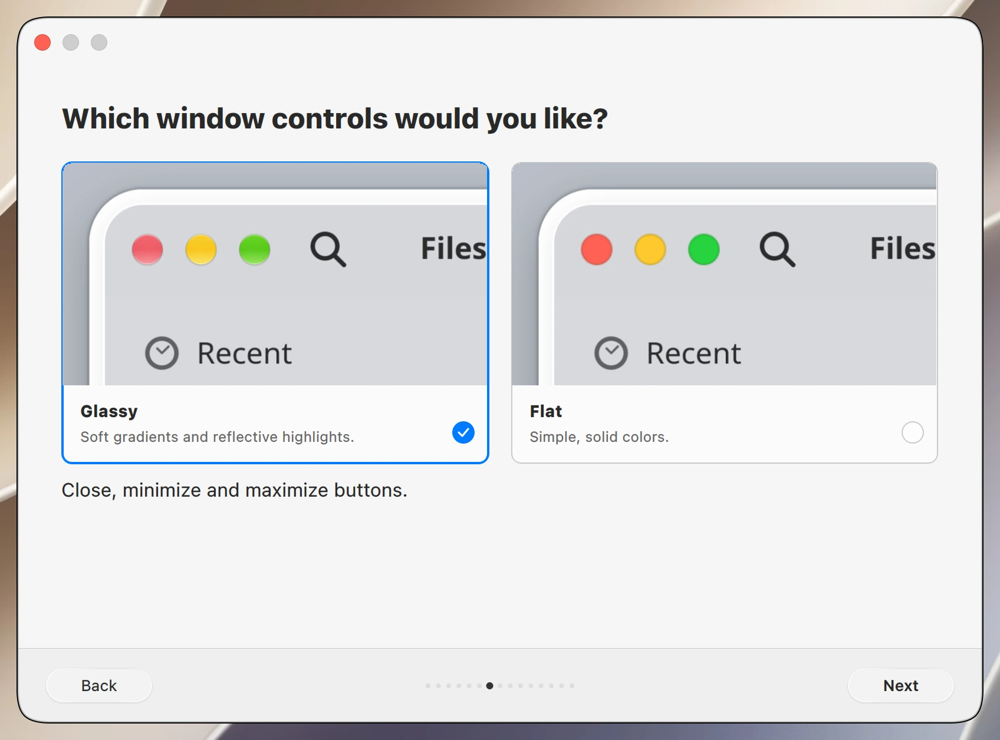 Window controls</td>
  <td align="center">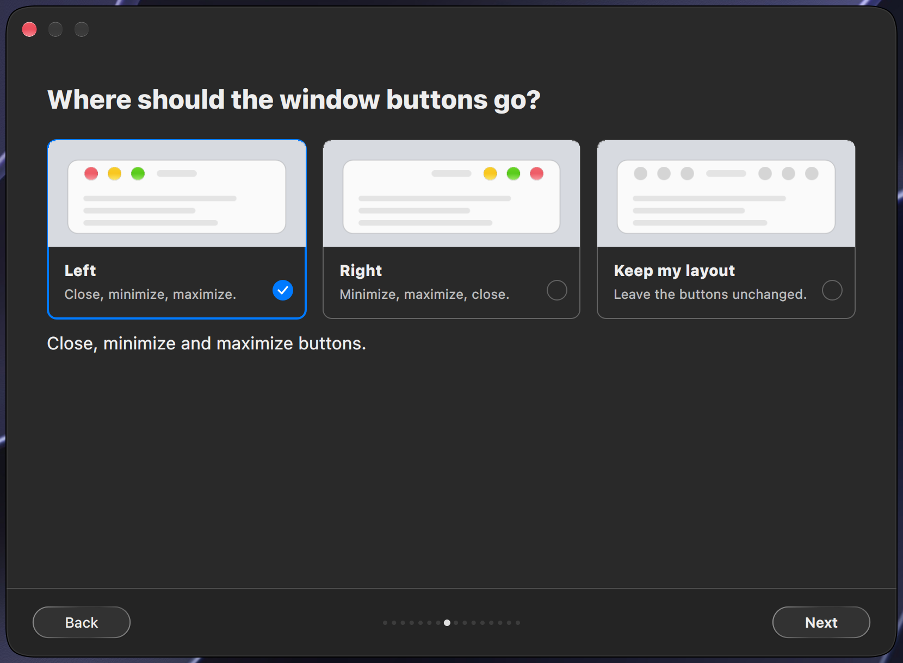 Window buttons</td>
  <td align="center">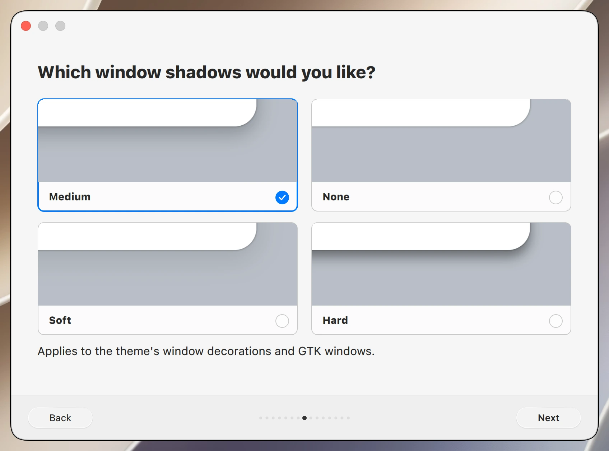 Window shadows</td>
  <td align="center">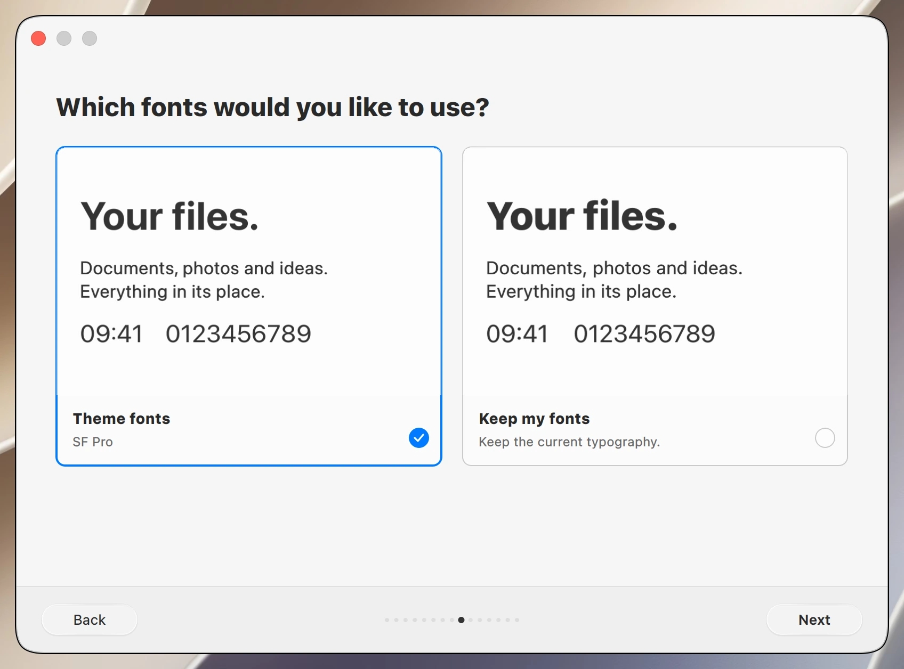 Fonts</td>
  <td align="center">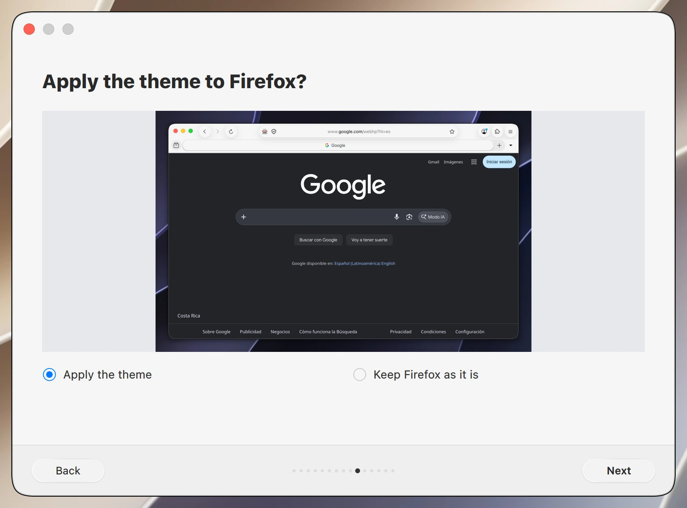 Firefox</td>
  <td align="center">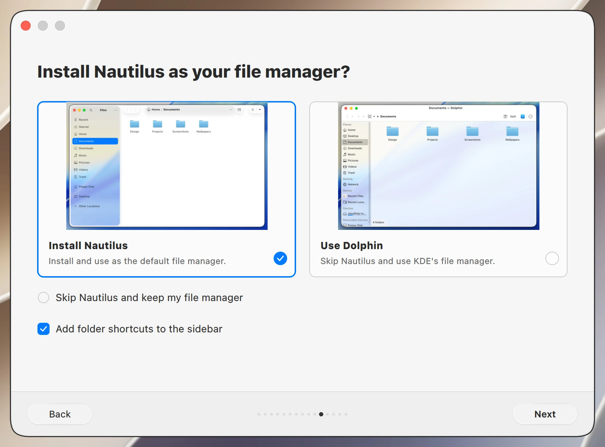 File manager</td>
  <td align="center">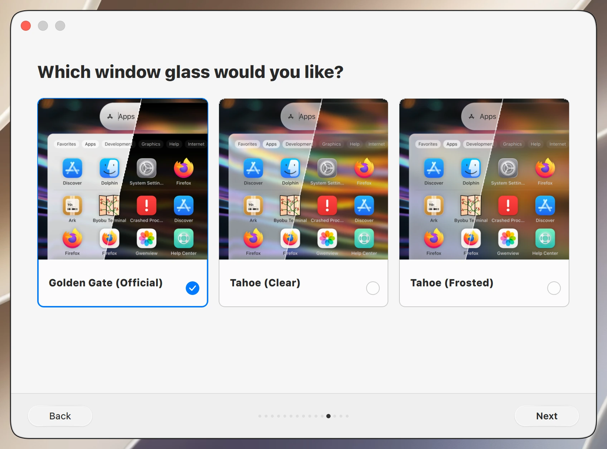 Window glass</td>
  <td align="center"> Boot animation</td>
  <td align="center">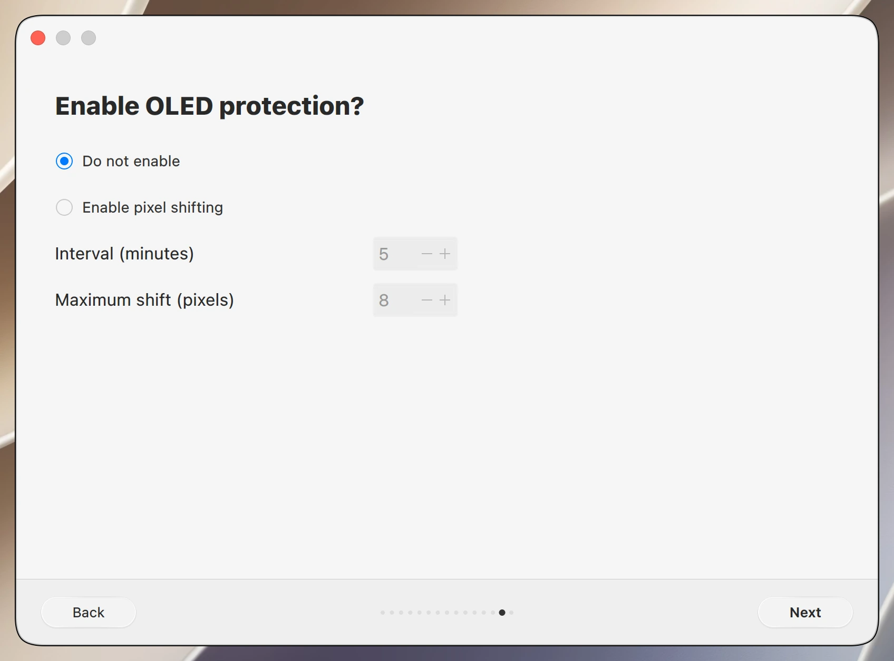 OLED protection</td>
  <td align="center">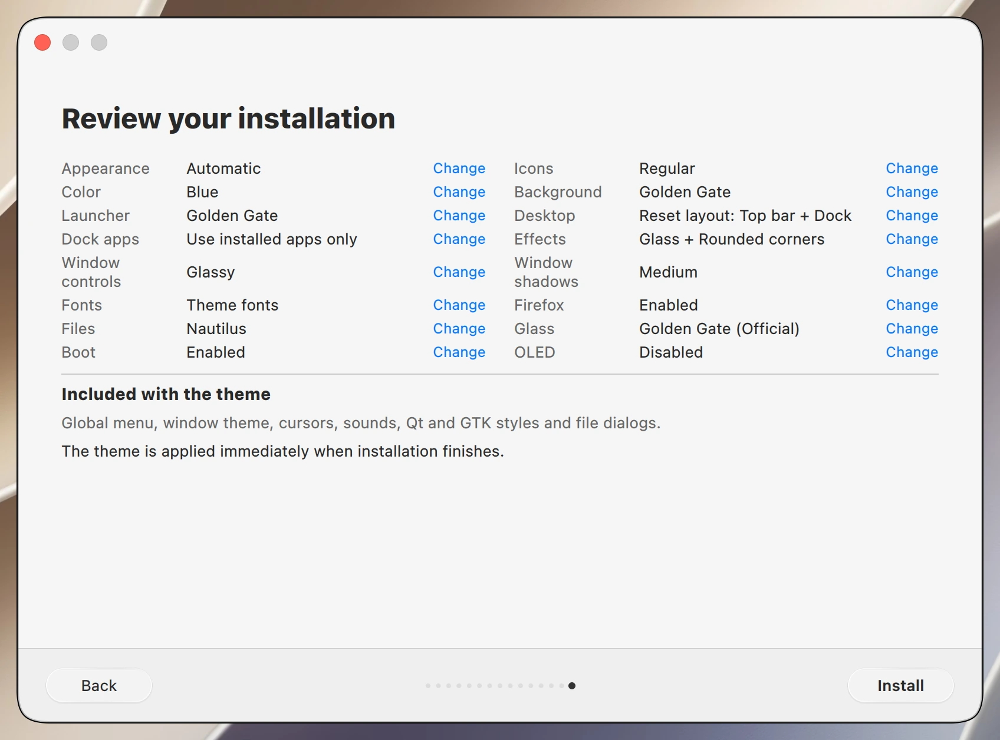 Summary</td>
</tr>
</table>

Window buttons, captured in a disposable VM: [Light wizard](src/screenshots/previews/button-position-golden-gate-light-wizard-36aca73ad37c.webp) · [Light comparison](src/screenshots/previews/button-position-golden-gate-light-comparison-2252a75d62e9.png) · [Dark wizard](src/screenshots/previews/button-position-golden-gate-dark-wizard-a50b95609e38.webp) · [Dark comparison](src/screenshots/previews/button-position-golden-gate-dark-comparison-d3035dd038c4.png) · [Provenance](src/screenshots/previews/button-position-golden-gate-provenance-3524c01456df.json)
