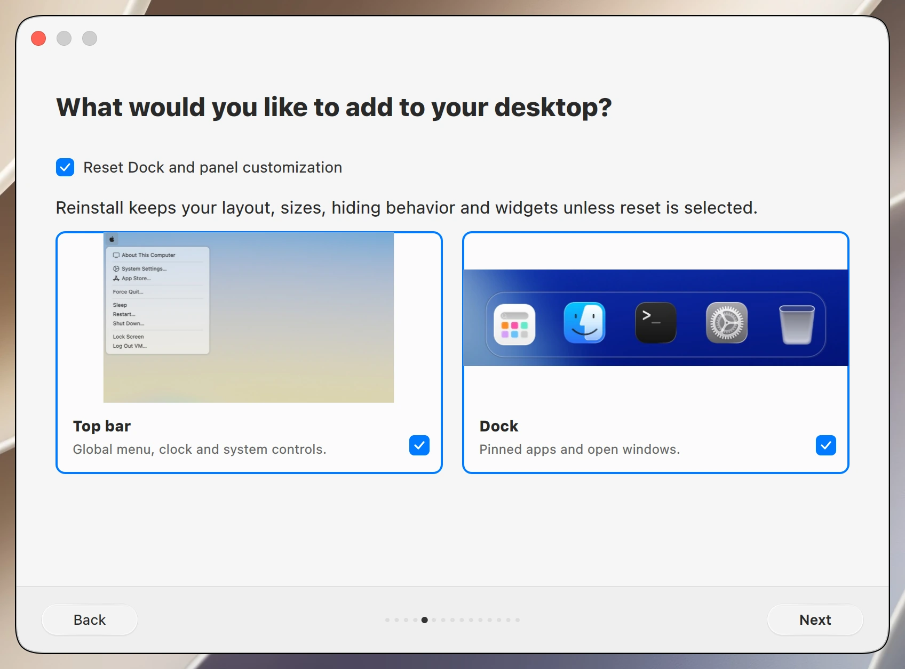

# Installer testing

Golden Gate **v0.63.2** uses fixed Dock spacing: a 56 px center pitch on the
default 68 px panel, preserving approximately 42 px visible icons. The old
spacing selector and its saved overrides no longer affect the Dock.

The shared implementation passed 20 Dock regressions and 7 task-manager/install
regressions in a disposable KDE neon VM, with light/dark/light visual checks.
See [detailed evidence](https://github.com/lestercorderomurillo/macos-tahoe-liquid-kde/blob/v0.63.2/tests/dock_spacing_validation.json)
for commands and coverage limits. Release publication requires passing CI
for the exact commits on main and dev in both repositories.

## Installation steps

Scroll horizontally through the installation steps.

<table>
<tr>
  <td align="center"> Welcome</td>
  <td align="center"> Appearance</td>
  <td align="center"> Icons and color</td>
  <td align="center"> Wallpaper</td>
  <td align="center"> Launcher</td>
  <td align="center"> Top bar and Dock</td>
  <td align="center"> Effects</td>
  <td align="center"> Window controls</td>
  <td align="center"> Window shadows</td>
  <td align="center"> Fonts</td>
  <td align="center"> Firefox</td>
  <td align="center"> File manager</td>
  <td align="center"> Window glass</td>
  <td align="center"> Boot animation</td>
  <td align="center"> OLED protection</td>
  <td align="center"> Summary</td>
</tr>
</table>
