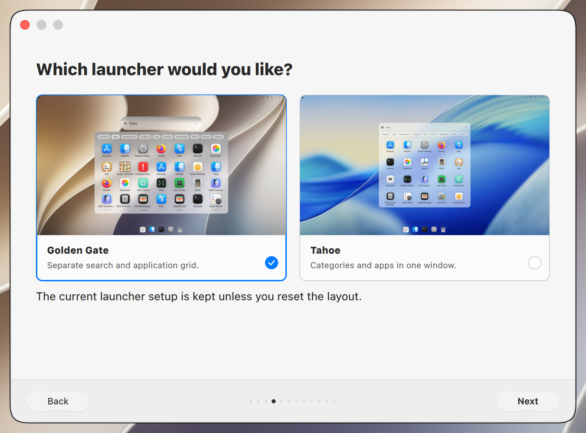
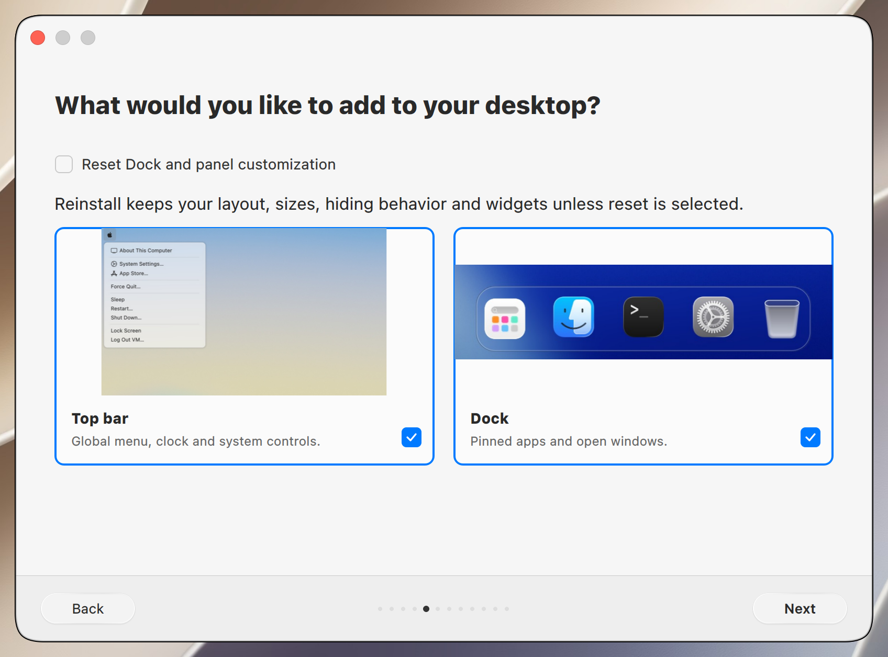
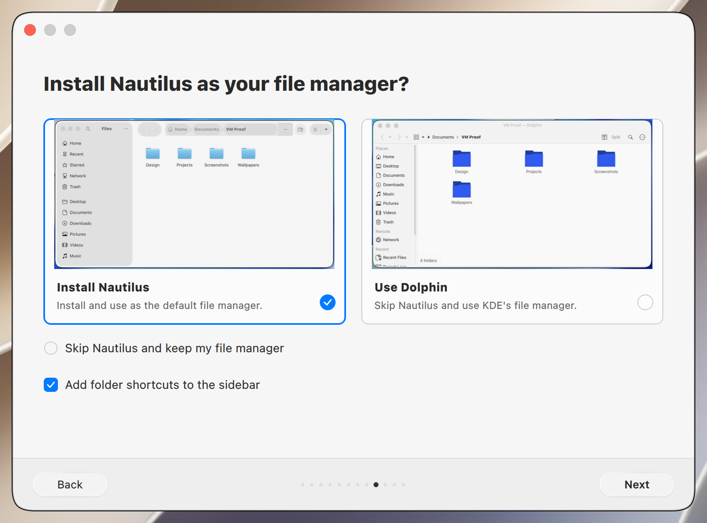
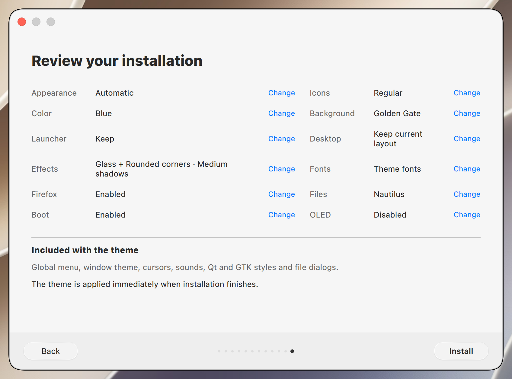

# Installer testing

Native installer screens for Golden Gate 0.61.4, captured in a disposable KDE Plasma VM.
The gallery is captured from the release source and reviewed before publication.
Release checks cover both editions, theme switching, installation, reboot and removal.

Run `./installer` from this checkout to review the wizard. For shared test commands and the capture workflow, see [Tahoe CONTRIBUTING.md](https://github.com/lestercorderomurillo/macos-tahoe-liquid-kde/blob/main/CONTRIBUTING.md).

## v0.61.4 validation

The wrapper suite passed 45 checks, including published-tag update selection,
version verification and dirty/diverged checkout protection. Preparing the local Tahoe candidate with
`GOLDEN_GATE_TAHOE_SOURCE` and `./installer --prepare` passed 38 affected
wizard/GTK checks, followed by nine final shadow regressions. After the Arch
login-defaults and GTK session fixes, the prepared source passed 112 affected
updater, wizard, KConfig, session-environment and shadow checks. Arch testing
matched the reporter's Plasma/KWin, Mesa and Firefox versions and covered
reinstall preservation/reset, skipping Nautilus, reboot, light/dark switching
and all four shadow levels. The VM GPU was VirGL rather than an RX 9060 XT.
The shared
implementation and disposable-VM evidence are described in
[Tahoe TESTING.md](https://github.com/lestercorderomurillo/macos-tahoe-liquid-kde/blob/main/TESTING.md).
The release workflow also requires successful push CI for both repositories'
exact `main` and `dev` release commits and verifies this edition's fresh,
reviewed screenshot bundle against the immutable Tahoe pin.

## Installation steps

Scroll horizontally through the installation steps.

<table>
<tr>
  <td align="center"> Welcome</td>
  <td align="center"> Appearance</td>
  <td align="center"> Icons and color</td>
  <td align="center"> Wallpaper</td>
  <td align="center"> Launcher</td>
  <td align="center"> Top bar and Dock</td>
  <td align="center"> Effects</td>
  <td align="center"> Fonts</td>
  <td align="center"> Firefox</td>
  <td align="center"> File manager</td>
  <td align="center"> Boot animation</td>
  <td align="center"> OLED protection</td>
  <td align="center"> Summary</td>
</tr>
</table>
