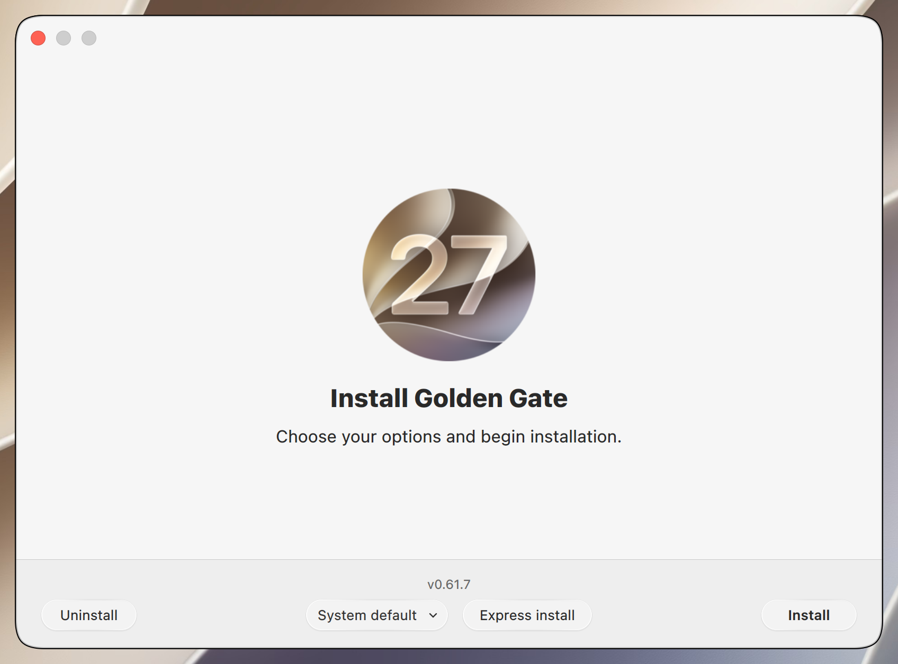
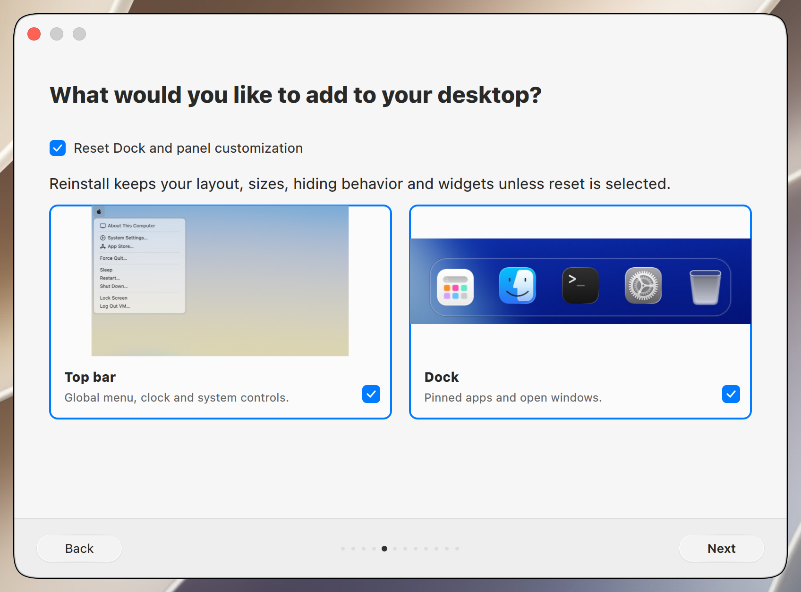
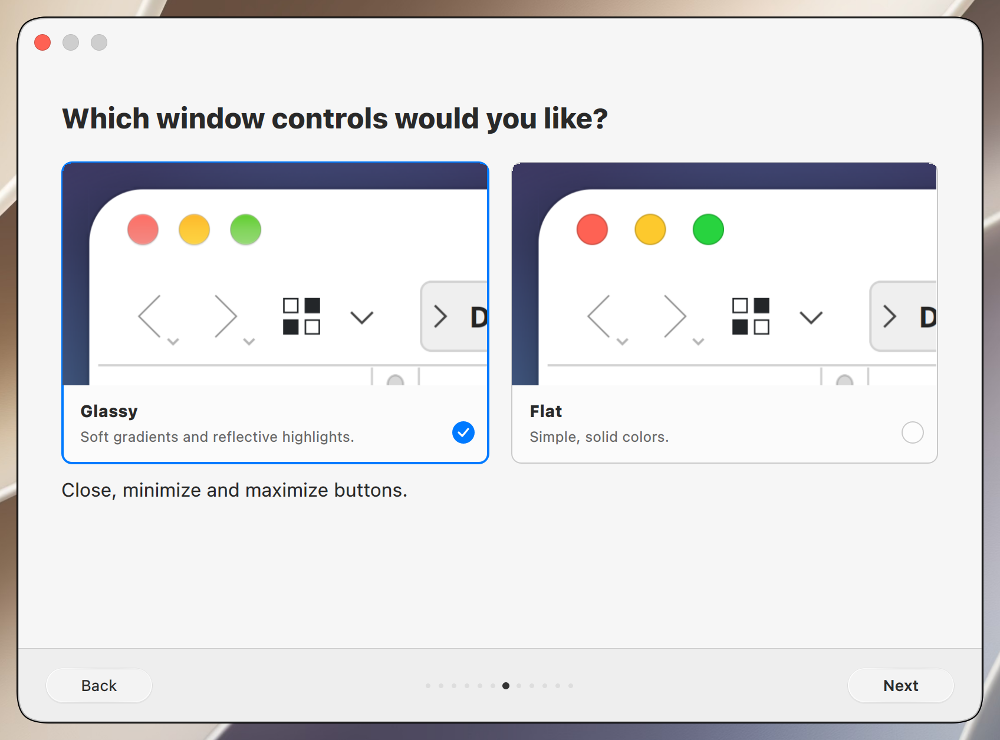
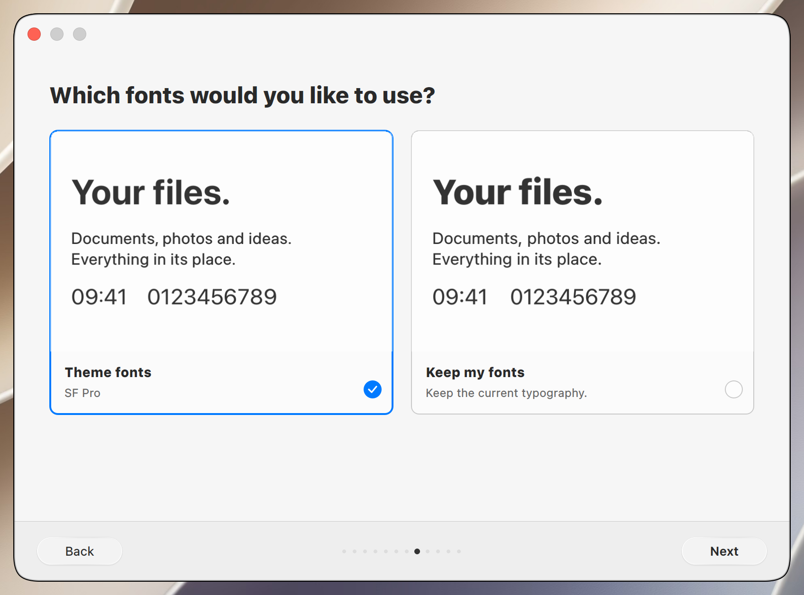
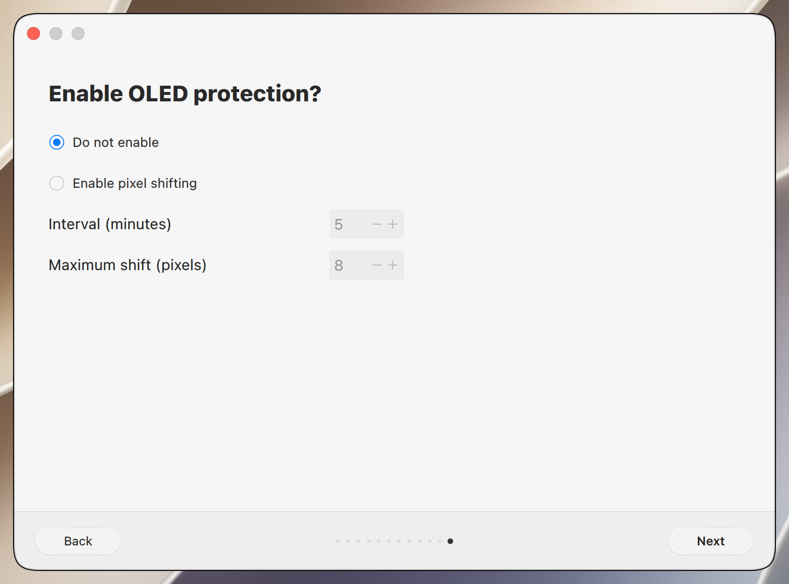
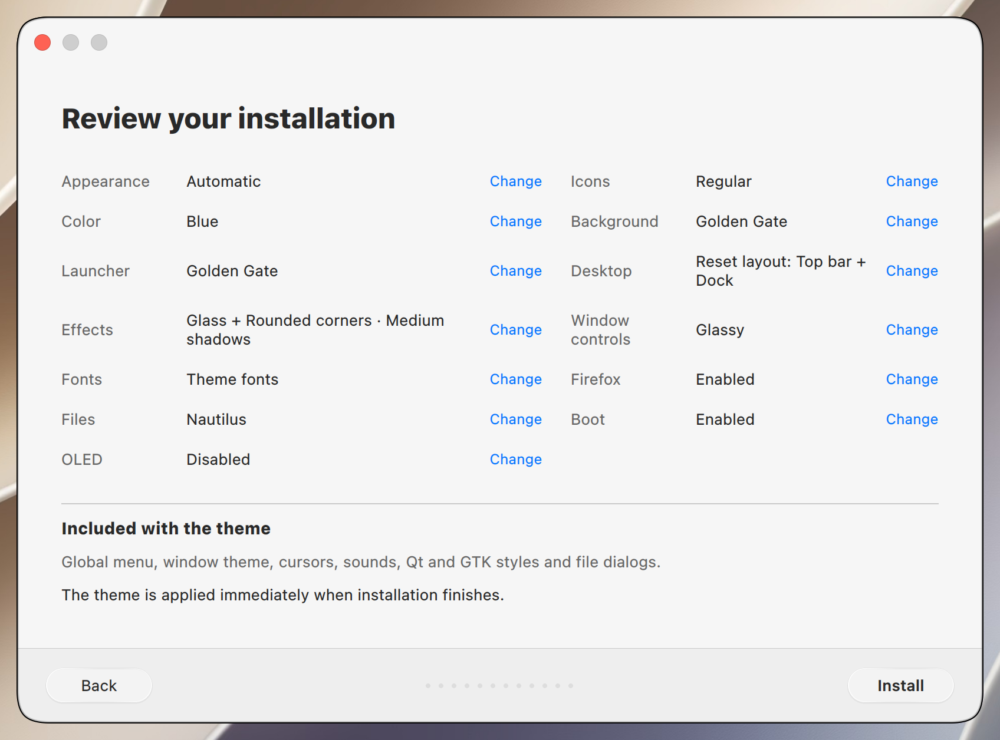

# Installer testing

Native installer screens for Golden Gate 0.61.7, captured in a disposable KDE Plasma VM.
The gallery is captured from the release source and reviewed before publication.
Release checks cover both editions, theme switching, installation, reboot and removal.

Run `./installer` from this checkout to review the wizard. For shared test commands and the capture workflow, see [Tahoe CONTRIBUTING.md](https://github.com/lestercorderomurillo/macos-tahoe-liquid-kde/blob/main/CONTRIBUTING.md).

## Window controls candidate

This unreleased candidate has Flat and Glassy controls with reviewed Nautilus
close-ups, stronger glass reflections and a separate Window shadows page with
four screenshot cards. Golden Gate starts with Glassy; explicit choices survive
navigation, summary edits and later light/dark switches.

Use `GOLDEN_GATE_TAHOE_SOURCE` with the matching Tahoe candidate for testing.
The already-published v0.61.7 does not contain this chooser. Publication and
merging to `main` remain on hold until the maintainer tests and approves it.
The prepared Golden Gate source passed 171 affected checks; after the final
summary spacing adjustment, all 28 wizard checks passed again. Shared validation is recorded in [Tahoe TESTING.md](https://github.com/lestercorderomurillo/macos-tahoe-liquid-kde/blob/codex/golden-gate-controls-v0617/TESTING.md).

The gallery below predates the Nautilus/shadows refinement. The next release
requires a fresh complete 90-frame bundle at the final version, a matching
immutable Tahoe pin and successful exact-commit CI on both branches.

## v0.61.5 reset default validation

The shared installer starts with **Reset Dock and panel customization** checked.
Uncheck it to preserve the current layout. Golden Gate prepared content
`f4438e729918882ada4b` passed 160 wizard, CLI, UI and layout component checks,
including the checked default and retaining an unchecked choice during navigation.
The release uses a new complete capture from the pinned disposable KDE neon VM;
its gallery and immutable Tahoe pin are verified before publication.

## v0.61.4 validation

The wrapper suite passed 45 checks, including published-tag update selection,
version verification and dirty/diverged checkout protection. Preparing the local Tahoe candidate with
`GOLDEN_GATE_TAHOE_SOURCE` and `./installer --prepare` passed 38 affected
wizard/GTK checks, followed by nine final shadow regressions. After the Arch
login-defaults and GTK session fixes, the prepared source passed 112 affected
updater, wizard, KConfig, session-environment and shadow checks. Arch testing
matched the reporter's Plasma/KWin, Mesa and Firefox versions and covered
reinstall preservation/reset, skipping Nautilus, reboot, light/dark switching
and all four shadow levels. The VM GPU was VirGL rather than an RX 9060 XT.
The shared
implementation and disposable-VM evidence are described in
[Tahoe TESTING.md](https://github.com/lestercorderomurillo/macos-tahoe-liquid-kde/blob/main/TESTING.md).
The release workflow also requires successful push CI for both repositories'
exact `main` and `dev` release commits and verifies this edition's fresh,
reviewed screenshot bundle against the immutable Tahoe pin.

## Installation steps

Scroll horizontally through the installation steps.

<table>
<tr>
  <td align="center"> Welcome</td>
  <td align="center"> Appearance</td>
  <td align="center"> Icons and color</td>
  <td align="center"> Wallpaper</td>
  <td align="center"> Launcher</td>
  <td align="center"> Top bar and Dock</td>
  <td align="center"> Effects</td>
  <td align="center"> Window controls</td>
  <td align="center"> Fonts</td>
  <td align="center"> Firefox</td>
  <td align="center"> File manager</td>
  <td align="center"> Boot animation</td>
  <td align="center"> OLED protection</td>
  <td align="center"> Summary</td>
</tr>
</table>
