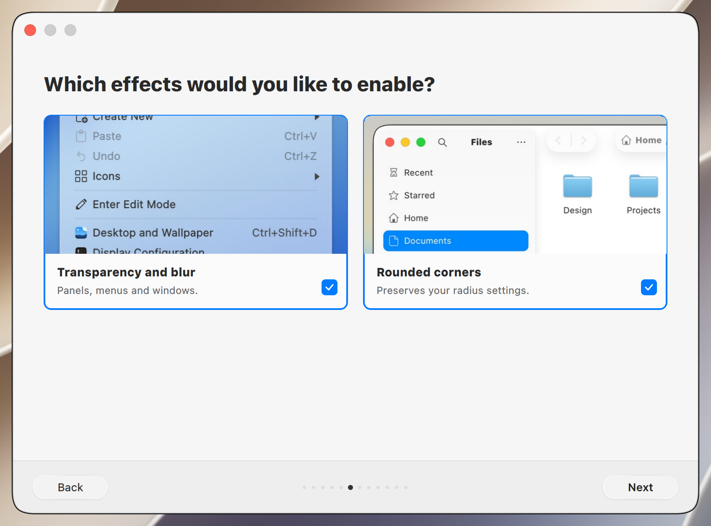
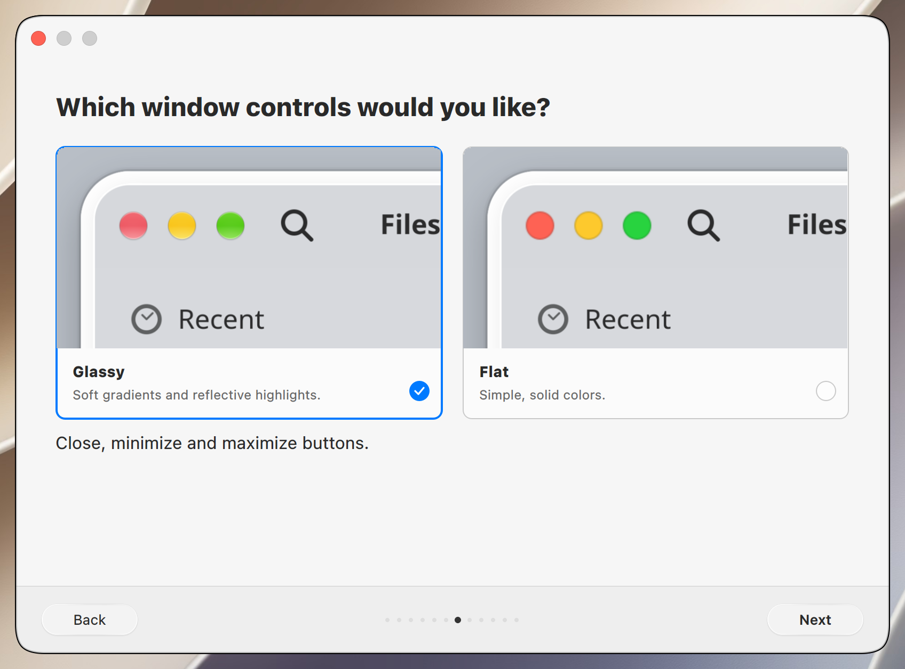
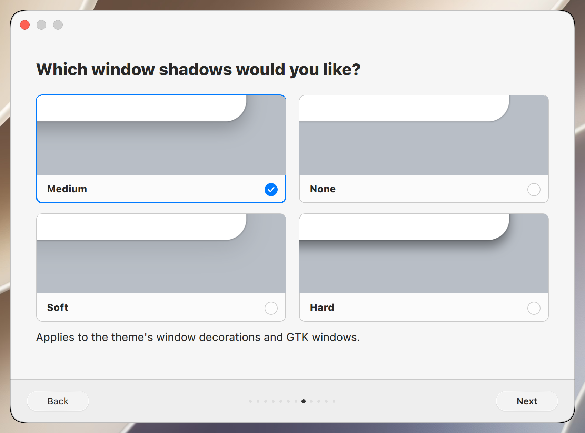
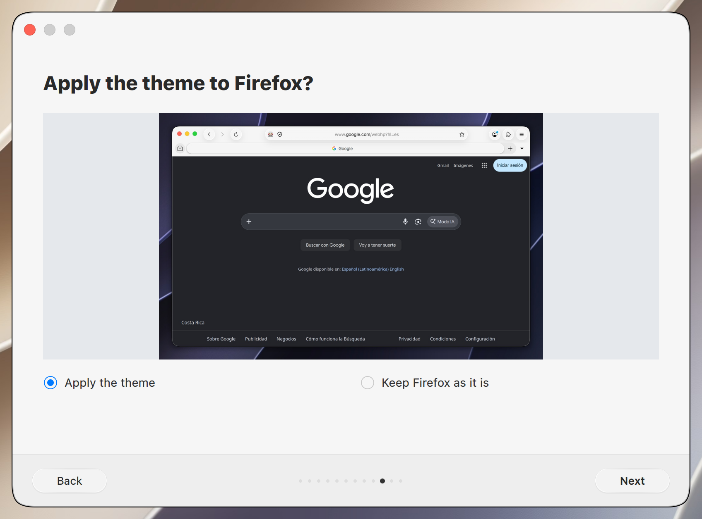
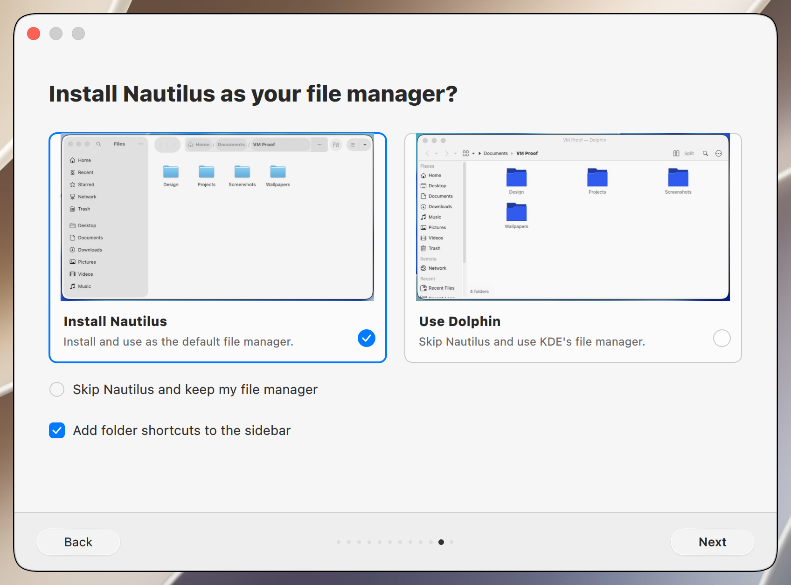
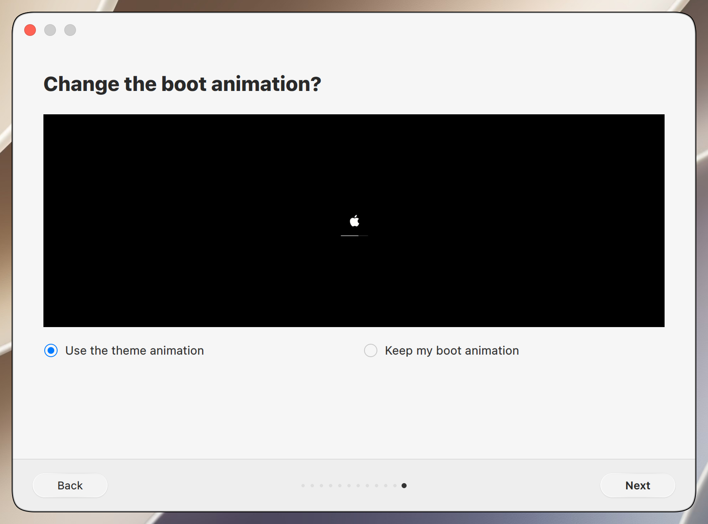
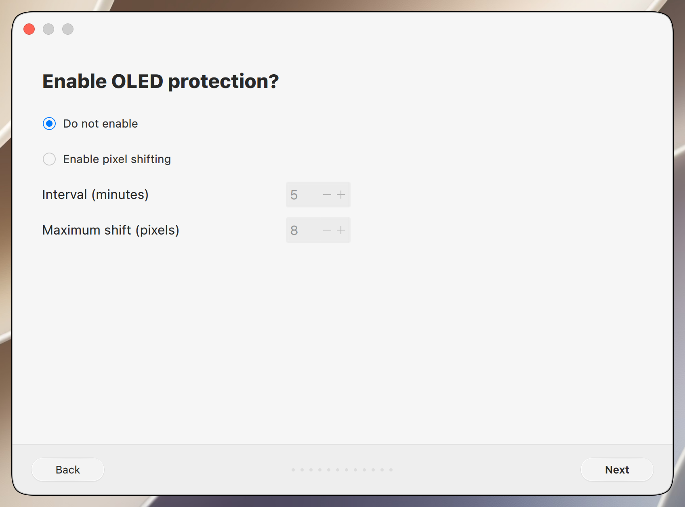
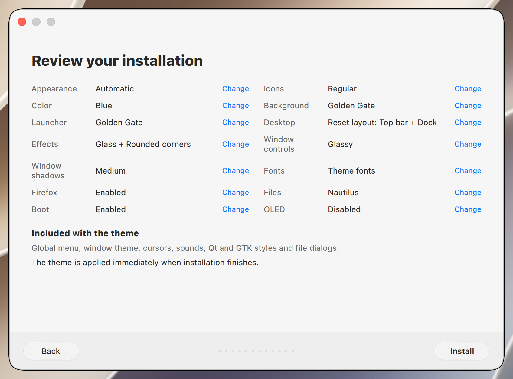

# Installer testing

Golden Gate **v0.61.15** validates safe installer storage maintenance with 89
wrapper checks and 39 affected shared checks on its prepared source. See the
[shared validation report](https://github.com/lestercorderomurillo/macos-tahoe-liquid-kde/blob/v0.61.15/tests/repository_maintenance_validation.md)
for commands, source identities and coverage limits, including local sandbox
restrictions on D-Bus/X11 tests and the required release CI gate. The unchanged
installer photographs below retain their reviewed disposable-VM provenance
and content hashes.

## Installation steps

Scroll horizontally through the installation steps.

<table>
<tr>
  <td align="center"> Welcome</td>
  <td align="center"> Appearance</td>
  <td align="center"> Icons and color</td>
  <td align="center"> Wallpaper</td>
  <td align="center"> Launcher</td>
  <td align="center"> Top bar and Dock</td>
  <td align="center"> Effects</td>
  <td align="center"> Window controls</td>
  <td align="center"> Window shadows</td>
  <td align="center"> Fonts</td>
  <td align="center"> Firefox</td>
  <td align="center"> File manager</td>
  <td align="center"> Boot animation</td>
  <td align="center"> OLED protection</td>
  <td align="center"> Summary</td>
</tr>
</table>
