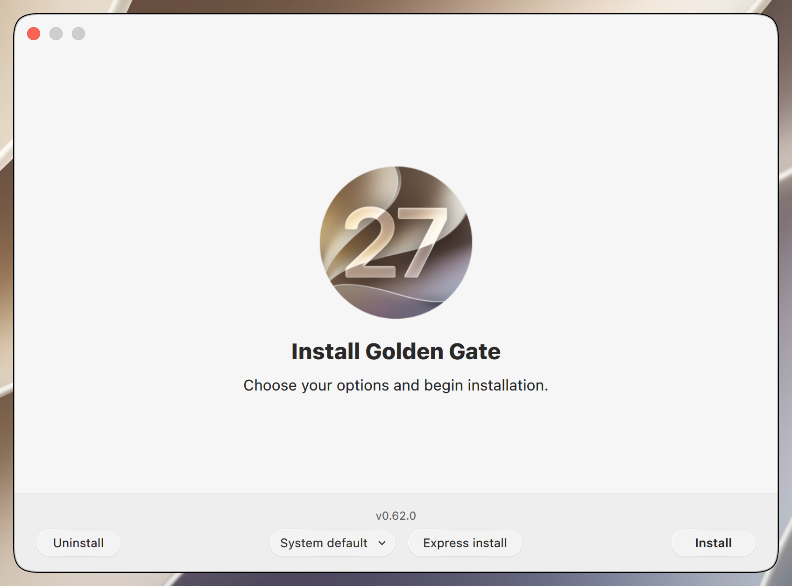
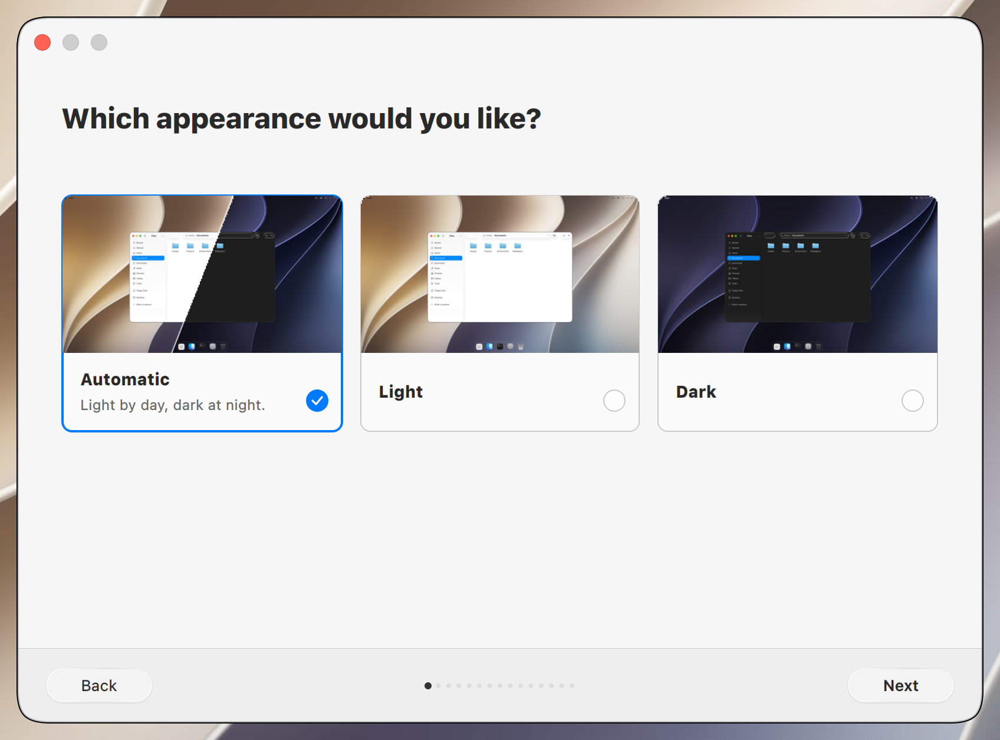
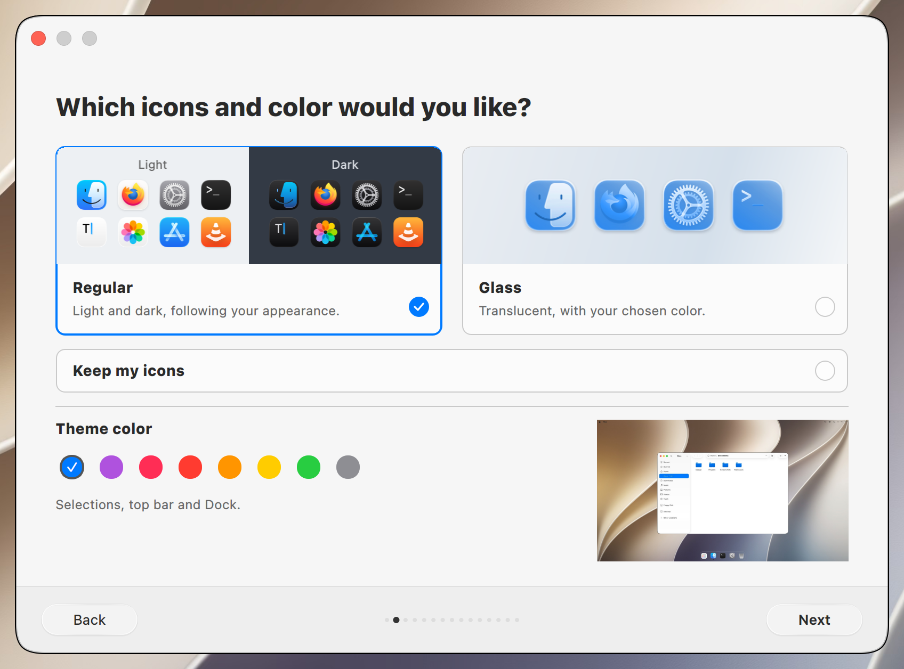
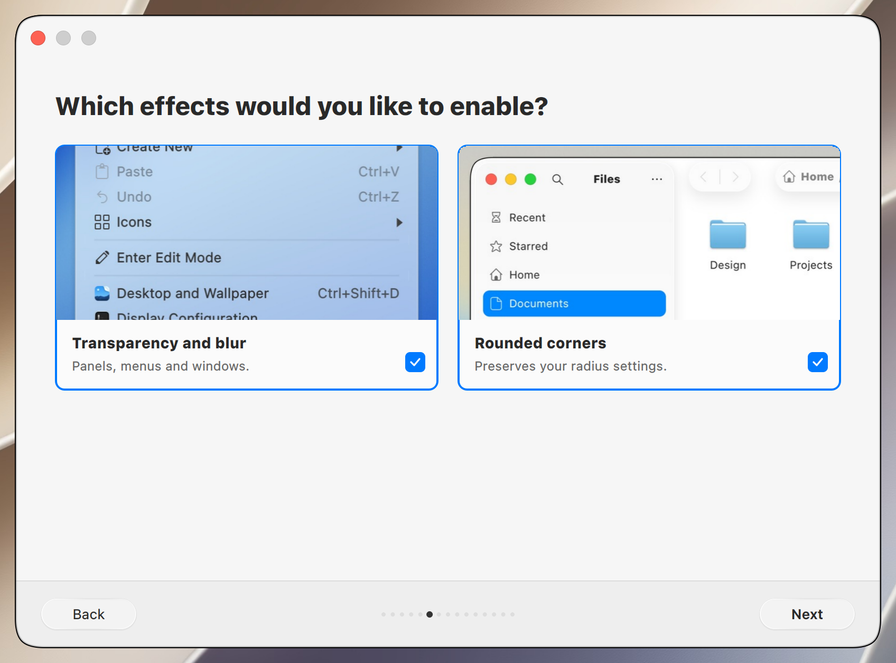
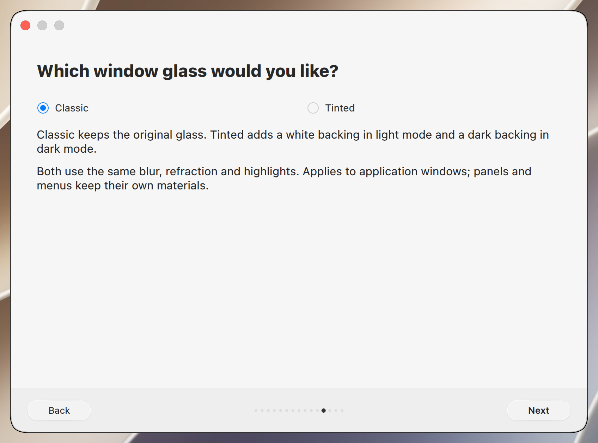
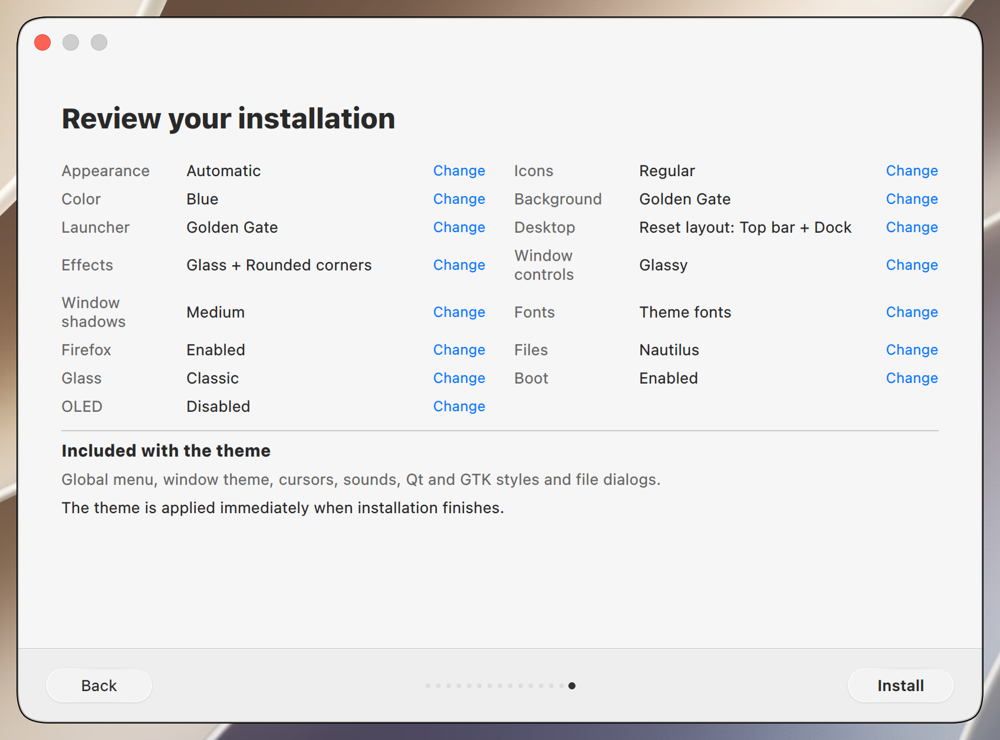

# Installer testing

Golden Gate **v0.62.0** includes the verified Acrylic fixes for Nautilus blur,
KWin scene damage and competing blur effects, with Glass opacity retired.
The prepared edition passed 69 affected preset, conflict and wizard tests;
its light/dark desktop and all sixteen installer pages were captured in the
pinned disposable VM and individually reviewed. See the
[Acrylic validation report](https://github.com/lestercorderomurillo/macos-tahoe-liquid-kde/blob/v0.62.0/tests/native/acrylic_glass_062.md)
for the actual Wayland/X11 rendering matrix, upstream audit and coverage limits.

The photographs below use the pinned disposable VM capture recipe and retain
reviewed, content-hashed provenance. Exact release commits require passing
push CI on both main and dev in both repositories.

## Installation steps

Scroll horizontally through the installation steps.

<table>
<tr>
  <td align="center"> Welcome</td>
  <td align="center"> Appearance</td>
  <td align="center"> Icons and color</td>
  <td align="center"> Wallpaper</td>
  <td align="center"> Launcher</td>
  <td align="center"> Top bar and Dock</td>
  <td align="center"> Effects</td>
  <td align="center"> Window controls</td>
  <td align="center"> Window shadows</td>
  <td align="center"> Fonts</td>
  <td align="center"> Firefox</td>
  <td align="center"> File manager</td>
  <td align="center"> Window glass</td>
  <td align="center"> Boot animation</td>
  <td align="center"> OLED protection</td>
  <td align="center"> Summary</td>
</tr>
</table>
